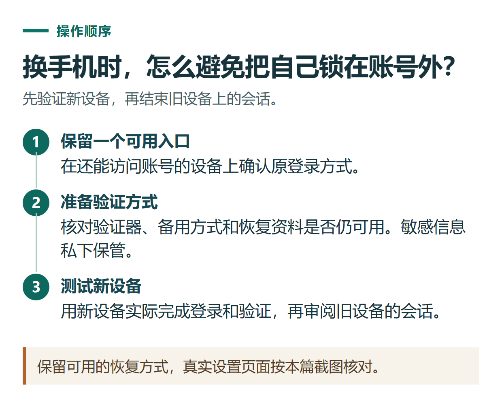

# ChatGPT 账号安全设置：开启 MFA、检查登录设备与处理异常访问

[知识库首页](../README.md) · [登录、隐私与账号](../catalog/topics/accounts.md) · [按问题找答案](../catalog/TASKS.md)

资料核对：2026-11-03。适用对象：个人OpenAI账号；组织统一身份管理应遵循所在工作区的设置。

> **先看结论：** 保护ChatGPT账号，先确保自己能控制原登录方式，再开启可用的多因素验证，并学会查看当前登录会话。只修改一个密码或打开一个开关，不能代替核对所有已经登录的设备。

<details>
<summary>本篇导航</summary>

- [一、先确认自己如何登录](#section-01)
- [二、MFA是什么，怎样开启](#section-02)
- [三、检查当前设备与安全记录](#section-03)
- [四、发现异常后的处理顺序](#section-04)
- [五、换手机前做这张检查卡](#section-05)

</details>

<a id="section-01"></a>

## 一、先确认自己如何登录

打开账号设置，记录使用的是独立邮箱密码，还是Google、Microsoft、Apple等第三方登录。使用第三方登录时，对应身份账号和邮箱本身也需要受到保护。

如果用独立密码，不要与其他网站复用。保存密码应使用自己可靠的密码管理方式，不把它贴进公开笔记、文章截图或客服群。

注册方式不确定时，先看[登录教程](chatgpt-sign-up-login.md)，不要为了“统一管理”随意创建另一账号。

<a id="section-02"></a>

## 二、MFA是什么，怎样开启

MFA即多因素验证，在登录时增加额外的身份确认。当前[官方MFA说明](https://help.openai.com/en/articles/7967234-managing-multi-factor-authentication-mfa)列出验证器、设备通知、短信等可用方式；具体选项取决于账号、设备和地区，不能保证每个人看到同一组。

进入“设置 → Security and login（安全与登录）”，在MFA区域选择自己能够长期使用的方式，按页面完成设置。若选择验证器，按官方页面显示的二维码或设置信息配置，再输入一次性验证码完成确认。

设置前先想好：换手机或手机丢失时，你还能使用哪种已配置的验证方法？可以在账号支持时增加备用方式，并妥善保存页面明确提供的恢复资料。

<a id="section-03"></a>

## 三、检查当前设备与安全记录

在安全设置中查看Security history等可用记录，结合时间、设备和位置判断是否是自己进行的操作。位置可能是近似信息，不能只凭城市名称不同就认定有人入侵。

需要查看已登录会话时，进入Active sessions等实际入口。遇到无法确认的访问，应按[官方账号安全说明](https://help.openai.com/en/articles/8304786-keeping-your-openai-account-secure)处理，并保存有用的异常时间和提示。

MFA开启后不会自动退出已有会话。如果怀疑账号被他人访问，除了处理暴露的登录凭证，还需要单独使用退出全部会话的功能；该操作也会影响自己的设备。

<a id="section-04"></a>

## 四、发现异常后的处理顺序

1. 保存可用于说明问题的时间、设备和异常操作，截图先脱敏。
2. 若独立密码可能泄露，及时修改；第三方登录则同时检查对应身份账号。
3. 在安全设置中退出不再信任的会话，必要时退出全部设备。
4. 核对MFA与备用方式是否仍由自己控制。
5. 出现非本人扣款或账号无法恢复时，通过[官方帮助中心](https://help.openai.com/)提交问题。

不要向聊天中自称支持人员的人发送验证码。对于确有必要的身份核验，使用自己主动打开的官方渠道，并按该渠道的说明处理。

<a id="section-05"></a>

## 五、换手机前做这张检查卡

```text
原登录方式还能使用：是 / 否
主要邮箱仍可接收邮件：是 / 否
新手机上的验证方式已按提示设置：是 / 否
备用验证或恢复安排已确认：是 / 否
新设备已经成功登录：是 / 否
旧设备是否需要退出：是 / 否
```

先确认新设备可用，再处理旧设备中的资料。不要先清空旧手机，之后才发现唯一的验证方法也被清掉。

如果所有已配置MFA方式都无法使用，联系官方支持完成恢复核验；这不等于支持一定能立即恢复，也不应把邮箱验证码描述为通用的MFA绕过方法。

办理会员时同样保留账号控制权。判断某个信息是否敏感，应看它能赋予什么访问能力，而不是只看办理方如何称呼它。具体订单信息与账户安全设置分开管理。



*保留可用的恢复方式，真实设置页面按本篇截图核对。*

## 接下来按你的情况继续

- [密码恢复与更换邮箱](chatgpt-login-recovery-email.md)：按原认证方式恢复登录并检查自助换邮箱资格。
- [导出与删除账号](chatgpt-export-delete-account.md)：先导出并检查资料，再判断是否需要永久删除账号。

[返回登录、隐私与账号专题](../catalog/topics/accounts.md) · [完整文章索引](../catalog/ALL_ARTICLES.md)
