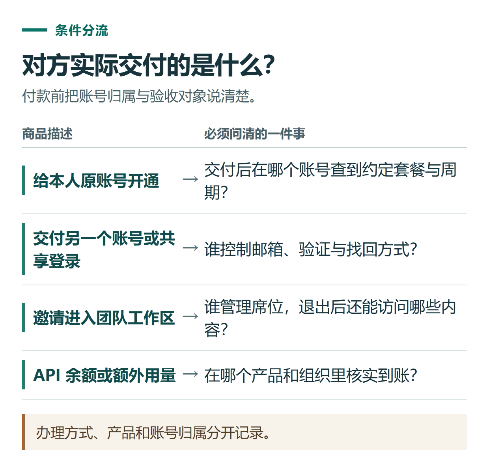
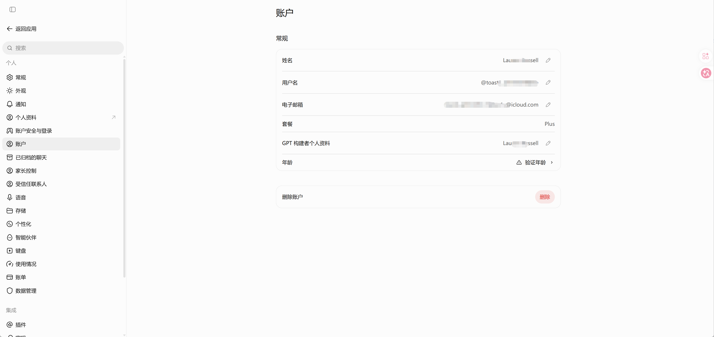
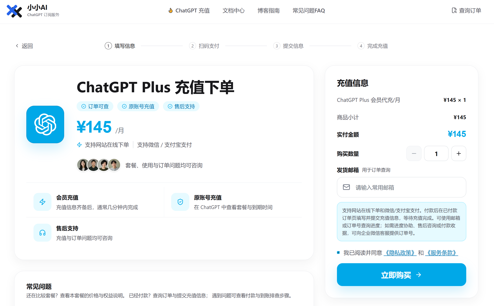

# ChatGPT 会员购买前检查：自己的账号、共享账号和第三方代充怎么区分

[知识库首页](../README.md) · [套餐、充值与账单](../catalog/topics/subscription.md) · [按问题找答案](../catalog/TASKS.md)

资料核对：2026-11-03。适用范围：个人会员购买前的信息核对，不代替具体订单条款。

> **先看结论：** 购买前最该说清楚的是：会员开在哪里，账号由谁控制，付的是什么费用，以及后续问题由谁处理。“能登录”和“拥有自己可持续管理的订阅”不能混为一谈。

本篇是付款前检查。已经确定目标账号与套餐，可按条件选读[官方订阅](chatgpt-official-subscription.md)或[小小AI办理流程](chatgpt-topup-order-guide.md)。

<details>
<summary>本篇导航</summary>

- [一、先辨认你实际购买的东西](#section-01)
- [二、自己的多台设备与多人共用不同](#section-02)
- [三、把售前问题一次问清楚](#section-03)
- [四、交付后按自己的页面验收](#section-04)
- [五、小小AI的办理入口](#section-05)

</details>

<a id="section-01"></a>

## 一、先辨认你实际购买的东西

| 商品描述 | 购买前必须确认 |
|---|---|
| 自己账号开通会员 | 是否为本人原账号，套餐、周期和续费渠道是什么 |
| 第三方协助办理或代充 | 服务主体、办理方式、账号是否仍由本人控制、交付验收标准 |
| 直接交付一个账号 | 邮箱及恢复方式由谁控制，原持有人能否找回，历史记录是否属于他人 |
| 多人共用账号 | 是否需要共用登录资料，聊天、文件和付款信息可能向谁暴露 |
| 团队工作区席位 | 加入哪个组织、由谁管理、退出后能保留哪些访问权限 |
| API余额或Codex额外额度 | 是否与你需要的会员属于同一种产品，在哪个页面确认到账 |

其中团队席位的实际权限由组织设置与官方规则决定，不能把一个邀请链接当作个人Plus订阅。产品类型的区别见[订阅、API与代充说明](chatgpt-subscription-api-topup.md)。



*办理方式、产品和账号归属分开记录。*

<a id="section-02"></a>

## 二、自己的多台设备与多人共用不同

OpenAI的个人账号分享政策说明，账号供创建者本人使用；本人可以在多台设备登录，但仍受使用限制。多人使用应分别建立自己的账号。[官方账号分享政策](https://help.openai.com/en/articles/10471989-openai-account-sharing-policy)

因此，不应把“多人登录同一账号”包装成官方允许的家庭会员方案。即使某个商品能临时使用，也需要独立核对账号控制权和服务规则。



*账号与套餐核对位置示例，截图中的身份信息已局部遮挡。*

<a id="section-03"></a>

## 三、把售前问题一次问清楚

下面的咨询内容可以按实际需要删改；它是问题清单，并非任何商家的承诺。

```text
我想给自己现有的ChatGPT账号办理会员，请确认：
1. 商品对应哪个套餐、周期和计费渠道？
2. 如何办理，账号的邮箱、验证和恢复方式是否仍由我管理？
3. 哪些资料必须提供，是否有不交出密码和验证码的处理方式？
4. 预计办理时间、失败处理办法和交付验收依据是什么？
5. 是否自动续费，之后在哪里取消？
6. 售后由谁负责，退款条件与可提供的交易凭证是什么？
请把暂时不能确认的部分单独说明。
```

如果对方要求密码、验证码、会话令牌或恢复码，先停止提交并核实必要性，优先选择自己控制验证步骤的方式。不要因为对方展示了会员截图，就认定其掌握了你的账号归属与续费情况。

<a id="section-04"></a>

## 四、交付后按自己的页面验收

在原账号核对套餐与相关功能，保存订单及约定；如有账期信息，分清到期和续费日期。功能仍受地区、计划、工作区及逐步开放影响，会员状态不意味着所有功能立刻出现。



*小小AI下单页面示例，实际商品和办理条件以订单页面为准。*

<a id="section-05"></a>

## 五、小小AI的办理入口

如需了解小小AI的服务，可查看[会员与额度办理页面](https://xiaoxiao.pro/shop?utm_source=github&utm_medium=referral&utm_campaign=chatgpt_guide&utm_content=a77_shop)，并按上面的清单核对当前商品信息。小小AI是独立第三方服务，不是OpenAI官方付款渠道；具体价格、时效和售后以实际下单时确认的条款为准。

已有订单的操作顺序见[小小AI下单与验收指南](chatgpt-topup-order-guide.md)。账号保护步骤见[ChatGPT账号安全](chatgpt-account-security.md)。

## 接下来按你的情况继续

- [套餐怎么选](chatgpt-plans-comparison.md)：选出待比较的档位，明确升级希望解决的限制。
- [小小AI下单与验收](chatgpt-topup-order-guide.md)：按同一笔订单完成付款核对和官方权益验收。

[返回套餐、充值与账单专题](../catalog/topics/subscription.md) · [完整文章索引](../catalog/ALL_ARTICLES.md)
