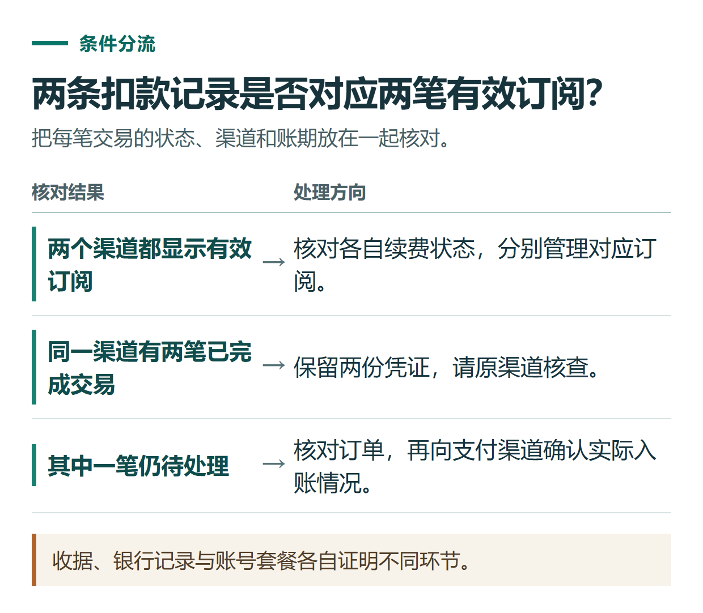
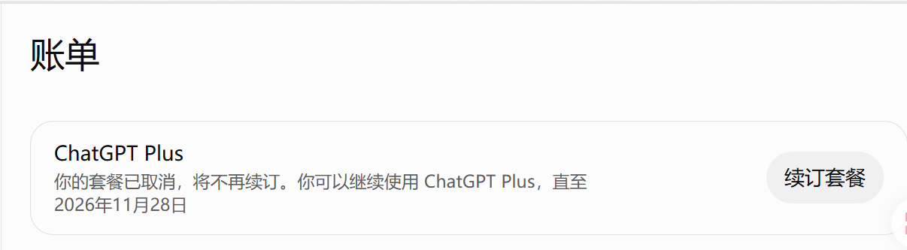

# ChatGPT 账单在哪里下载？收据查询、重复扣款与渠道核对

[知识库首页](../README.md) · [套餐、充值与账单](../catalog/topics/subscription.md) · [按问题找答案](../catalog/TASKS.md)

资料核对：2026-11-03。适用环境：个人订阅；网页、Apple与Google Play的账单分别查询。

> **先看结论：** 看到两笔扣款时，先找到每笔交易对应的账号、渠道和账期。银行记录、商店收据、ChatGPT订阅状态记录的是不同信息，单凭金额相同还不能判断重复订阅。

本篇导航

- [一、先整理一张账单对照表](#section-01)
- [二、到实际扣费的渠道找凭证](#section-02)
- [三、两笔记录分三种情况处理](#section-03)
- [四、第三方订单和官方凭证分开保存](#section-04)

## 一、先整理一张账单对照表

在自己的记录中填写购买日期、金额与币种、计费渠道、ChatGPT账号、订单编号、账期和交易状态。账号与完整订单信息只留在私人记录中，对外截图先脱敏。

假设你发现11月2日有一笔网页付款，11月3日又收到Apple续费通知。这只是一个虚构排查例子。下一步应分别打开网页订阅与Apple订阅，核对是否两份都有效，而不是根据两封邮件直接推断哪一笔会自动退回。

## 二、到实际扣费的渠道找凭证

| 购买渠道 | 当前查询路径 | 应核对的内容 |
|---|---|---|
| ChatGPT网页 | Settings → Billing → Invoices → View或View all | 发票日期、金额、账期和所属账号 |
| Apple App Store | App Store个人头像 → Apps & Purchase History → Purchase History | Apple购买记录与邮件收据 |
| Google Play | 个人头像 → Payments & subscriptions → Budget & history | Google Play订单与收据 |

界面语言和版本可能不同。商店购买的收据不会因此出现在网页Invoices列表中；不要因网页没有账单就认定没有付过款。[官方账单查询说明](https://help.openai.com/en/articles/12356340-finding-past-chatgpt-invoices)

## 三、两笔记录分三种情况处理

**两个渠道都有有效订阅：** 核对各自账期，选择今后保留的渠道；在原购买渠道取消不需要的续订，再按该渠道规则询问退款。取消续订和退回已扣费用是两件事。

**同一渠道有两笔已完成交易：** 保留两份凭证、时间和账号信息，交由相应支持渠道核查。不要自行断言一定是系统重复收费。

**银行显示待处理或状态不明：** 先核对商店及账单页面，并向发卡行或支付渠道确认交易状态。待处理记录不能直接当作第二份会员已经开通。

OpenAI提醒，网页与移动商店的订阅可能分别续费。Apple续费失败也不等于订阅已取消；更新付款方式后仍可能再次扣费。切换渠道前应确认旧订阅取消，并等旧订阅结束，再开通新渠道。[避免跨渠道重复扣费](https://help.openai.com/en/articles/20001043-how-do-i-avoid-being-charged-twice-if-i-subscribe-to-chatgpt-on-ios-android-and-the-web)

*收据、银行记录与账号套餐各自证明不同环节。*

*网页订阅状态示例。商店订阅请到对应商店核对。*

## 四、第三方订单和官方凭证分开保存

通过独立第三方办理时，商家订单证明你与商家的交易，不能直接替代OpenAI或应用商店的账单。开票主体、凭证类型、退款处理方应在购买前确认，不把英文Invoice自动解释为中国增值税发票。

会员仍未显示时，先按[付款与会员未生效排查](chatgpt-payment-troubleshooting.md)核对原账号，不急于再买一次。需要取消或退款时看[各渠道处理指南](chatgpt-cancel-refund.md)，需要提交证据时看[支持请求模板](chatgpt-support-ticket-troubleshooting.md)。

## 接下来按你的情况继续

- [取消续费与退款](chatgpt-cancel-refund.md)：知道停止未来扣费和申请退款的不同路径。
- [付款失败或会员未生效](chatgpt-payment-troubleshooting.md)：找到所属问题分支并准备有效反馈材料。

[返回套餐、充值与账单专题](../catalog/topics/subscription.md) · [完整文章索引](../catalog/ALL_ARTICLES.md)
