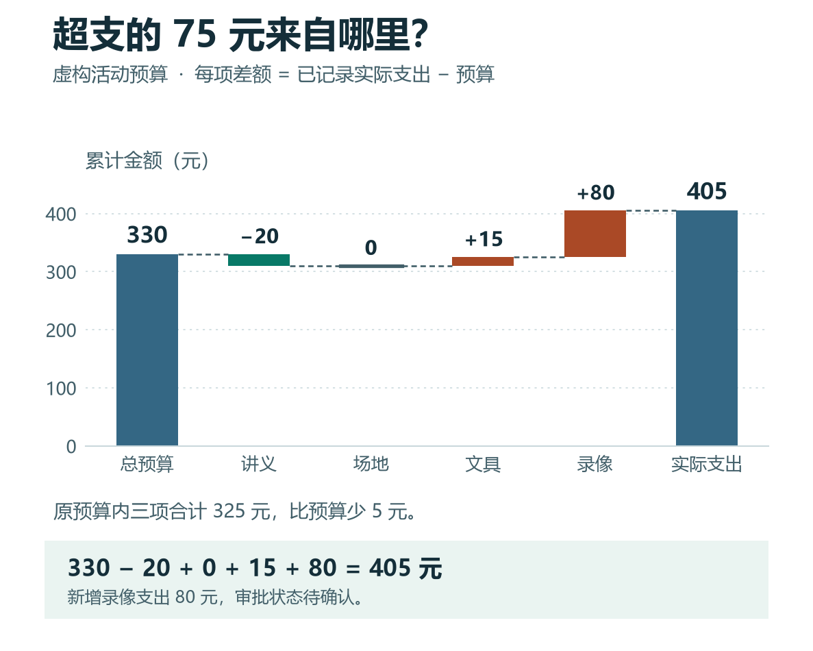

# ChatGPT 整理活动预算：计划与实际对比、差额计算和待核对费用

[知识库首页](../README.md) · [文件、表格与图表](../catalog/topics/data-files.md) · [按问题找答案](../catalog/TASKS.md)

资料核对：2026-11-03。适用环境：表格计算与活动管理练习；数据为原创虚构，不涉及投资或税务建议。

> **先看结论：** 活动结束后，先区分预算、已记录支出和仍待确认的费用，再讨论有没有超支。不能把预算余额写成已经节省，也不能因为某项没有预算，就把它从实际支出中删掉。

**练习材料：** [打开输入、提示词与检查答案](../resources/practice/chatgpt-budget-expense-analysis/README.md)。

<details>
<summary>本篇导航</summary>

- [一、输入一份完整练习表](#section-01)
- [二、先计算逐项差额](#section-02)
- [三、解释差异时避免偷换范围](#section-03)
- [四、把结果改成一段简短汇报](#section-04)
- [五、实际使用时补哪些列](#section-05)

</details>

<a id="section-01"></a>

## 一、输入一份完整练习表

金额单位均为人民币元：

| 项目 | 预算 | 已记录实际支出 | 备注 |
|---|---:|---:|---|
| 打印讲义 | 80 | 60 | 已记录 |
| 场地 | 200 | 200 | 已记录 |
| 文具 | 50 | 65 | 已记录 |
| 录像服务 | 0 | 80 | 新增项目，审批状态待确认 |

“已记录实际支出”只表示本练习中的记录，不等于凭证已经核验通过。真实业务还要核查票据、重复支付和金额单位。

<a id="section-02"></a>

## 二、先计算逐项差额

```text
请按“实际支出－预算”计算差额。
正数表示超过该项预算，负数表示低于预算。
保留录像服务，单独标注未列预算和审批待确认。
先给计算表，不判断任何人责任，也不把待确认事项改成已批准。
```

参考差额依次为－20、0、＋15、＋80元。预算合计330元，实际合计405元，总差额＋75元。每个数字都可回到原表核算。

ChatGPT可以辅助表格计算，但需要明确列名、口径与检查方式。[官方数据分析说明](https://help.openai.com/en/articles/8437071-data-analysis-with-chatgpt)

<a id="section-03"></a>

## 三、解释差异时避免偷换范围

如果只看原预算内的三项，实际为325元，比330元少5元；但包括新增录像服务后，全部支出405元，超过总预算75元。两种计算都可以列出，但必须说明范围，不能只选更好看的数字汇报。



*图中数据来自本篇虚构练习。沿虚线从左往右读，每一项接在上一项的累计金额上。原预算内少支的 5 元，抵掉了新增录像费用中的 5 元。*

缺少支出记录时，不要把空值填成零。先列出“金额未知”的项目，等待核对后再更新总额。

<a id="section-04"></a>

## 四、把结果改成一段简短汇报

```text
请根据已经核对的表格写一段中文汇报。
先写预算与实际合计，再解释主要差异。
明确录像服务为新增项目，审批状态待确认。
不写节省率、责任归属或报销结论，不推断票据合规性。
```

原创参考表述：本次练习预算330元，已记录支出405元，较预算增加75元。原预算内三项合计低于预算5元，新增录像服务支出80元，其审批状态仍需确认。

<a id="section-05"></a>

## 五、实际使用时补哪些列

可以增加记录日期、经办人、凭证编号和核对状态；对外分享时只保留必要信息。需要修改原表，先留副本并记录变更，不用模型的判断替代实际审批。

如果文件较大，先按项目分组再汇总，并抽查原始记录。公式写法见[Excel公式辅助](chatgpt-excel-formulas.md)，图形表达见[图表教程](chatgpt-charts-dashboard.md)。

## 接下来按你的情况继续

- [Excel公式](chatgpt-excel-formulas.md)：根据字段与条件写公式，并检查新增行是否纳入。
- [图表与指标口径](chatgpt-charts-dashboard.md)：先核对指标口径，再制作和检查图表。

[返回文件、表格与图表专题](../catalog/topics/data-files.md) · [完整文章索引](../catalog/ALL_ARTICLES.md)
