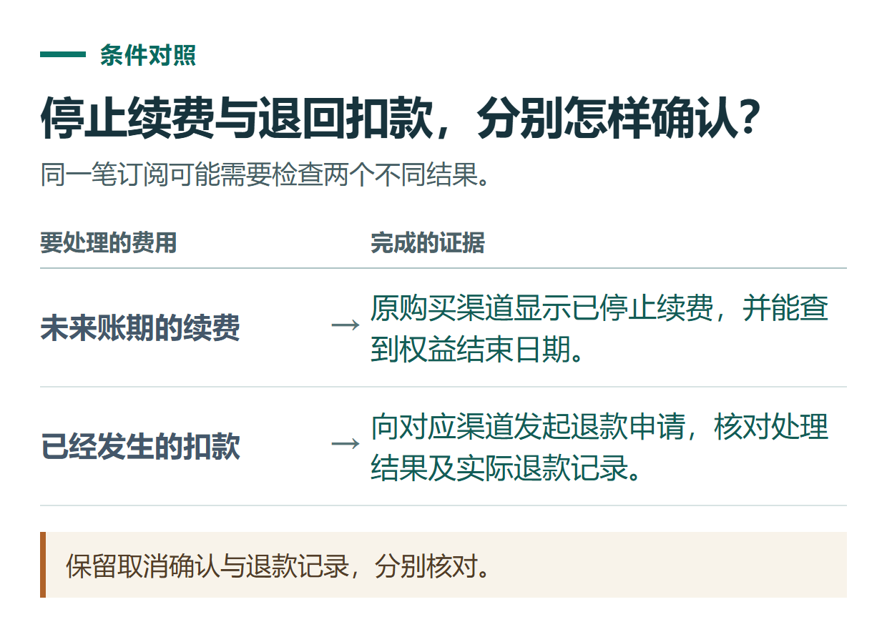
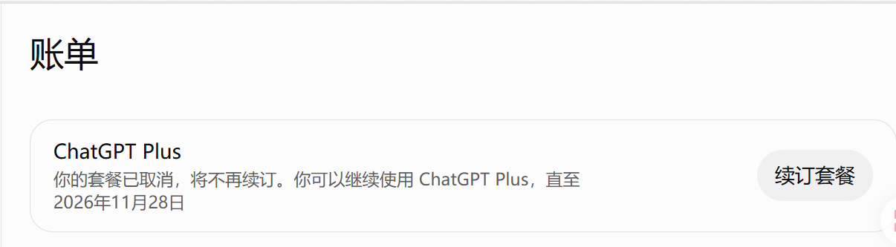

# ChatGPT 怎么取消自动续费和申请退款？网页、Apple、Google Play 分开操作

[知识库首页](../README.md) · [套餐、充值与账单](../ROADMAP.md#module-03) · [已上线教程](../README.md)

资料核对：2026-11-03。适用范围：个人 ChatGPT 订阅；企业工作区不在本文操作范围内。

> **先看结论：** 取消续费是停止未来扣款；申请退款是处理已经发生的付款。两件事需要分别确认。卸载应用也不会自动取消订阅。

<details>
<summary>本篇导航</summary>

- [一、先找出谁收了这笔钱](#section-01)
- [二、三个官方购买渠道的取消步骤](#section-02)
- [三、操作完如何确认成功](#section-03)
- [四、已经扣款，怎样提出退款申请](#section-04)
- [五、通过小小AI办理的订单怎么办](#section-05)

</details>

<a id="section-01"></a>

## 一、先找出谁收了这笔钱

查看购买收据、商店订阅记录或原订单，确认是网页订阅、Apple App Store、Google Play，还是第三方服务订单。当前使用手机或电脑，并不能证明最初从哪个渠道购买。

| 原购买渠道 | 取消后续续费的入口 | 退款申请入口 |
|---|---|---|
| ChatGPT网页 | ChatGPT账号中的 Billing | OpenAI帮助中心 |
| Apple App Store | Apple账号的订阅管理 | Apple |
| Google Play | 原Google账号的订阅管理 | 按OpenAI当前说明通过帮助中心申请 |
| 第三方订单 | 核对原订单与官方订阅的续费安排 | 先联系收款服务方核验订单 |

取消路径依据[OpenAI取消订阅说明](https://help.openai.com/en/articles/7232927-canceling-your-chatgpt-subscription)；退款渠道依据[OpenAI退款说明](https://help.openai.com/en/articles/7232895-how-do-i-request-a-refund-for-my-chatgpt-subscription)。

<a id="section-02"></a>

## 二、三个官方购买渠道的取消步骤

**网页购买：** 登录原账号，进入“Settings（设置）→ Billing（账单）”，在取消套餐区域选择取消，完成页面确认。

**Apple购买：** 打开iPhone或iPad的系统设置，点击自己的姓名，进入“订阅”，选择ChatGPT并确认取消订阅。

**Google Play购买：** 用购买时的Google账号打开Play商店的“订阅”，找到ChatGPT，选择取消并按提示确认。

官方建议至少提前24小时取消，避免进入下一期扣费流程。普通取消后，本期已付费权益通常保留至当前账期结束；退款获批的情况另行处理。

<a id="section-03"></a>

## 三、操作完如何确认成功

不要只记得自己点过某个按钮。重新打开原平台的订阅页面，查看是否已停止续费，记录权益结束日期或取消确认信息。

如果仍看到未来续费提示，先检查是不是另一个账号或另一个平台的订阅。若同时买了两份，取消其中一份不代表另一份也自动取消。

找不到网页账单入口时，先换浏览器登录同一账号检查；找不到商店订阅时，核对商店账号和收据。无法登录原账号的情况，应向对应平台寻求账号或订阅支持，保留付款凭证。



*保留取消确认与退款记录，分别核对。*



*截图示例显示套餐已停止续订，仍可使用至页面标明的日期。请以本人账号中的状态和日期为准。*

<a id="section-04"></a>

## 四、已经扣款，怎样提出退款申请

网页或Google Play订阅，按官方当前说明登录与该笔扣款对应的ChatGPT账号，进入[OpenAI帮助中心](https://help.openai.com/)，通过聊天支持提交退款原因和付款信息。Apple订阅则向Apple申请。

先准备下面这些内容，可减少来回补充：

```text
购买渠道：
订阅套餐与账期：
扣款日期、金额和币种：
对应订单或收据：
请求退款的事实原因：
是否已经取消未来续费：
希望核验的问题：重复购买 / 账单异常 / 其他真实原因
```

是否符合退款条件，需要结合购买情况、使用情况、地区及现行政策判断。“误买”“忘记取消”不应写成保证退款的理由；不要为了退款虚构未使用或未经授权扣款的事实。

收到“已受理”也不等于款项已经到账。保留处理通知，并对照原付款渠道核对实际退款记录。

<a id="section-05"></a>

## 五、通过小小AI办理的订单怎么办

[小小AI](https://xiaoxiao.pro/)会在充值完成的时候直接取消连续订阅，并且不影响当月的使用和后续的续费，免去了客户的繁琐操作。

如果只是不再续费使用，不必理会后续，不做任何处理，不会有任何影响。
如果仍需续费，直接去小小AI重新下单或者联系小小AI客服快捷续费即可。

## 接下来按你的情况继续

- 账单与重复扣款：按渠道找凭证并判断两笔交易的状态。
- 会员购买前检查：购买前明确产品、账号控制、续费和验收。

[返回套餐、充值与账单专题](../ROADMAP.md#module-03) · [完整目录](../ROADMAP.md)
