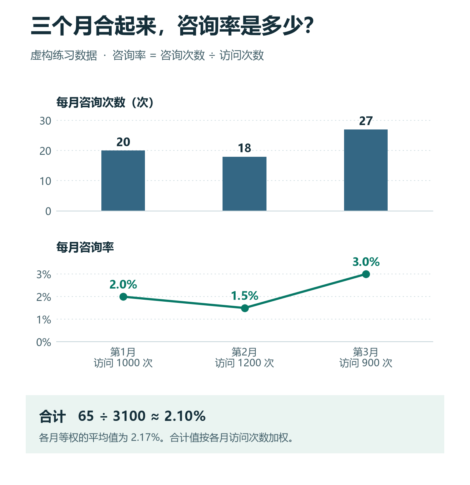

# ChatGPT 制作图表与分析看板：选指标、算比例、检查单位和误导性结论

[知识库首页](../README.md) · [文件、表格与图表](../catalog/topics/data-files.md) · [按问题找答案](../catalog/TASKS.md)

资料核对：2026-11-03。适用环境：具备数据分析或文件制作能力的ChatGPT；以下为原创虚构网站数据。

> **先看结论：** 图表先回答一个问题，再决定用什么图。访问量变化、咨询量变化和咨询率变化不是同一回事；把三者都叫“效果提升”，可能掩盖相反的趋势。

**练习材料：** [打开输入、提示词与检查答案](../resources/practice/chatgpt-charts-dashboard/README.md)。

<details>
<summary>本篇导航</summary>

- [一、用三个月的数据练习](#section-01)
- [二、先生成结果表，再画图](#section-02)
- [三、图表怎样安排更清楚](#section-03)
- [四、总咨询率不能直接平均三个月比例](#section-04)
- [五、交付看板时检查可用性](#section-05)

</details>

<a id="section-01"></a>

## 一、用三个月的数据练习

```csv
月份,访问次数,咨询次数
第1月,1000,20
第2月,1200,18
第3月,900,27
```

本练习把咨询率定义为“咨询次数÷访问次数”。真实业务里，如果一次访问可产生多次咨询，需要重新明确口径，不能自动把它理解为独立访客转化率。

官方数据分析支持生成表格和图表；结果需要核对计算方法与假设。[数据分析说明](https://help.openai.com/en/articles/8437071-data-analysis-with-chatgpt)

<a id="section-02"></a>

## 二、先生成结果表，再画图

```text
请按每月咨询次数除以访问次数计算咨询率。
先列计算表，保留分子分母；百分比显示两位小数。
再建议两张能看清变化的图，不把访问量和咨询率混成同一单位。
只描述数据，不推断广告、内容或产品变化导致了结果。
```

正确月度比例为2.00%、1.50%、3.00%。第2月访问更多但咨询更少，第3月访问更少但咨询更多；这支持描述差异，却不能直接解释原因。

<a id="section-03"></a>

## 三、图表怎样安排更清楚

可以用一张柱状图显示各月咨询次数，另一张折线图显示咨询率。每张图写清标题、横轴、纵轴、单位和统计区间。

```text
图1：各月咨询次数，柱状图，纵轴从0开始。
图2：各月咨询率，折线图，使用百分比标签。
颜色保持一致，图下写数据定义。
不要用3D效果，不把比率写成金额或人数。
```

这里的图形选择是本例的编辑建议，不是所有数据都只能这样画。若需要比较两个数量级相差很大的指标，分图通常更容易核对。

<a id="section-04"></a>

## 四、总咨询率不能直接平均三个月比例

三个月合计访问3100次、咨询65次，合计咨询率为65÷3100，约2.10%。三个百分比的简单平均约2.17%，不是同一个统计口径。



*图中数据来自本篇虚构练习。第 2 月有 1200 次访问，访问量最大，因此它的 1.5% 在合计咨询率中的权重也最大。*

让ChatGPT把汇总公式展示出来，再自己核对一次。只看图上四舍五入后的标签，容易遗漏计算差异。

<a id="section-05"></a>

## 五、交付看板时检查可用性

若要给同事使用，明确要静态图片、Excel工作簿还是可交互页面。能在聊天里交互，不代表导出图片还能筛选。文件打开后，检查图例、标签、字体和数据范围是否完整。

报告结论可以写“第3月咨询率最高，需要结合流量来源进一步分析”，不能写“某策略使咨询率提升”而材料没有策略记录。更完整的工作簿流程见[Excel与CSV分析](chatgpt-data-analysis.md)。

## 接下来按你的情况继续

- [问卷与客户反馈](chatgpt-survey-feedback-analysis.md)：对开放反馈编码，区分空白、多标签和有效样本。
- [数据分析入门](chatgpt-data-analysis.md)：得到700访问、36咨询、11订单、1595元及正确比率。

[返回文件、表格与图表专题](../catalog/topics/data-files.md) · [完整文章索引](../catalog/ALL_ARTICLES.md)
