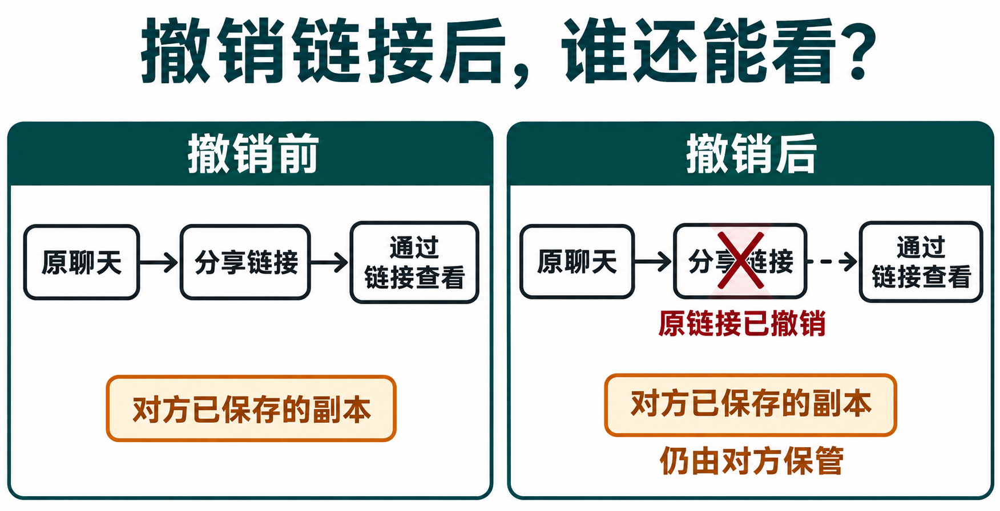

# ChatGPT 聊天记录怎么找、归档和分享？保留内容与删除链接的区别

[知识库首页](../README.md) · [登录、隐私与账号](../catalog/topics/accounts.md) · [按问题找答案](../catalog/TASKS.md)

资料核对：2026-11-03。适用环境：ChatGPT网页为主；个人账号与组织工作区的分享规则分别说明。

> **先看结论：** 侧栏里看不到旧聊天，不一定是被删除；归档也不是删除。整理聊天记录时，先用搜索找到对话，再决定是继续使用、归档还是删除。准备分享时，还要单独检查链接会展示哪些内容。

<details>
<summary>本篇导航</summary>

- [一、怎样找回一段旧聊天](#section-01)
- [二、归档、删除分别适合什么情况](#section-02)
- [三、分享之前，完整查看预览](#section-03)
- [四、发错链接以后怎样停止访问](#section-04)
- [五、一个可安全演练的整理流程](#section-05)

</details>

<a id="section-01"></a>

## 一、怎样找回一段旧聊天

打开侧栏Search，输入自己记得的标题、文件名或原话。网页可用Windows的 `Ctrl+K` 或Mac的 `Command+K` 打开搜索。结果较多时，使用当前页面提供的类型筛选。

搜索“周报”太宽泛，可以换成“截图审核11月”或一段独特原文。如果仍然没有结果，先核对账号和工作区，再看是否归档，不要立即认定数据丢失。[官方内容查找说明](https://help.openai.com/en/articles/10056348-finding-your-chats-projects-and-files-in-chatgpt)

这里搜索的是自己的聊天及可访问内容，不是互联网。查实时信息应使用[联网搜索](chatgpt-search-research.md)。

<a id="section-02"></a>

## 二、归档、删除分别适合什么情况

| 操作 | 适用需求 | 结果 |
|---|---|---|
| 保留并命名 | 以后继续这项工作 | 容易按主题再次查找 |
| 归档 | 不想放在常用侧栏，但仍要保留 | 仍可搜索和取消归档 |
| 删除 | 确定不再保留这段对话 | 无法通过聊天界面或支持恢复 |

在对话的更多菜单中选择Archive或Delete。查看已归档内容，可进入“设置 → 数据控制 → 已归档聊天”等实际入口，再选择取消归档。

[官方归档与删除说明](https://help.openai.com/en/articles/8809935-deleting-and-archiving-chats-in-chatgpt)明确区分这两项操作。删除聊天不等于删除Library或Space里单独保存的文件；资料管理见[文件与资料库教程](chatgpt-library-space-files.md)。

建议命名为“主题＋用途＋版本”，例如“注册教程－文字审核－第一轮”。比“新聊天”“测试2”更容易找，但不要把账号密码或客户电话写进标题。

<a id="section-03"></a>

## 三、分享之前，完整查看预览

打开对话，选择Share，阅读分享预览，再生成或复制链接。若界面允许只分享某条回答，确认预览确实只包含该内容。

个人账号链接通常是创建或更新时的内容快照，持有链接的人可以查看。组织工作区链接则有不同的访问范围和更新行为，应阅读页面提示。不要把这两类链接都理解为“只有我发给的人能看”。[官方分享说明](https://help.openai.com/en/articles/7925741-sharing-conversations-and-scheduled-tasks-in-chatgpt)

特别检查截图、附件、原始提问和之前的上下文。只想展示一个结果，却把整个含私人资料的对话分享出去，是预览环节应该发现的问题。

<a id="section-04"></a>

## 四、发错链接以后怎样停止访问

进入“设置 → 数据控制 → Shared links（分享链接）→ Manage”，找到对应链接并删除，再检查该链接的访问状态。

删除链接与删除原聊天是不同操作。停止原链接访问，也不能收回对方已经复制或保存的内容。因此，分享前的检查比事后撤销更可靠。

普通聊天分享链接也不适合作为长期文章地址。正式教程应放在知识库或网站中，避免文章正文、图片和链接管理依赖某个临时对话。



*AI 教学图解。撤销原分享链接后，对方已经独立保存的副本仍由对方保管。*

<a id="section-05"></a>

## 五、一个可安全演练的整理流程

```text
新建一段只含虚构内容的聊天，标题写“历史整理演示”。
用Search找到它。
归档后再次搜索，确认仍可定位。
取消归档，查看分享预览，但不发送给其他人。
若确实创建了测试链接，用Shared links撤销。
```

不需要为练习删除重要对话。若主要需求是把整个账号资料留一份副本，继续看[数据导出与账号删除](chatgpt-export-delete-account.md)。

## 接下来按你的情况继续

- [多设备同步排查](chatgpt-devices-sync-troubleshooting.md)：辨认账号、聊天类型、本地文件和云端接续差异。
- [Space协作与权限](chatgpt-space-collaboration.md)：按实际任务安排查看、评论、编辑并复核可见范围。

[返回登录、隐私与账号专题](../catalog/topics/accounts.md) · [完整文章索引](../catalog/ALL_ARTICLES.md)
