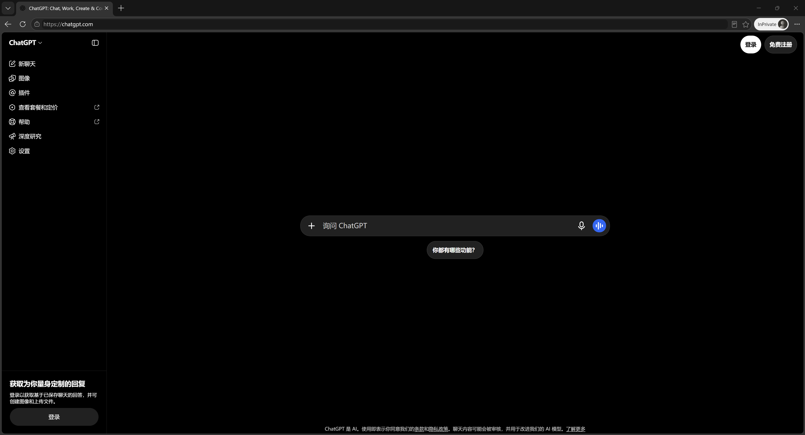
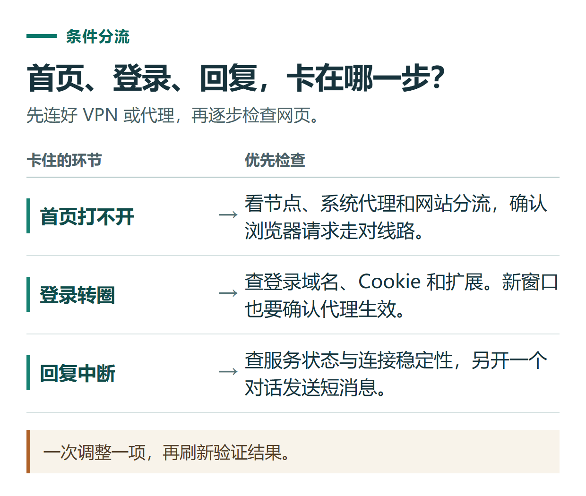
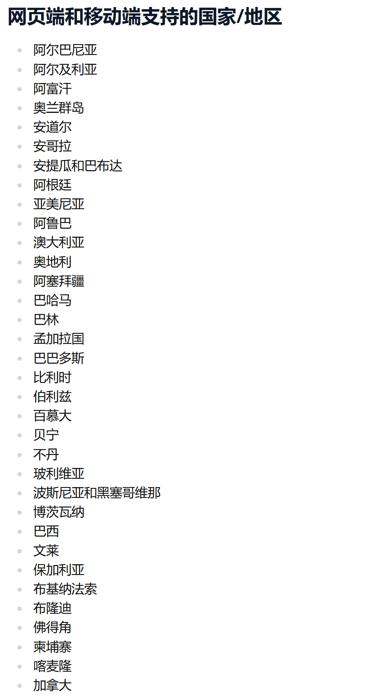

# 国内怎么用 ChatGPT？从网络准备到第一次对话

[知识库首页](../README.md) · [认识与开始](../ROADMAP.md#module-01) · [已上线教程](../README.md)

更新与资料核对日期为 2026 年 11 月 5 日。

**这篇写给在中国大陆、准备通过 VPN 或机场代理使用 ChatGPT 的读者。** 从连接线路开始，一步步确认浏览器代理是否生效、打开官网、注册或登录，再完成一次中文对话。

已经能打开官网，可以直接看[注册与登录](#section-03)。代理已连上，但网页打不开或登录页转圈，先看[故障排查](#section-02)。

<details>
<summary>本篇导航</summary>

- [一、先准备网络、浏览器和邮箱](#section-01)
- [二、打开 ChatGPT 官网，按现象排查连接问题](#section-02)
- [三、注册或登录自己的 ChatGPT 账号](#section-03)
- [四、第一次中文提问，试写一条微信群通知](#section-04)
- [五、跑通基本使用后，怎样考虑会员与人民币付款](#section-05)

</details>

<a id="section-01"></a>

## 一、先准备网络、浏览器和邮箱

开始前，手边准备三样东西。

| 准备什么 | 用来做什么 |
|---|---|
| 已安装的 VPN 或代理客户端，以及可用线路 | 让当前设备访问 ChatGPT 网页和登录服务 |
| 电脑或手机上的浏览器 | 先跑通网页版，方便观察网址、错误提示和登录跳转 |
| 自己能长期收信的邮箱，或已有的 Google、Microsoft、Apple 账号 | 注册、登录和接收验证信息 |

### 1. 连接 VPN，或导入机场订阅并选择节点

使用 VPN 应用的读者，先选择线路并连接。使用机场代理的读者，先把服务方提供的订阅导入代理客户端，确认能看到节点，再选中一个节点。

“机场”在这里指提供代理节点订阅的服务商。**客户端负责运行代理，订阅提供线路配置。** 如果节点列表为空，先检查订阅是否导入成功、是否需要更新，以及服务是否到期。

以电脑端 Clash Verge Rev 为例，入门顺序是导入订阅、选择节点与模式、开启系统代理。不同客户端的按钮名称会有差异，可以对照自己使用的客户端说明操作。[Clash Verge Rev 快速入门](https://www.clashverge.dev/guide/quickstart.html)

### 2. 确认浏览器的请求确实经过代理

客户端显示节点名称或延迟后，还要检查流量接管设置。

- **使用系统代理的客户端**，确认“系统代理”已经开启。大多数浏览器可以通过这项设置使用代理。
- **只装了浏览器代理扩展**，检查扩展是否在当前浏览器和当前窗口中启用。换浏览器或打开无痕窗口时，重新确认代理设置。
- **手机或电脑使用 VPN 应用**，检查应用的连接状态。如果启用了分应用设置，把正在使用的浏览器包含在内。
- **使用 TUN 模式**，按客户端说明检查虚拟网卡与路由设置。它常用于接管不遵循系统代理的程序，是否需要启用取决于你的设备和应用。[系统代理与 TUN 说明](https://www.clashverge.dev/guide/quickstart.html)

有些客户端会按网站分流。可以在“连接”或日志中查找 ChatGPT 请求，看看匹配了哪个规则、使用哪个节点。若相关请求显示为直连，就检查该配置的分流规则。系统代理、TUN 和规则分流各自承担不同工作，排查时一次改一项，再刷新页面验证。[代理与路由规则说明](https://www.clashverge.dev/guide/bypass.html)

<a id="section-02"></a>

## 二、打开 ChatGPT 官网，按现象排查连接问题

在浏览器地址栏输入 **`https://chatgpt.com/`**。找到消息输入框或登录按钮后，继续下一步。如果想安装手机或桌面客户端，可以从官方下载页进入对应下载渠道。[ChatGPT 官网](https://chatgpt.com/) · [官方下载页](https://chatgpt.com/download/)



*官网首页示例。页面布局可能随版本调整。*

第一次访问时，按下面三步检查。

1. **能否完整打开首页。** 观察文字、按钮和输入框是否正常显示。
2. **能否完成登录跳转。** 点击登录后，观察是否进入账号验证页面，并能返回 ChatGPT。
3. **能否收到一条完整回复。** 发送“请用简体中文介绍一下你能帮我做什么”，等它完成回答。

每一步检查的是不同环节。外网搜索能打开，只说明那个网站可达。ChatGPT 还会使用登录、网页资源等域名，部分功能需要持续连接。首页能显示后，也要实际试一次登录和对话。[OpenAI 网络说明](https://help.openai.com/en/articles/9247338-network-recommendations-for-chatgpt-errors-on-web-and-apps)



*逐步检查首页、登录和回复，把问题定位到具体环节。*

### 已连接代理，为什么还是用不了？

下表是针对本篇场景整理的排查顺序。先记下错误原文，再做一项调整，刷新验证结果。

| 看到的现象 | 先做什么 |
|---|---|
| 官网超时、无法访问，其他外网页面也打不开 | 回到客户端检查订阅状态、当前节点和代理开关。可换一条线路做对照，再重试官网。 |
| 其他外网正常，ChatGPT 首页打不开或缺少按钮 | 查看 ChatGPT 请求的分流结果。检查 `chatgpt.com`、`openai.com` 和 `oaistatic.com` 等相关域名是否被直连或拦截。 |
| 首页能打开，点登录一直转圈或反复验证 | 检查 `auth.openai.com` 等登录请求是否可达。允许相关站点的 Cookie 和 JavaScript，临时停用拦截页面的扩展，再用新的浏览器窗口对照。 |
| 提示“国家或地区不受支持” | 检查相关请求是否确实经过代理，以及线路实际出口是否与节点标注一致。向线路服务方核对出口信息，并保留错误原文。 |
| 提示登录方式错误，或进入后看不到原来的聊天 | 核对原来用的登录方式和账号。最初使用 Google 或 Apple 登录，就先选回对应入口。 |
| 能登录，发送消息后一直转圈或回复中断 | 先看服务状态，开启一个新对话重试，再检查连接稳定性。需要对照时，只更换线路、浏览器或设备中的一项。 |

网页登录与回复异常的资料依据见下方。针对国内代理环境的检查顺序是本文整理的操作建议，具体线路要用实际结果验证。[登录排查](https://help.openai.com/en/articles/7426629-why-cant-i-log-in-to-chatgpt) · [错误提示排查](https://help.openai.com/en/articles/7996703-troubleshooting-chatgpt-error-messages) · [服务状态](https://status.openai.com/)

**遇到验证循环时，无痕窗口要配合代理设置一起检查。** 如果依赖浏览器扩展提供代理，无痕窗口可能需要单独开启扩展权限。先确认新窗口也能联网，再比较是否仍然报错。Chrome 可在扩展的“详情”中检查“在无痕模式下启用”。[Chrome 扩展设置](https://support.google.com/chrome/answer/2664769?hl=zh-Hans)

### 遇到地区提示时，可补充查看的资料

平台公布的服务地区见官方名单。线路的出口标注、当前连通结果和平台的地区规则，需要分别核对。[OpenAI 支持地区名单](https://help.openai.com/zh-hans-cn/articles/7947663-chatgpt-supported-countries)



*官方地区名单的局部截图，完整内容以正文链接为准。*

<a id="section-03"></a>

## 三、注册或登录自己的 ChatGPT 账号

### 第一次注册

1. 在官网点击“注册”或“Sign up”，按当前页面选择邮箱或第三方账号方式。
2. 使用自己长期能收信的邮箱，按页面提示完成验证。如果选择 Google、Microsoft 或 Apple，使用自己管理的对应账号。
3. 完成页面要求的设置，回到聊天界面。
4. 在账号设置中核对账号邮箱，并记下使用的登录方式，方便以后在手机、电脑或新浏览器中登录。[官方账号与登录说明](https://help.openai.com/en/articles/7426629-why-cant-i-log-in-to-chatgpt)

例如，第一次点击“使用 Google 继续”并选了自己的 Gmail，下次优先用同一个 Google 账号登录。Apple 的“隐藏邮件地址”可能让账号显示为中转邮箱，仍应通过原 Apple 账号进入。

详细注册步骤、验证邮件和登录异常，可以继续看专门的教程。[ChatGPT 注册与登录](chatgpt-sign-up-login.md)

### 已经有账号

点击“登录”或“Log in”，先使用原来的登录方式。登录后，查看账号邮箱、历史对话和套餐。如果页面里的信息与你预期不一致，先核对是否进入了另一个账号。

### 官网允许直接输入，要先注册吗？

如果当前页面允许直接发送消息，可以先做下一节的小练习。想保存和继续查看对话时，再登录自己的账号。部分访问环境会先显示登录要求，按当前页面继续即可。[ChatGPT 首页使用说明](https://help.openai.com/en/articles/9125172-the-chatgpt-home-page)

<a id="section-04"></a>

## 四、第一次中文提问，试写一条微信群通知

假设你负责组织一次选题会，手头只有四条工作记录。把下面整段发给 ChatGPT。

```text
请把这份记录改成一条能直接发到同事微信群的通知，用简体中文。
先说大家需要做什么，再说开会安排。控制在100字以内。

每人准备2个公众号选题，周四18:00前填入共享表格。
周五14:00开线上选题会，预计30分钟。
会议链接由主持人在会前发送。
不能参加的同事，请在周四18:00前在群里说明。
请保留所有时间、数量和反馈方式，不补写会议地点或会议链接。
```

**人工参考通知**

> 请大家在周四18:00前把各自的2个公众号选题填入共享表格。周五14:00开线上选题会，预计30分钟，主持人会前发链接。不能参加的同事也请在周四18:00前在群里说明。

对照原始记录，先找两个容易写错的地方。“周四18:00”是**交选题和说明缺席的截止时间**，“周五14:00”才是**开会时间**。再检查“每人2个”有没有变成“全组2个”。如果只漏了缺席说明，可以在同一对话里追问：“补上不能参加时怎么反馈，保留原来的两个时间和每人2个选题。”还想继续练习，可以试着让 ChatGPT 把会议记录整理成待办事项。

<a id="section-05"></a>

## 五、跑通基本使用后，怎样考虑会员与人民币付款

第一次使用，先完成“打开官网 → 登录账号 → 收到完整回复”。然后用自己的任务试几次，例如改简历、整理会议记录或处理文件。遇到明确的功能或用量限制，再比较套餐。[个人套餐如何选择](chatgpt-plans-comparison.md)

国内读者购买前，先看清商品对应哪里。

| 商品 | 去哪里查看结果 |
|---|---|
| 本人 ChatGPT 账号的会员 | 登录自己的 ChatGPT，查看套餐和订阅周期 |
| API 余额 | 查看对应 API 组织的账单与余额 |
| 某个中文网站的点数或会员 | 在该网站的个人中心查看次数、额度或权益 |

“机场订阅”则用于代理线路。代理服务、ChatGPT 会员和第三方平台点数，各有自己的订单与续费安排。[会员、API 余额与代充的区别](chatgpt-subscription-api-topup.md)

**已经能正常使用自己的 ChatGPT 账号，想用人民币办理会员**，可以查看小小AI当前的商品、价格和办理说明。小小AI是本指南维护者提供的独立第三方服务。下单前确认账号、套餐名称、周期、总价和售后，完成后回到自己的 ChatGPT 账号核对权益。官方订阅教程 · [小小AI会员办理](https://xiaoxiao.pro/shop?utm_source=github&utm_medium=referral&utm_campaign=chatgpt_guide&utm_content=a01_shop)

接下来可以继续学习网页版的对话管理、文件上传和常用入口。[ChatGPT 网页版入门](chatgpt-web-basics.md)

[返回认识与开始专题](../ROADMAP.md#module-01) · [完整目录](../ROADMAP.md)
