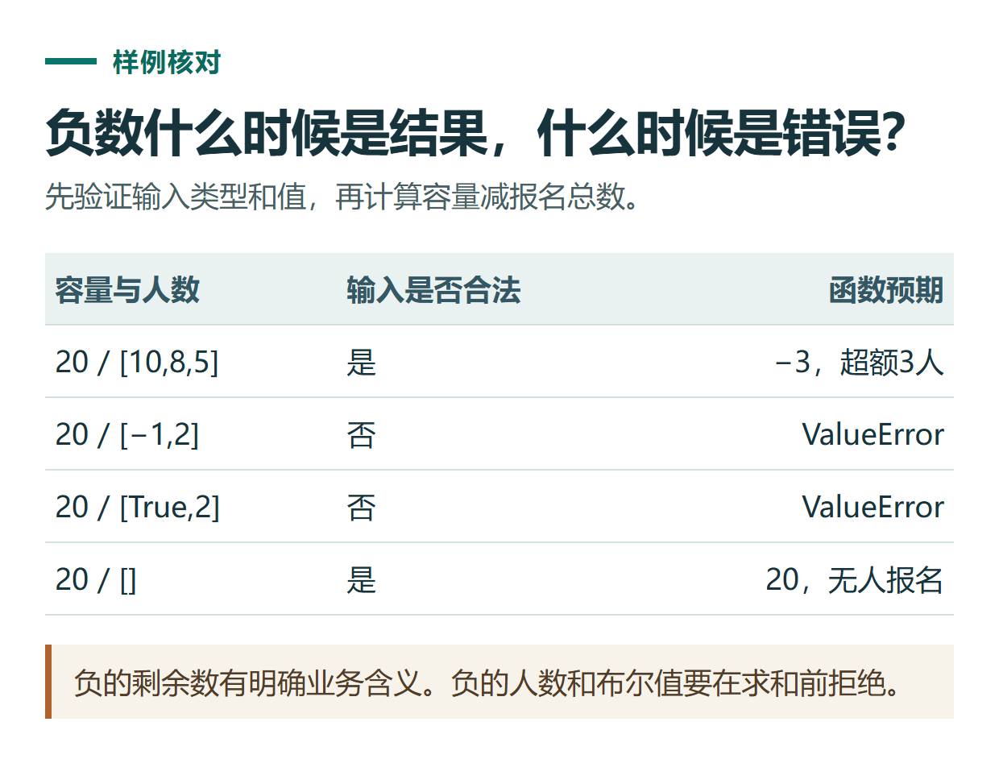

# ChatGPT 代码审查与测试：检查需求、边界和修改后的旧功能

[知识库首页](../README.md) · [代码与小工具](../catalog/topics/coding.md) · [按问题找答案](../catalog/TASKS.md)

资料核对：2026-11-03。适用环境：Python 3练习或具备代码工具的任务；代码与验收表为原创。

> **先看结论：** 代码能运行只是第一步。审查要回答它是否符合需求、特殊输入怎样处理、改动是否影响原来的正确行为。让ChatGPT只说“代码质量不错”，帮助有限。

**练习材料：** [打开输入、提示词与检查答案](../resources/practice/chatgpt-code-review-testing/README.md)。

<details>
<summary>本篇导航</summary>

- [一、先写需求，再看实现](#section-01)
- [二、把审查要求写具体](#section-02)
- [三、用六个样例覆盖关键行为](#section-03)
- [四、区分“提出测试”和“实际运行”](#section-04)
- [五、把审查结论交付清楚](#section-05)

</details>

<a id="section-01"></a>

## 一、先写需求，再看实现

本练习的需求是：计算活动剩余名额，容量和各组人数必须为非负整数；如果报名超过容量，可以返回负数表示超出的名额。Python里布尔值不是本题想接受的人数，应拒绝。

参考实现：

```python
def remaining_seats(capacity, groups):
    values = [capacity, *groups]
    if any(type(v) is not int or v < 0 for v in values):
        raise ValueError('容量和人数必须是非负整数')
    return capacity - sum(groups)
```

先理解“允许负的剩余数”和“不允许负的输入人数”是两件事。若不先写需求，模型可能把所有负结果都改成0，反而丢失超额信息。

<a id="section-02"></a>

## 二、把审查要求写具体

```text
请按上面的需求审查函数。
重点检查输入验证、空列表、刚好满员和超额情况。
每个问题都给出能复现的输入、实际行为与预期行为。
没有发现问题可以明确说明，不为凑条目编造缺陷。
先给审查意见，不修改文件。
```

开发类任务可选提供相应技术视图的Codex，工具能力和运行环境仍需确认。[模式选择说明](https://learn.chatgpt.com/docs/use-chatgpt)

<a id="section-03"></a>

## 三、用六个样例覆盖关键行为

| 输入 | 预期 |
|---|---|
| 20，[8,6,4] | 2 |
| 20，[10,10] | 0 |
| 20，[10,8,5] | －3 |
| 20，[] | 20 |
| 20，[－1,2] | ValueError |
| 20，[True,2] | ValueError |

前三项检查正常、边界和超额；空列表检查没有报名；后两项检查非法类型与值。还可增加小数、负容量等样例，但不必反复测试同一种情况。

Python标准库unittest可以把输入与预期整理成可反复运行的测试，具体断言方式见[官方测试文档](https://docs.python.org/3/library/unittest.html)。



*本篇练习图。负的剩余数有明确业务含义。负的人数和布尔值要在求和前拒绝。*

<a id="section-04"></a>

## 四、区分“提出测试”和“实际运行”

如果ChatGPT不能访问你的运行环境，它可以写测试代码和执行说明，但不能宣称已经跑过。实际运行后保留通过数、失败项和环境；出现失败，先检查需求还是实现不一致。

修复一个缺陷后，重跑与它相关的检查以及原有核心路径。不要因为新增错误输入已经被拒绝，就省略正常输入的验证。

<a id="section-05"></a>

## 五、把审查结论交付清楚

最后说明改了什么、原因、哪些情况已检查、哪些尚未验证。对真实项目还应考虑依赖、调用方和数据格式，本篇的小函数检查不能代替完整系统验收。

基础报错处理见[代码排错教程](chatgpt-coding-debugging.md)；一个完整输入到输出的练习见[CSV统计脚本](chatgpt-coding-python-csv.md)。

## 接下来按你的情况继续

- [排查代码报错](chatgpt-coding-debugging.md)：复现空输入错误，按业务含义修复并验证。
- [HTML人数小工具](chatgpt-html-mini-tool.md)：生成本地人数计算器并按样例检查交互。

[返回代码与小工具专题](../catalog/topics/coding.md) · [完整文章索引](../catalog/ALL_ARTICLES.md)
