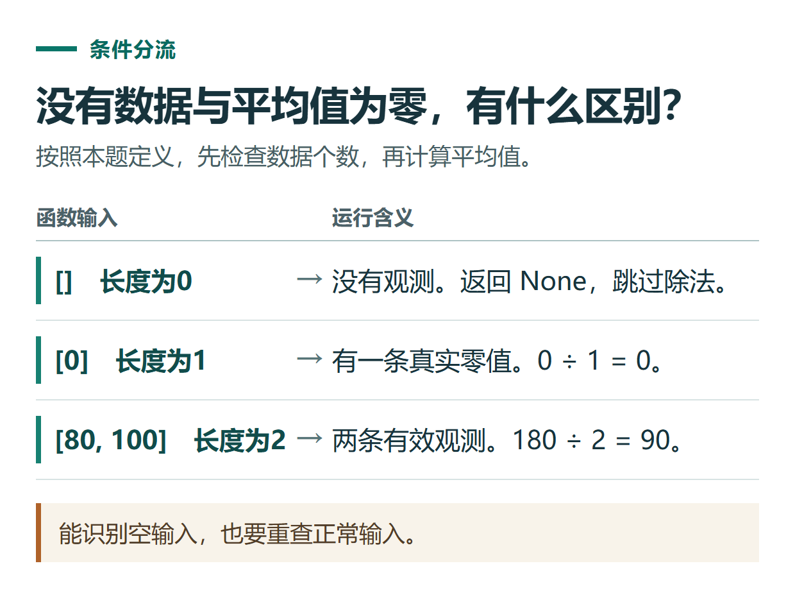

# ChatGPT 帮你排查代码报错：提供最小例子、说明预期并验证修复

[知识库首页](../README.md) · [代码与小工具](../catalog/topics/coding.md) · [按问题找答案](../catalog/TASKS.md)

资料核对：2026-11-03。适用环境：Python 3练习；代码由编辑编写，实际项目需按自己的环境验证。

> **先看结论：** 遇到报错时，把完整错误、触发它的输入和预期行为一起给ChatGPT。只发最后一句“运行不了”，往往会得到大量不适用的猜测。

**练习材料：** [打开输入、提示词与检查答案](../resources/practice/chatgpt-coding-debugging/README.md)。

<details>
<summary>本篇导航</summary>

- [一、准备一个可以复现的小例子](#section-01)
- [二、给出真正想要的行为](#section-02)
- [三、检查修改是不是针对原因](#section-03)
- [四、用几组输入验证](#section-04)
- [五、真实项目报错怎样缩小范围](#section-05)

</details>

<a id="section-01"></a>

## 一、准备一个可以复现的小例子

下面的代码在空列表时会出错：

```python
def average(values):
    return sum(values) / len(values)

print(average([]))
```

因为空列表长度为0，程序尝试除以零。Python的异常信息会指出异常类型和相关调用位置，完整记录比单独截图一个红色文字更有帮助。[Python错误与异常说明](https://docs.python.org/3/tutorial/errors.html)

<a id="section-02"></a>

## 二、给出真正想要的行为

```text
上面的函数输入空列表时出现ZeroDivisionError。
我希望非空数字列表返回平均值；空列表返回None，表示没有数据。
输入[0]应该返回0，不能和没有数据混淆。
请先解释原因，再做最小修改，保留函数名称和其他行为。
```

如果不说明空列表应如何处理，模型可能自行返回0。这会让“没有成绩”和“平均分为0”变成同一个结果，程序虽然不报错，业务含义却错了。

<a id="section-03"></a>

## 三、检查修改是不是针对原因

一种符合本题要求的参考实现：

```python
def average(values):
    if not values:
        return None
    return sum(values) / len(values)
```

它处理的是空输入，不是把所有异常都吞掉。若传入文字列表，仍需要另行定义允许的数据类型；不能因为解决了这一次错误，就声称函数适用于任何输入。



*能识别空输入，也要重查正常输入。*

<a id="section-04"></a>

## 四、用几组输入验证

| 输入 | 预期 |
|---|---|
| [80,100] | 90 |
| [] | None |
| [0] | 0 |
| [5] | 5 |

把这些条件交给ChatGPT，让它提供检查方法；然后在实际环境运行。没有执行能力时，它应说明只是提出测试，而不是已经测试通过。

```text
请解释每个检查覆盖什么问题。
如果你没有实际运行环境，明确说未运行。
修复后不要顺带改名、引入第三方库或重写整个项目。
```

<a id="section-05"></a>

## 五、真实项目报错怎样缩小范围

先记录语言与版本、操作系统、运行方式、依赖版本、完整错误和最近改动。再移除无关代码，保留仍会触发问题的最小输入。真实资料无法公开时，用结构相同的虚构数据替换。

一次只改变一类因素，修改后重跑原错误输入和一个正常输入。若修复影响其他功能，把新报错和具体差异交回去，不反复让它“全部重写”。后续检查可用[代码审查与测试流程](chatgpt-code-review-testing.md)。

## 接下来按你的情况继续

- [第一个Python脚本](chatgpt-coding-python-csv.md)：读取完整练习数据，统计已支付条数及金额。
- [代码审查与测试](chatgpt-code-review-testing.md)：按需求检查名额函数并验证正常与异常输入。

[返回代码与小工具专题](../catalog/topics/coding.md) · [完整文章索引](../catalog/ALL_ARTICLES.md)
