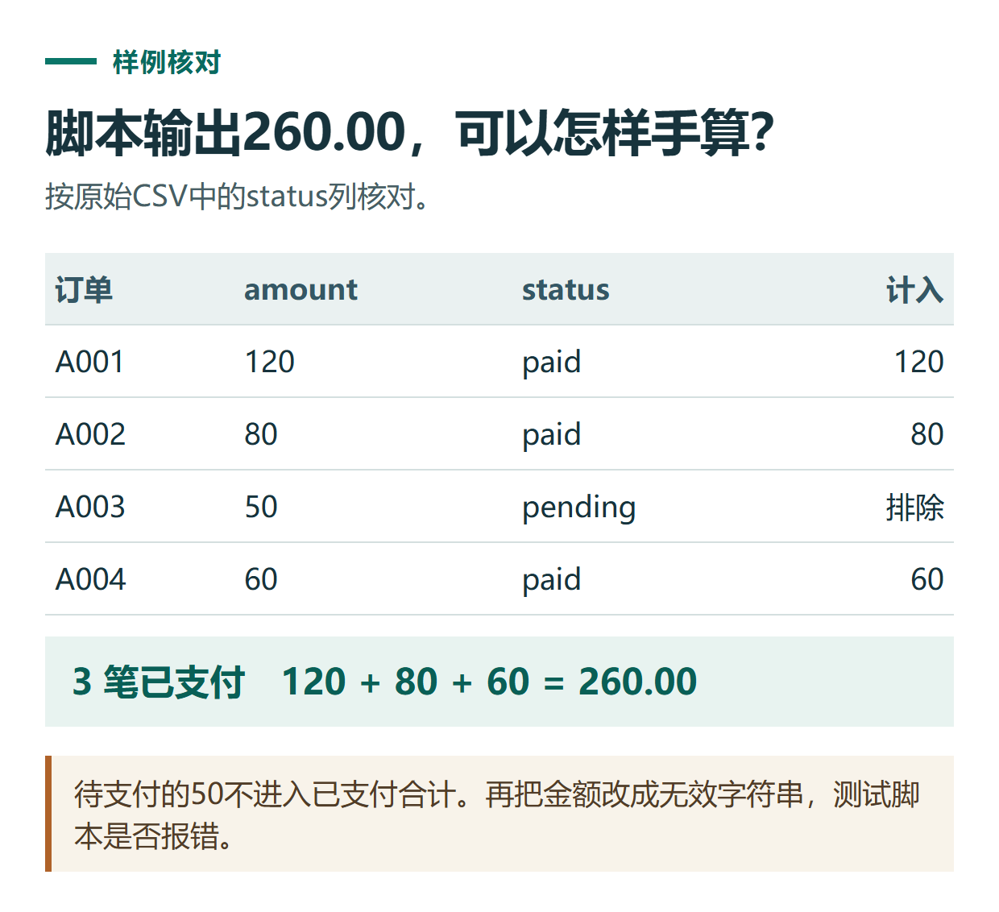

# 用 ChatGPT 写第一个 Python 小脚本：读取 CSV 并统计已支付金额

[知识库首页](../README.md) · [代码与小工具](../catalog/topics/coding.md) · [按问题找答案](../catalog/TASKS.md)

资料核对：2026-11-03。适用环境：Python 3与文字代码辅助；样例为原创。参考脚本的本地检查与ChatGPT账号操作分开记录。

> **先看结论：** 第一次用ChatGPT写程序，建议选择输入很小、结果能手算、不会修改原文件的任务。本篇统计一份虚构CSV里的已支付金额，不需要连接账号、数据库或付款系统。

**练习材料：** [打开输入、提示词与检查答案](../resources/practice/chatgpt-coding-python-csv/README.md)。

<details>
<summary>本篇导航</summary>

- [一、准备输入与预期结果](#section-01)
- [二、把环境和边界告诉ChatGPT](#section-02)
- [三、用完整参考脚本对照](#section-03)
- [四、先检查正常结果，再检查错误输入](#section-04)
- [五、扩大任务之前先补规则](#section-05)

</details>

<a id="section-01"></a>

## 一、准备输入与预期结果

把以下内容保存为UTF-8文本文件 `orders.csv`：

```csv
order_id,amount,status
A001,120,paid
A002,80,paid
A003,50,pending
A004,60,paid
```

参考结果是3条已支付记录，合计260.00。待支付的50不纳入；这只是练习数据。



*本篇练习图。待支付的50不进入已支付合计。再把金额改成无效字符串，测试脚本是否报错。*

<a id="section-02"></a>

## 二、把环境和边界告诉ChatGPT

```text
请用Python 3标准库读取orders.csv。
只统计status为paid的金额，输出条数和合计。
金额按十进制处理；空值、非数字和非有限金额应明确报错。
只读原文件，不删除、不改名，不联网，不要求额外安装第三方库。
给完整脚本、运行方式，以及我应看到的结果。
```

Python标准库的csv模块提供按列名读取的DictReader，读取字段不会自动转换成数值，需要明确处理。[Python csv文档](https://docs.python.org/3/library/csv.html)

<a id="section-03"></a>

## 三、用完整参考脚本对照

下面是编辑编写的参考实现，可与ChatGPT生成结果比较：

```python
import csv
from decimal import Decimal, InvalidOperation

total = Decimal('0')
paid_count = 0
with open('orders.csv', encoding='utf-8-sig', newline='') as f:
    reader = csv.DictReader(f)
    required = {'order_id', 'amount', 'status'}
    if not required.issubset(set(reader.fieldnames or [])):
        raise ValueError('缺少必要列')
    for line_number, row in enumerate(reader, start=2):
        try:
            amount = Decimal(row['amount'])
        except (InvalidOperation, TypeError):
            raise ValueError(f'第{line_number}行金额不是有效数字')
        if not amount.is_finite():
            raise ValueError(f'第{line_number}行金额不是有限数值')
        if row['status'].strip() == 'paid':
            total += amount
            paid_count += 1
print(f'已支付条数：{paid_count}')
print(f'已支付金额：{total:.2f}')
```

保存为 `summarize_orders.py`，与CSV放在同一练习文件夹。在已安装Python 3的环境进入该目录，运行 `python summarize_orders.py`；若电脑的Python命令不同，使用实际安装对应的命令。

<a id="section-04"></a>

## 四、先检查正常结果，再检查错误输入

正常样例应输出3和260.00。另复制一份练习，把某行金额改为“未知”，再运行时应明确报告对应行，而不是默默把它当零。修改测试副本后，恢复原始练习数据。

如果提示找不到文件，先检查运行位置和文件名；若提示缺列，核对表头拼写。具体错误处理见[代码排错](chatgpt-coding-debugging.md)。

<a id="section-05"></a>

## 五、扩大任务之前先补规则

退款、重复订单、不同币种和缺少状态都需要额外定义。本脚本只按输入状态统计，没有替你完成真实订单清洗。加入新规则后，先准备人工可算的小样例再修改程序。

数据本身不整齐时先看[数据清洗](chatgpt-excel-data-cleaning.md)；要检查程序改动是否破坏旧功能，继续看[代码审查与测试](chatgpt-code-review-testing.md)。

## 接下来按你的情况继续

- [排查代码报错](chatgpt-coding-debugging.md)：复现空输入错误，按业务含义修复并验证。
- [代码审查与测试](chatgpt-code-review-testing.md)：按需求检查名额函数并验证正常与异常输入。

[返回代码与小工具专题](../catalog/topics/coding.md) · [完整文章索引](../catalog/ALL_ARTICLES.md)
