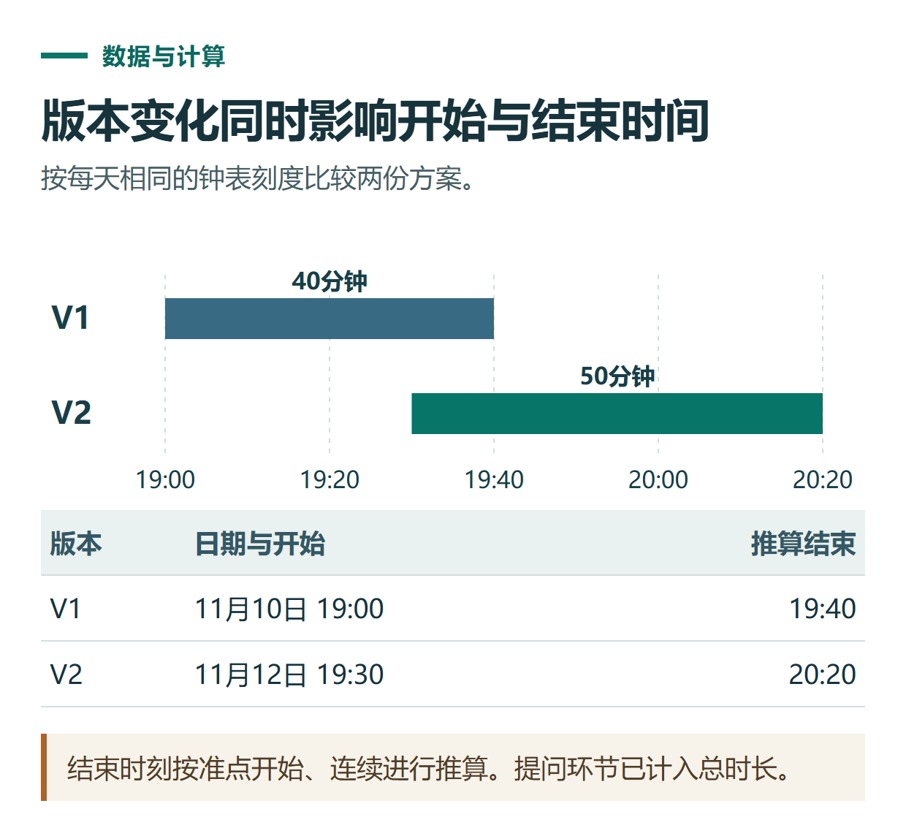

# ChatGPT 对比两份文档：找出改动、保留原文依据与检查遗漏

[知识库首页](../README.md) · [搜索、PDF与研究](../catalog/topics/research.md) · [按问题找答案](../catalog/TASKS.md)

资料核对：2026-11-03。适用环境：文字输入或文档上传；以下两份活动方案均为原创虚构练习。

> **先看结论：** 比较文档时，不要只问“有什么区别”。先指定旧版与新版，再约定哪些字段必须核对，并要求每条差异附上两版原文。这样既能找改动，也能避免把遗漏或措辞变化误判成业务变化。

官方[文件使用说明](https://help.openai.com/en/articles/8555545-uploading-files-and-audio-to-chatgpt)列有文档比较用途。本文提供一组可以人工复核的短材料。

**练习材料：** [打开输入、提示词与检查答案](../resources/practice/chatgpt-compare-documents/README.md)。

<details>
<summary>本篇导航</summary>

- [一、把版本关系说清楚](#section-01)
- [二、第一轮提取字段，不急着写结论](#section-02)
- [三、第二轮输出差异表](#section-03)
- [四、用反向核对找漏项](#section-04)
- [五、长文档与复杂版本怎样扩展](#section-05)

</details>

<a id="section-01"></a>

## 一、把版本关系说清楚

分别保存为 `plan-v1.txt` 和 `plan-v2.txt`，或者将两段内容一起粘贴并保留标签：

```text
【旧版V1】
主题：新员工资料整理分享
日期：11月10日
开始：19:00
总时长：40分钟
人数：8人
交付材料：PDF讲义
提问环节：10分钟，包含在总时长内
报名截止：11月9日18:00

【新版V2】
主题：新员工资料整理分享
日期：11月12日
开始：19:30
总时长：50分钟
人数：8人
交付材料：PDF讲义和TXT练习文件
提问环节：15分钟，包含在总时长内
报名截止：11月11日18:00
```

“V2是新版”来自你提供的版本说明，不是模型根据文件名猜测。真实文件里有修订日期、附件或批注时，一并交代哪些属于本次比较范围。

<a id="section-02"></a>

## 二、第一轮提取字段，不急着写结论

```text
分别提取两份方案的主题、日期、开始时间、总时长、人数、交付材料、提问时长和报名截止。
按原文记录，缺失字段写“未提供”。
先展示两份字段表，让我检查是否读全；暂不判断哪版更好。
```

先核对输入读取是否正确。若文件是一份扫描件，优先解决识别问题，再做比较，必要时使用[图片识别方法](chatgpt-image-understanding-ocr.md)。

<a id="section-03"></a>

## 三、第二轮输出差异表

```text
按刚才核对的字段比较V1和V2。
输出：字段、旧版原文、新版原文、变化类型、需要同步检查的材料。
只列实际变化，另列保持不变的关键字段。
“需要同步检查”属于建议，不能写成已经修改完成。
```

这组练习应发现6个变化：日期、开始时间、总时长、交付材料、提问时长和报名截止。主题与人数保持不变。

例如，日期从11月10日变为11月12日，对应建议是检查报名页、海报和通知；交付从PDF变为PDF加TXT，对应建议是检查材料打包清单。建议不等于已经执行，也不能凭文档内容判断变更已获批准。



*本篇练习图。结束时刻按准点开始、连续进行推算。提问环节已计入总时长。*

<a id="section-04"></a>

## 四、用反向核对找漏项

完成差异表后继续提问：

```text
现在逐项检查新版的全部8个字段。
每个字段标为“已列入差异”或“与旧版相同”，并给出依据。
如果发现之前漏掉的变化，单独补充，不改写原始材料。
```

反向检查可以帮助发现前一轮漏掉的字段，但最后仍由你对照原文。检查重点不是它是否说“没有遗漏”，而是8项有没有逐项对应。

<a id="section-05"></a>

## 五、长文档与复杂版本怎样扩展

先按章节或条目编号比较，再汇总。统一术语和编号，区分文字重写、数字变动、增加、删除及仅调整位置。目录变化不一定意味着正文内容有变化。

如果两份材料信息冲突，报告“哪里冲突”即可，不擅自决定哪份有效。对需要负责人确认的条目，整理成待确认清单，再交给实际维护者。

比较结果可进一步生成修订说明，但应保留原文件和差异表。最终成果需要排版时，继续看[Word与PPT文件制作](chatgpt-word-ppt-files.md)。

## 接下来按你的情况继续

- [多文件项目案例](chatgpt-projects-multi-file-case.md)：用需求、资源和旧记录生成有版本依据的活动方案。
- [生成Word与PPT](chatgpt-word-ppt-files.md)：从同一材料制作可编辑文件，并检查下载后的内容与版式。

[返回搜索、PDF与研究专题](../catalog/topics/research.md) · [完整文章索引](../catalog/ALL_ARTICLES.md)
