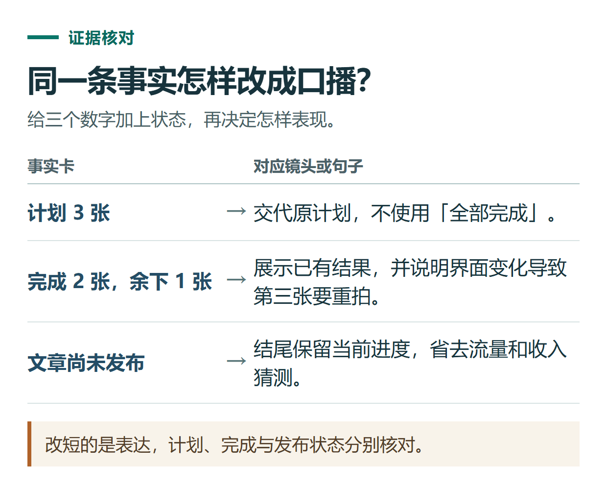

# 用 ChatGPT 写公众号文章和视频号脚本：一份材料的完整改编案例

[知识库首页](../README.md) · [办公与内容创作](../catalog/topics/work.md) · [按问题找答案](../catalog/TASKS.md)

资料核对：2026-11-03。适用环境：普通文字对话；本文案例、成稿片段和脚本均为编辑原创示例，不代表真实发布效果。

> **先看结论：** 同一份材料可以改成公众号文章和短视频脚本，但不能只把长文删短。文章靠段落展开，视频还要考虑口播节奏、画面和字幕。先把事实定下来，再分别设计表达方式，能减少不同平台版本互相矛盾的问题。

本篇演示同一事实如何改成公众号与视频；六个平台的交付安排见[内容排期](chatgpt-content-calendar.md)。

需要给同一主题配封面，先按[图片生成与修改](chatgpt-image-generation.md)完成构图；中文海报再看[文字与裁切检查](chatgpt-image-poster-text-layout.md)，让画面与母稿事实一致。

**练习材料：** [打开输入、提示词与检查答案](../resources/practice/chatgpt-content-workflow/README.md)。

<details>
<summary>本篇导航</summary>

- [一、准备一份所有版本共用的事实卡](#section-01)
- [二、先确定文章解决哪一个问题](#section-02)
- [三、一段可核对的公众号示例正文](#section-03)
- [四、把同一材料改成约一分钟视频](#section-04)
- [五、发布前检查和后续承接](#section-05)

</details>

<a id="section-01"></a>

## 一、准备一份所有版本共用的事实卡

以下是虚构教程素材，可以直接作为练习输入：

```text
主题：写周报前，先区分计划与完成。
读者：刚开始用AI整理工作记录的职场人。
原始记录：
周一计划补3张截图；周三已补2张，第三张因界面变化需要重拍。
周四已完成文字检查，但文章还没有发布。
要说明的方法：
先给原始记录，要求分为已完成、进行中、阻碍、下一步；
再对照数字与状态，不能把计划直接改写为成果。
没有依据的内容：节省了多少时间、多少人验证有效、带来了多少收入。
```

事实卡不需要很漂亮，但要完整。如果要增加产品当前功能或价格，先做[来源核查](chatgpt-search-research.md)，再加入事实卡。语言流畅不能替代证据。

<a id="section-02"></a>

## 二、先确定文章解决哪一个问题

发送下面的要求，让ChatGPT先出结构：

```text
基于事实卡，为公众号文章设计一个结构。
只解决“如何避免把计划写成已完成”这个问题。
标题自然包含“ChatGPT写周报”，不夸大效果，不写未经证明的排名和热度。
给出3个标题和一份4节以内的提纲，先不要写全文。
```

可以选择这样的标题：“ChatGPT写周报：别把计划当成已经完成”。结构可依次说明错误、给出原始记录、展示整理方法、教读者核对。

确认提纲后，再要求写正文，明确“只使用事实卡，示例标注为虚构”。这是按[官方提示指南](https://learn.chatgpt.com/docs/prompting)进行逐步限定与修改的应用方式，不是平台流量公式。

<a id="section-03"></a>

## 三、一段可核对的公众号示例正文

> **示例正文：**
>
> 工作记录里写着“计划补3张截图”，周报却变成“已完成3张截图”。句子更顺了，事实反而错了。
>
> 用ChatGPT整理周报前，先把计划和实际进展一起提供。比如这份虚构记录：周一计划补3张截图，周三完成2张，最后1张因为界面变化需要重拍；文字已经检查，但文章尚未发布。
>
> 可以要求它按“已完成、进行中、阻碍、下一步”整理。这里的已完成是2张截图和文字检查；进行中包括重拍剩余截图，文章也不能写成已发布。
>
> 生成以后，再检查两个问题：数字来自哪里，完成状态有没有原始记录支持。遇到没有依据的负责人和截止日期，让它写待确认。
>
> 你可以先拿一段不含私人信息的工作记录练习。比起得到一份漂亮模板，更有用的是学会找出一处会影响工作判断的错误。

这是一份人工编写的短示例，正式文章可以补充实际操作截图，但不能在没运行之前写“实测证明”。需要完整会议场景时，可链接到[会议纪要与周报教程](chatgpt-meeting-weekly-report.md)。

<a id="section-04"></a>

## 四、把同一材料改成约一分钟视频

```text
把已确认文章改成约60秒的中文口播脚本。
保留“计划3张、完成2张、未发布”的事实。
结构：一个具体问题、一个演示、一个检查方法、一个简单行动。
按镜头编号输出画面、口播、字幕重点。
时长只作估算，不编造实际录制数据，不添加效果保证。
```

可以用下面这份原创脚本作为参考，再按自己的语速调整：

| 镜头 | 画面 | 口播 | 字幕重点 |
|---|---|---|---|
| 1 | 出示两句工作记录 | 用AI写周报，先检查一件事：它有没有把计划写成完成？ | 计划不等于完成 |
| 2 | 标出3和2 | 这里原计划补3张截图，实际只完成2张，最后1张还要重拍。 | 计划3张，完成2张 |
| 3 | 展示整理要求 | 提问时，让它按已完成、进行中、阻碍和下一步整理。没有依据的信息写待确认。 | 分清状态 |
| 4 | 对照文章状态 | 文字检查完成，也不代表文章已经发布。最后再对照原记录，查数字、查状态。 | 查数字，查状态 |
| 5 | 展示空白练习框 | 拿一段不含私人信息的记录试一次。生成之后，先找出有没有多写的一项成果。 | 用自己的记录练一次 |

实际录制前读一遍并计时，过长就删解释句，不删关键事实。不同平台的标题和封面可以不同，但事实卡里的数字与状态保持一致。



*改短的是表达，计划、完成与发布状态分别核对。*

<a id="section-05"></a>

## 五、发布前检查和后续承接

核对标题是否准确、示例是否注明性质、图片能否读清、口播与字幕是否一致，以及链接是否对应读者下一步需求。

这类基础教程适合引导读者继续阅读[小小AI博客](https://xiaoxiao.pro/blog)中的相关内容。只有文章本身讨论会员条件或读者确实需要办理时，再引向[会员服务](https://xiaoxiao.pro/shop)，不必在每个小技巧后插入充值推销。

发布后记录读者具体提出了什么问题、哪些步骤容易卡住，再据此补文章。没有流量与成交数据时，不把“发了多个平台”写成已经带来业务效果。

## 接下来按你的情况继续

- [六平台内容排期](chatgpt-content-calendar.md)：将一个完整主题改编成六个平台的具体交付。
- [SEO文章需求与大纲](chatgpt-seo-article-brief.md)：按读者问题组织资料、案例、关键词和核查。

[返回办公与内容创作专题](../catalog/topics/work.md) · [完整文章索引](../catalog/ALL_ARTICLES.md)
