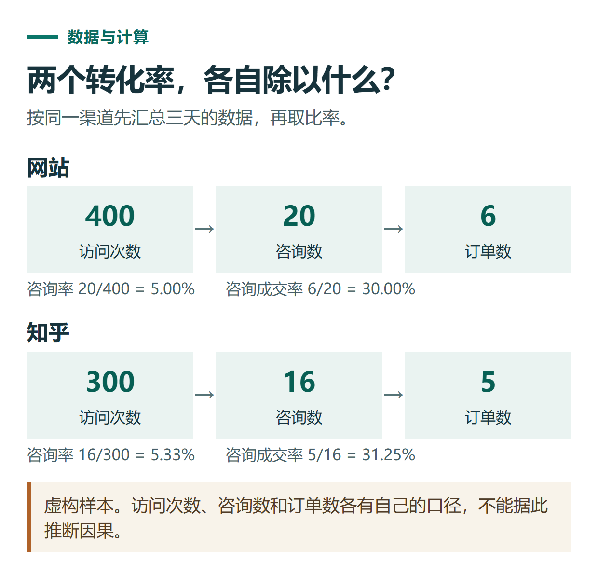

# ChatGPT 分析 Excel 和 CSV：计算转化率、制作图表与核对数据

[知识库首页](../README.md) · [文件、表格与图表](../catalog/topics/data-files.md) · [按问题找答案](../catalog/TASKS.md)

资料核对：2026-11-03。适用环境：支持数据分析的ChatGPT账号；以下全部数据为虚构练习，不代表小小AI真实经营数据或报价。

> **先看结论：** 用ChatGPT分析表格，关键是先定义每一列和计算口径。否则即使图表做得漂亮，也可能把访问量当作人数、把订单率当作咨询成交率，最后得出错误结论。

官方[数据分析说明](https://help.openai.com/en/articles/8437071-data-analysis-with-chatgpt)建议使用清楚的列名和结构化数据。每行放一条记录，减少合并单元格和只存在于图片中的数字，便于可靠处理。

本篇重点是统计口径与结果检查；原表有重复空值先看[数据清洗](chatgpt-excel-data-cleaning.md)，需要公式看[SUMIFS练习](chatgpt-excel-formulas.md)。

<details>
<summary>本篇导航</summary>

- [一、准备一份可以手算复核的数据](#section-01)
- [二、先检查数据，再计算](#section-02)
- [三、明确计算口径](#section-03)
- [四、再要求生成一张能看懂的图](#section-04)
- [五、哪些结论可以说，哪些还不能说](#section-05)

</details>

<a id="section-01"></a>

## 一、准备一份可以手算复核的数据

将下面内容保存成UTF-8编码的 `channel-demo.csv`，也可以复制到Excel再保存为XLSX。第一行是列名，每行都是一个日期下某个渠道的汇总。

```csv
日期,渠道,访问次数,咨询数,订单数,销售额元
2026-10-26,网站,120,6,2,290
2026-10-27,网站,150,9,3,435
2026-10-28,网站,130,5,1,145
2026-10-26,知乎,80,4,1,145
2026-10-27,知乎,100,6,2,290
2026-10-28,知乎,120,6,2,290
```

这份练习假设每笔咨询与订单只归属一个渠道，并统一在表内统计。真实业务若存在跨日转化、重复咨询或多渠道触点，应先确定归属规则，再套用公式。

<a id="section-02"></a>

## 二、先检查数据，再计算

上传后发送：

```text
先检查附件，不急着得出营销结论。
说明行数、列名、日期范围、渠道、缺失值和重复行。
每行是一天一个渠道的汇总，访问次数不是去重人数。
金额单位为人民币元。
不要自行补齐缺失值；如果发现异常，先列出供我确认。
```

正常应识别为6条数据、2个渠道、3个日期。若把第一行当成数据，或者把金额读取成文字，先修正，再进入计算。

<a id="section-03"></a>

## 三、明确计算口径

```text
按渠道汇总访问次数、咨询数、订单数和销售额。
咨询率 = 渠道咨询数合计 / 渠道访问次数合计。
咨询成交率 = 渠道订单数合计 / 渠道咨询数合计。
保留原始合计值，比例显示两位小数。
分母为0时写“不适用”，不要直接填0%。
不能直接平均每天的百分比；请展示公式和可核对的中间值。
```

本练习的人工核算结果如下：

| 渠道 | 访问次数 | 咨询数 | 订单数 | 销售额/元 | 咨询率 | 咨询成交率 |
|---|---:|---:|---:|---:|---:|---:|
| 网站 | 400 | 20 | 6 | 870 | 5.00% | 30.00% |
| 知乎 | 300 | 16 | 5 | 725 | 5.33% | 31.25% |
| 合计 | 700 | 36 | 11 | 1595 | 5.14% | 30.56% |

检查总销售额是否为1595元，订单是否为11笔。汇总咨询率应为36÷700，而不是把每天的比例相加后简单平均。



*本篇练习图。虚构样本。访问次数、咨询数和订单数各有自己的口径，不能据此推断因果。*

<a id="section-04"></a>

## 四、再要求生成一张能看懂的图

```text
根据刚才核对过的汇总，制作按渠道对比订单数的柱状图。
横轴为渠道，纵轴为订单数，显示具体数值，纵轴从0开始。
标题注明“虚构数据练习”，不要把销售额和订单数放在同一数值轴上。
如果当前环境能生成可下载图像，请提供；否则说明限制并给出可复用的数据表。
```

图中应有网站6笔、知乎5笔。若中文显示异常，可以要求使用可显示中文的字体或导出表格自行制图。图上的数字要与已核对的表一致。

<a id="section-05"></a>

## 五、哪些结论可以说，哪些还不能说

可以说，这份练习数据中网站订单更多，知乎的咨询率和咨询成交率略高。不能因此断言知乎一定更值得投入，因为这里只有三天、两个渠道，还没有成本和长期转化数据。

也不能从销售额直接推导利润；利润还需要成本等信息。若要比较渠道投入，可以另补工时、投放费用、退款和归因方式，再扩展分析。

结果交付前，至少手工核对一个合计、一个比例和一个图上数值。需要先从文档中取得表格时，参考[PDF提取教程](chatgpt-pdf-reading.md)，但精确计算优先使用原始表格文件。

## 接下来按你的情况继续

- [清洗表格数据](chatgpt-excel-data-cleaning.md)：处理重复、日期、空值、金额和退款并保留清洗记录。
- [图表与指标口径](chatgpt-charts-dashboard.md)：先核对指标口径，再制作和检查图表。

[返回文件、表格与图表专题](../catalog/topics/data-files.md) · [完整文章索引](../catalog/ALL_ARTICLES.md)
