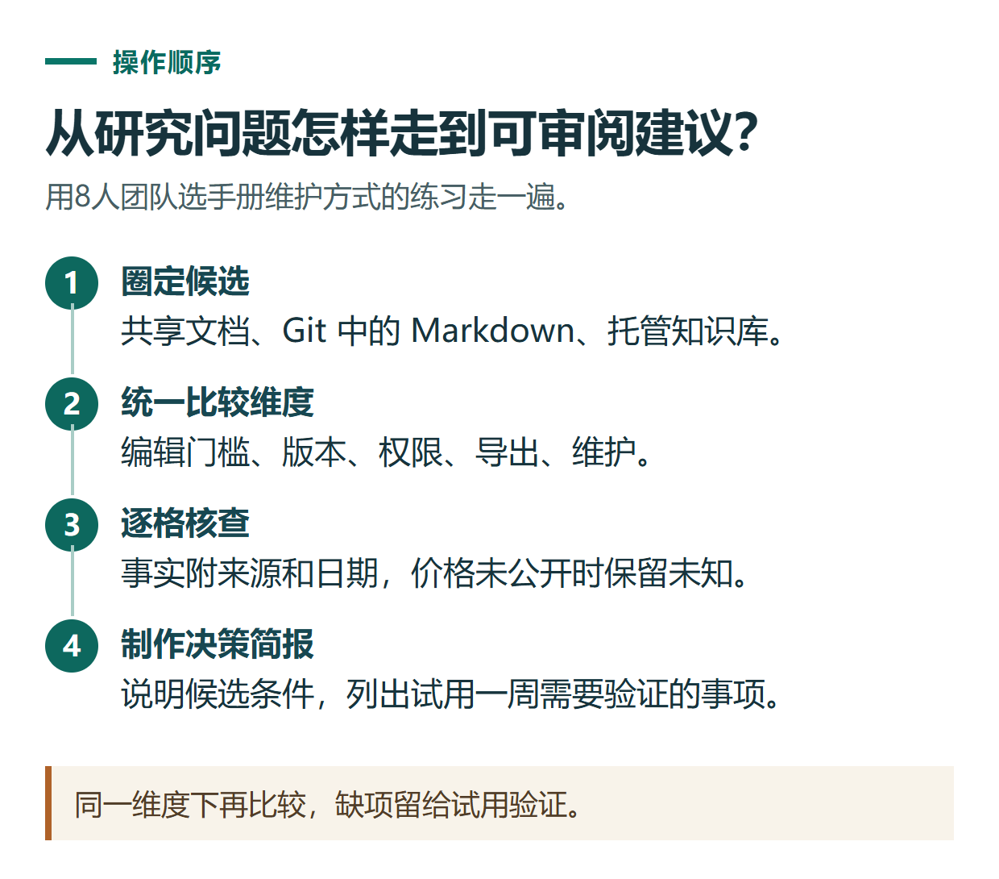

# ChatGPT 深度研究完整实践：限定范围、审核计划、检查证据与交付报告

[知识库首页](../README.md) · [搜索、PDF与研究](../catalog/topics/research.md) · [按问题找答案](../catalog/TASKS.md)

资料核对：2026-11-03。适用环境：账号已开放Deep research的网页或桌面端；下文研究任务为原创练习，未宣称已经运行。

> **先看结论：** 深度研究适合需要综合多个来源的问题。真正有用的报告，应该让你看出结论依据、适用条件和仍未解决的问题。先把研究范围写清，再检查计划，比直接要求“全面研究某行业”更容易得到可用成果。

<details>
<summary>本篇导航</summary>

- [一、把大问题缩成可完成的任务](#section-01)
- [二、进入研究模式并审阅计划](#section-02)
- [三、控制资料来源](#section-03)
- [四、先验收证据，再读推荐结论](#section-04)
- [五、把报告交付成能执行的下一步](#section-05)

</details>

<a id="section-01"></a>

## 一、把大问题缩成可完成的任务

下面用一个虚构团队的资料管理需求练习，不预设产品排名：

```text
团队有8人，需要共同维护中文操作手册。
请比较“共享文档”“Git仓库中的Markdown”“托管知识库”三种做法。
重点：编辑门槛、版本追踪、权限、导出和维护工作。
先说明需要我补充什么，再给研究计划。
优先引用官方说明，价格注明查阅日期；没有公开价格就写未知。
最终交付一份中文决策简报，不替团队注册或购买服务。
```

这里比较的是三种做法。若你只想研究指定产品，就明确列出名称，避免它花大量时间寻找不相关的候选项。预算、所在地区、必须具备的功能也应先说明。

<a id="section-02"></a>

## 二、进入研究模式并审阅计划

网页可从工具菜单选择Deep research，或使用当前提供的入口。桌面Work可通过Deep research插件开始。可见入口和使用量受账号条件影响。[深度研究说明](https://help.openai.com/en/articles/10500283-deep-research-in-chatgpt)、[Work研究入口](https://learn.chatgpt.com/docs/web-search)

先看拟议计划：是否覆盖你关心的五项，是否把“官方支持导出”误写成“所有格式都能导出”，有没有为了显得全面增加无关产品。必要时缩小范围再启动。

<a id="section-03"></a>

## 三、控制资料来源

可以指定网站和文件。当前工具区的Sites设置可限制只查指定站点，或优先这些站点并允许扩展搜索；连接应用还取决于可用性与权限。研究使用连接应用的读取能力，不代表替你修改原资料。[来源选择说明](https://help.openai.com/en/articles/10500283-deep-research-in-chatgpt)

原始资料优先放最新的需求说明，旧版另标日期。企业私有文件只在有权限的环境使用。不要因为报告需要“更多信息”，就把无关的客户名单也上传。



*同一维度下再比较，缺项留给试用验证。*

<a id="section-04"></a>

## 四、先验收证据，再读推荐结论

要求最终报告按下面的结构输出：

```text
1. 适合团队的两种候选路径及各自条件
2. 五个维度的对照表
3. 每项关键判断对应的官方链接和查阅日期
4. 尚未核实的信息
5. 一周小范围试用需要验证的事项
将事实、推断和建议分别表述，不补写真实用户评价。
```

打开涉及购买决策的来源，检查页面是否支持对应结论。例如官方说“可以导出”，但未列出图片或历史版本，不能直接推成“完整迁移全部资料”。

<a id="section-05"></a>

## 五、把报告交付成能执行的下一步

报告可按当前提供的格式下载；先打开文件检查表格、链接和章节是否完整。官方列出的研究报告下载格式包括Markdown、Word和PDF，实际入口以账号为准。[报告查看与导出](https://help.openai.com/en/articles/10500283-deep-research-in-chatgpt)

最后选择一项小验证，例如用不敏感的示例文档测试权限和导出。不要直接把模型推荐当成已经替团队验证过的方案。研究过程中发现的问题，可按[来源核对清单](chatgpt-research-source-checking.md)进一步复查。

## 接下来按你的情况继续

- [逐条核查来源](chatgpt-research-source-checking.md)：把结论对应到可打开的原始页面，识别推断与未知。
- [论文阅读与比较](chatgpt-paper-reading-literature.md)：提取研究设计、结果及不能据此得出的结论。

[返回搜索、PDF与研究专题](../catalog/topics/research.md) · [完整文章索引](../catalog/ALL_ARTICLES.md)
