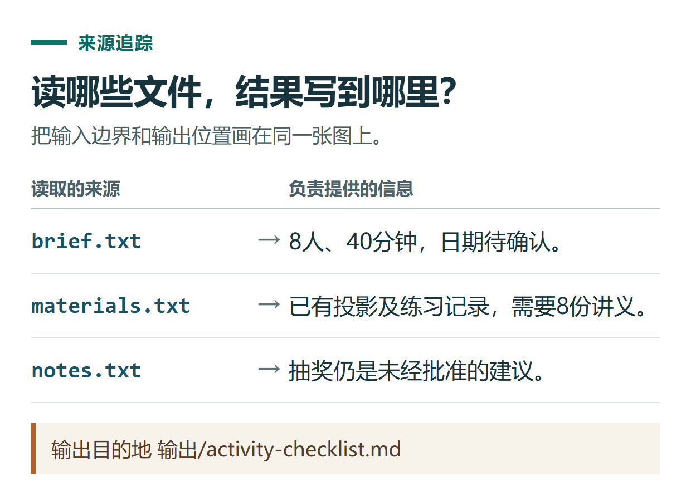

# ChatGPT Work 处理本地文件：选择文件夹、限定改动与验收输出

[知识库首页](../README.md) · [工具连接与协作](../catalog/topics/tools.md) · [按问题找答案](../catalog/TASKS.md)

资料核对：2026-11-03。适用环境：具备本地文件工具的桌面Work或相关本地项目；示例目录为练习建议。

> **先看结论：** 让ChatGPT处理电脑里的资料时，先指定一个范围清楚的文件夹。普通ChatGPT项目的上传资料，与连接电脑目录的本地项目不是一回事；在手机看到了聊天，也不意味着电脑离线时仍能读取所有本地文件。

官方[项目说明](https://learn.chatgpt.com/docs/projects)区分了这两类项目，[Work入门](https://learn.chatgpt.com/docs/get-started-with-work)也说明本地能力依赖实际工具、权限和连接状态。

<details>
<summary>本篇导航</summary>

- [一、建立只包含练习材料的目录](#section-01)
- [二、选择本地项目并确认读取范围](#section-02)
- [三、要求把成果写到明确位置](#section-03)
- [四、修改时说清范围](#section-04)
- [五、换设备后文件为什么不可用](#section-05)

</details>

<a id="section-01"></a>

## 一、建立只包含练习材料的目录

可在自己方便的位置新建“ChatGPT练习”，放三个文件：

```text
brief.txt：活动给8位同事使用，安排40分钟，日期待确认。
materials.txt：已有投影和练习记录，需要8份纸质讲义。
notes.txt：有人建议增加抽奖，尚未批准。
```

另建一个“输出”子文件夹。先用小材料走通流程，再处理复杂资料；不要把整块磁盘当作第一个练习的范围。

<a id="section-02"></a>

## 二、选择本地项目并确认读取范围

在桌面项目入口选择对应文件夹或按当前界面添加本地项目。先让它列出本次可用文件，再要求概括每份文件的一句话用途。如果它只能看到聊天附件，就按实际工具选择上传方式，不假定已连接电脑目录。

```text
只读取我选定练习文件夹中的brief.txt、materials.txt和notes.txt。
先列出三个文件及核心内容，不修改原文件。
缺少文件时告诉我，不搜索电脑其他位置补找。
```

<a id="section-03"></a>

## 三、要求把成果写到明确位置

```text
依据这三份材料写一页活动准备清单。
保存为输出/activity-checklist.md。
分为已确定安排、准备物料、待确认事项。
原始材料保持不变，不删除、不移动输入文件。
完成后给出输出位置，并说明检查了哪些事实。
```

打开实际文件，核对人数8、时长40分钟、日期待确认，抽奖仍为建议。不要只看聊天里“已保存”的回复；文件夹里应实际存在成果，而且内容能打开。



*输出目的地   输出/activity-checklist.md*

<a id="section-04"></a>

## 四、修改时说清范围

第二次可以要求：“只把物料清单改成表格，其他章节保持原样，保存v2文件。”这样便于比较，也能保留上一版。

如果任务还涉及批量改名、移动或删除，先让它给出具体文件映射，核对后再执行。对于只需总结的任务，没有必要额外整理所有原文件。

<a id="section-05"></a>

## 五、换设备后文件为什么不可用

本地文件访问取决于电脑是否在线、应用是否运行，以及任务的模式与同步条件。某些同步能力只适用于开启后新建的任务，旧任务不能直接按新规则推断。[Work跨设备条件](https://learn.chatgpt.com/docs/get-started-with-work)

如果只想在手机审阅结果，可以提前将最终文档保存到合适的可访问位置。遇到同步差异，使用[跨设备排查](chatgpt-devices-sync-troubleshooting.md)；文件格式验收参考[Word与PPT教程](chatgpt-word-ppt-files.md)。

需要协助配置自己的工具、工作流或知识库时，可了解[小小AI安装与定制服务](https://xiaoxiao-ai.com/?utm_source=github&utm_medium=referral&utm_campaign=chatgpt_guide&utm_content=a48_implementation)。这是维护者提供的独立第三方服务；先说明设备、输入、目标与验收要求，再确认范围和费用。

## 接下来按你的情况继续

- [Windows桌面端](chatgpt-windows-app.md)：完成安装登录，读取短文本并检查结构化结果。
- [Mac桌面端](chatgpt-macos-app.md)：确认应用版本与设备兼容，完成30分钟提纲。

[返回工具连接与协作专题](../catalog/topics/tools.md) · [完整文章索引](../catalog/ALL_ARTICLES.md)
