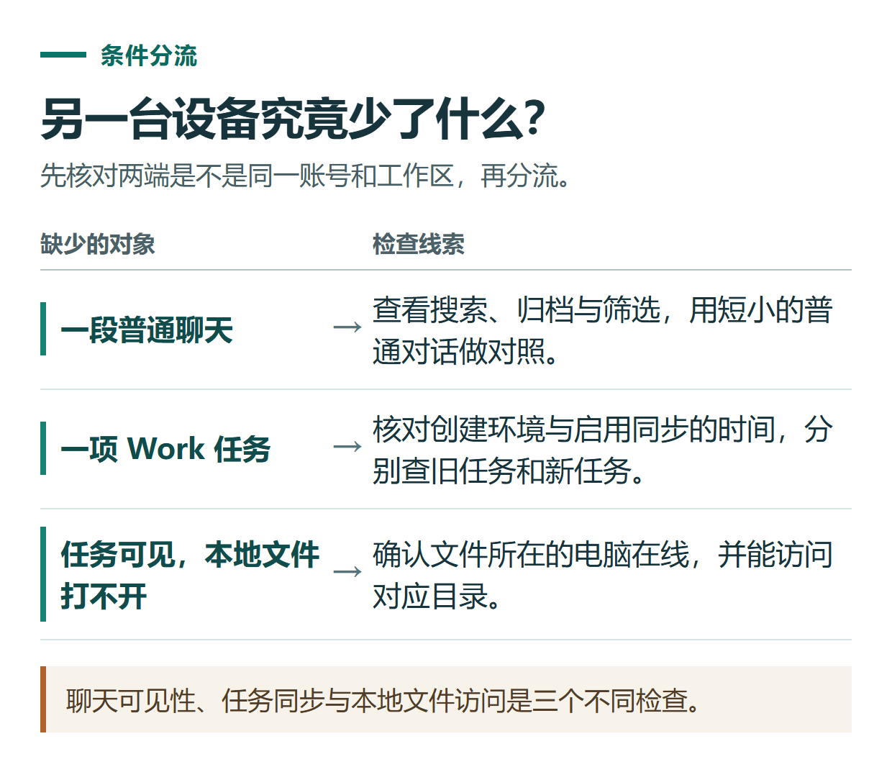

# ChatGPT 手机与电脑不同步怎么办？按账号、聊天类型和本地文件逐项排查

[知识库首页](../README.md) · [登录、隐私与账号](../catalog/topics/accounts.md) · [按问题找答案](../catalog/TASKS.md)

资料核对：2026-11-03。适用环境：官方网页、移动端和桌面端；普通聊天与Work本地任务分别判断。

> **先看结论：** 手机找不到电脑里的内容，先检查两端是不是同一个ChatGPT账号和工作区，再判断缺的是聊天、会员状态还是本地文件。这三个问题不能都靠重装应用解决。

本篇导航

- [一、先记录两端的实际身份](#section-01)
- [二、用一段无隐私聊天做小测试](#section-02)
- [三、Work任务要检查创建环境](#section-03)
- [四、聊天可见但文件不能读，怎么处理](#section-04)
- [五、排查后再考虑重新登录](#section-05)

## 一、先记录两端的实际身份

在仍能正常访问内容的设备上，先查看账号标识、登录方式和工作区。尤其是Apple隐藏邮箱、Google登录和自己输入邮箱，可能对应不同账号。

官方订阅排查也建议先确认拥有订阅的原账号，不把商店收据邮箱当作唯一身份依据。[订阅与账号说明](https://help.openai.com/en/articles/20001056-troubleshooting-chatgpt-subscription-access-and-account-changes)

## 二、用一段无隐私聊天做小测试

在网页新建普通聊天，输入“同步练习：资料整理，8人，40分钟”，记录标题和时间。再到手机用相同账号查找。这个测试不使用临时聊天，也不涉及只存在本机的文件。

若旧聊天缺失，检查搜索、归档和当前筛选；侧栏没有列出全部旧记录，不等于内容已经删除。具体操作见[聊天记录管理](chatgpt-chat-history-sharing.md)。

## 三、Work任务要检查创建环境

官方桌面排查说明，某些Work同步能力取决于工作区设置，并只适用于启用后新建的任务；已有任务不会自动迁移。不能因为现在打开了一个同步开关，就认定所有旧本地任务都应出现在手机里。[Work同步排查](https://learn.chatgpt.com/docs/reference/troubleshooting)

记录任务是在网页、桌面本地还是云端创建的，什么时候创建，所需资料在哪里。找不到时先按这一组信息检查，避免重复新建多份同名任务。

*聊天可见性、任务同步与本地文件访问是三个不同检查。*

## 四、聊天可见但文件不能读，怎么处理

本地文件和工具依赖相关电脑在线与连接状态。符合条件的任务在某些情况下可以继续云端工作，但不能凭空访问离线电脑里的文件。[本地资源与跨设备条件](https://learn.chatgpt.com/docs/get-started-with-work)

可以先把需要审阅的最终成果保存在当前能访问的位置；不要为了查看一份结果就开放整个私人文件目录。原文件被移动或改名时，也要更新实际入口。

## 五、排查后再考虑重新登录

先保存未提交文字，确认原登录方式可用，再尝试更新应用、刷新或重新登录。会员只在一端显示时，不立即重新购买；用原账号核对购买归属。

仍有问题，整理两端平台、版本、账号与工作区、任务类型、出现时间和已试方法，按[支持请求模板](chatgpt-support-ticket-troubleshooting.md)提交。没有同步的证据时，不先把问题解释成账号被封或资料被永久删除。

## 接下来按你的情况继续

- [iPhone与Android](chatgpt-mobile-app.md)：正确安装登录并完成可检查的短任务。
- [Windows桌面端](chatgpt-windows-app.md)：完成安装登录，读取短文本并检查结构化结果。

[返回登录、隐私与账号专题](../catalog/topics/accounts.md) · [完整文章索引](../catalog/ALL_ARTICLES.md)
