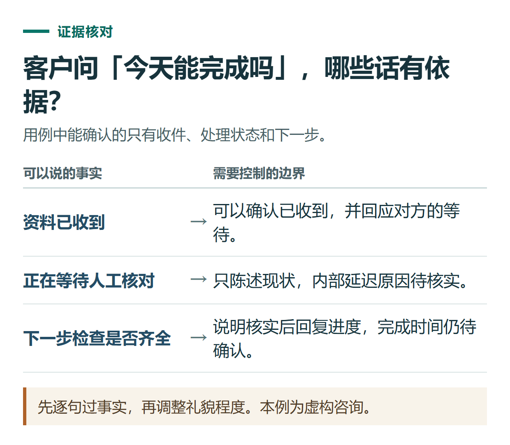

# ChatGPT 写客户回复与工作邮件：先核对事实，再调整语气和下一步

[知识库首页](../README.md) · [办公与内容创作](../catalog/topics/work.md) · [按问题找答案](../catalog/TASKS.md)

资料核对：2026-11-03。适用环境：文字草稿；下文服务条款、订单和人物全部为原创虚构，不代表小小AI实际政策。

> **先看结论：** 客户回复最重要的是把已知事实、未知事项和下一步说清楚。礼貌可以改善表达，但不能让模型擅自承诺退款、交付时间或优惠。

**练习材料：** [打开输入、提示词与检查答案](../resources/practice/chatgpt-email-customer-replies/README.md)。

<details>
<summary>本篇导航</summary>

- [一、同时提供问题与已确认规则](#section-01)
- [二、先生成一版事实准确的回复](#section-02)
- [三、调整语气，但保留条件](#section-03)
- [四、不同情况用不同结构](#section-04)
- [五、发送前由你做最后检查](#section-05)

</details>

<a id="section-01"></a>

## 一、同时提供问题与已确认规则

```text
虚构客户来信：我昨天提交了资料，为什么还没有结果？今天能完成吗？
已确认事实：资料已收到，订单当前等待人工核对。
已确认规则：核对完成后通知客户；没有承诺具体完成时间。
可执行下一步：检查资料是否齐全，核实后回复进度。
限制：不承诺今天完成，不索要密码和验证码，不编造处理原因。
```

不要只把客户的抱怨发给ChatGPT，然后要求“帮我安抚”。缺少真实状态时，流畅的回复可能变成不真实的保证。

<a id="section-02"></a>

## 二、先生成一版事实准确的回复

```text
请写一段自然、简短的中文回复。
说明已经收到资料，目前仍在核对；对等待表达理解。
给出可以执行的下一步，不承诺未知时间。
先给草稿，不发送消息。
```

官方提示指南建议明确材料、成果与必要边界；这里的业务内容必须由实际服务方确认。[官方提示指南](https://learn.chatgpt.com/docs/prompting)

原创参考回复：您好，资料已经收到，目前仍在人工核对中。理解您希望尽快知道结果，我们会先检查资料是否齐全，并在核实后向您反馈进度。当前还无法确认今天能否完成，请以实际通知为准。



*先逐句过事实，再调整礼貌程度。本例为虚构咨询。*

<a id="section-03"></a>

## 三、调整语气，但保留条件

可以继续要求：“更像真人聊天，删掉空泛套话；保留无法确认今天完成这一条件。”若需要正式邮件，再增加主题、称呼和落款，收件人由你核对。

避免把“会检查”润色成“已解决”，把“当前无法确定”润色成“很快完成”。对真实业务而言，这些词改变了事实与承诺范围。

<a id="section-04"></a>

## 四、不同情况用不同结构

| 场景 | 回复重点 |
|---|---|
| 缺少必要资料 | 列出缺哪一项及安全提交方式 |
| 需要继续核对 | 当前状态、已采取动作、后续反馈方式 |
| 已确认处理完成 | 实际完成事项及客户如何验证 |
| 规则中没有答案 | 明确待确认，提交给有权限的人处理 |

“已确认完成”的模板只能在真实状态支持时使用。可以给ChatGPT一份脱敏事实表，让它按不同情况生成草稿，避免把同一句保证套给所有客户。

<a id="section-05"></a>

## 五、发送前由你做最后检查

核对对象、订单状态、附件和措辞，确认没有把别人的信息混进去。连接邮箱或客服工具时，也要明确是写草稿还是发送；这两项行为不应模糊。

涉及中英文回复可结合[翻译与润色](chatgpt-translation-polishing.md)，需要将常见处理步骤标准化，可继续看[SOP编写](chatgpt-sop-process-docs.md)。

## 接下来按你的情况继续

- [翻译与润色](chatgpt-translation-polishing.md)：分两轮做准确翻译与语气调整，再核对日期、条件和范围。
- [写SOP流程](chatgpt-sop-process-docs.md)：把文章配图流程整理为步骤、责任与异常处理。

[返回办公与内容创作专题](../catalog/topics/work.md) · [完整文章索引](../catalog/ALL_ARTICLES.md)
