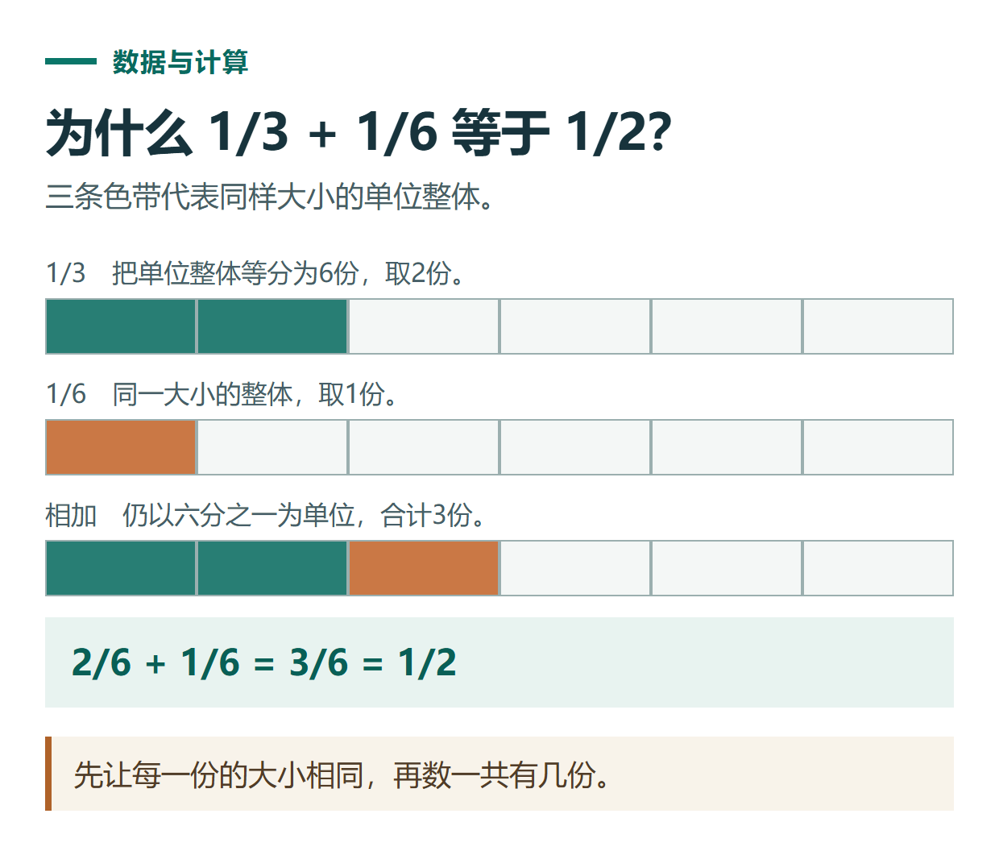

# ChatGPT 错题复盘教程：找出错误步骤，再做一道能验证理解的新题

[知识库首页](../README.md) · [学习、求职与表达](../catalog/topics/learning.md) · [按问题找答案](../catalog/TASKS.md)

资料核对：2026-11-03。适用环境：普通文字对话或Study模式；以下基础数学题为原创练习。

> **先看结论：** 错题复盘不只是拿到正确答案。先保留自己的解题过程，找出最早出现错误的步骤，再做一道结构相似的新题，才知道是理解了还是记住了原题结果。

<details>
<summary>本篇导航</summary>

- [一、把题目、过程和困惑一起给出](#section-01)
- [二、让它先诊断，不急着给全解](#section-02)
- [三、正确答案用于核对，不代替解释](#section-03)
- [四、错题本只保留必要信息](#section-04)
- [五、安排下一次练习](#section-05)

</details>

<a id="section-01"></a>

## 一、把题目、过程和困惑一起给出

下面三道虚构错题用于练习：

| 题目 | 错误答案 | 需要定位的概念 |
|---|---|---|
| 1/3＋1/6 | 2/9 | 分数加法不能直接把分母相加 |
| 3x＋2＝14 | x＝14/5 | 等式变形与合并方式 |
| 长8、宽5的长方形面积 | 26 | 面积与周长混淆 |

真实任务还应附自己的草稿，而不是只写“我不会”。图片模糊时先确认题目识别正确，再开始讲解。

<a id="section-02"></a>

## 二、让它先诊断，不急着给全解

```text
请一次只处理一道错题。
先让我解释为什么这样算，再指出最早出错的一步。
用一个提示帮助我继续，不立即给完整答案。
等我改完后，再判断是否理解了规则。
```

学习模式支持逐步提问与理解检查，但仍可能直接给答案或判断失误，需要你继续调整要求。[官方学习模式说明](https://help.openai.com/en/articles/11780217-using-study-mode-in-chatgpt)

<a id="section-03"></a>

## 三、正确答案用于核对，不代替解释

本例参考结果：1/3＋1/6＝2/6＋1/6＝1/2；3x＋2＝14先减2，再除3，得到x＝4；面积为8×5＝40，26对应的是周长。

能够复述规则后，再要求一题变式：

```text
请按我刚才犯错的概念出一道新题。
换数字，但保持核心规则；先不显示答案。
我回答后，检查过程与结果，不只判断最后数字。
```

可以用1/4＋1/8＝3/8、2x＋3＝11得到x＝4，以及长6宽4面积24作人工参考。真实生成的新题需重新核算，不能套用这组答案。



*本篇练习图。先让每一份的大小相同，再数一共有几份。*

<a id="section-04"></a>

## 四、错题本只保留必要信息

记录题号、错误类型、关键规则、自己能否解释和变式结果。不要把所有聊天内容原样堆进错题本，之后反而难以找到需要复习的点。

| 题号 | 错误类型 | 下次检查动作 |
|---|---|---|
| 1 | 未通分 | 先找公分母，再加分子 |
| 2 | 等式变形错误 | 每一步保持两边同做相应运算 |
| 3 | 概念混淆 | 先确认求面积还是周长，并检查单位 |

<a id="section-05"></a>

## 五、安排下一次练习

下次先做最容易混淆的一题，再解释规则，最后加入一种新情境。若仍出错，检查题干理解、步骤、计算和单位分别在哪一层出现问题。

需要做成卡片可看[学习卡片教程](chatgpt-knowledge-flashcards.md)；需要定时提醒复习可看[计划任务](chatgpt-scheduled-tasks.md)。这套方法是练习设计，不承诺固定时间内提升多少分。

## 接下来按你的情况继续

- [学习模式](chatgpt-study-mode.md)：按当前入口启用学习模式，通过提问和反馈掌握一个概念。
- [知识卡片与复习](chatgpt-knowledge-flashcards.md)：从给定材料生成可追溯的概念卡与情境卡。

[返回学习、求职与表达专题](../catalog/topics/learning.md) · [完整文章索引](../catalog/ALL_ARTICLES.md)
