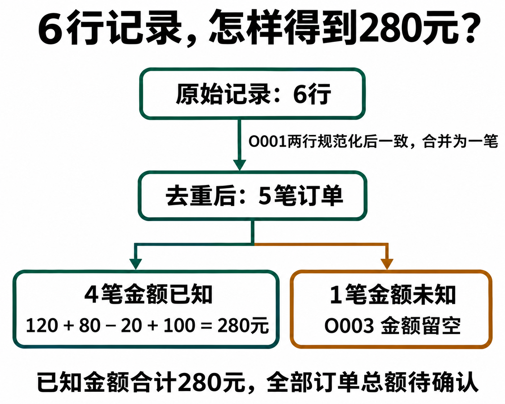

# ChatGPT 清洗 Excel 数据：重复记录、空值、日期和金额怎么处理

[知识库首页](../README.md) · [文件、表格与图表](../catalog/topics/data-files.md) · [按问题找答案](../catalog/TASKS.md)

资料核对：2026-11-03。适用环境：文字表格或可用的数据分析功能；下文为原创虚构订单练习。

> **先看结论：** 清洗数据的第一步是确定规则。重复订单怎么判定、空白金额代表什么、退款是否保留负数，都需要说明。直接要求“把表整理干净”，可能得到看起来整齐却丢失信息的结果。

官方建议表格列名清楚、一行一条记录。上传后先核对读取范围，再做处理。[数据分析说明](https://help.openai.com/en/articles/8437071-data-analysis-with-chatgpt)

**练习材料：** [打开输入、提示词与检查答案](../resources/practice/chatgpt-excel-data-cleaning/README.md)。

<details>
<summary>本篇导航</summary>

- [一、使用这份六行练习](#section-01)
- [二、先让它报告问题](#section-02)
- [三、确认规则后再处理](#section-03)
- [四、为什么不能一律删重复或填零](#section-04)
- [五、下载后再做三项核对](#section-05)

</details>

<a id="section-01"></a>

## 一、使用这份六行练习

可以复制为CSV文本，或粘贴到表格中：

```csv
订单号,日期,渠道,金额,状态
O001,2026/11/01,公众号,120,已支付
O001,2026-11-01,公众号 ,120,已支付
O002,2026-11-02,知乎,80,已支付
O003,,公众号,,待确认
O004,2026-11-03,GitHub,-20,退款
O005,2026-11-03,知乎,¥100,已支付
```

这里故意包含日期格式差异、尾部空格、重复记录、缺失值和货币符号。保留原始数据副本，不直接覆盖唯一文件。

<a id="section-02"></a>

## 二、先让它报告问题

```text
先检查这份表，不删除或改写数据。
列出行数、字段、疑似重复、空值和格式问题。
金额单位统一视为人民币；退款用负数记录。
同一订单号但信息不同的记录，需要单独提示冲突。
```

检查它是否识别出O001的两行属于同一订单的格式差异，而不是两个真实订单。O003缺失日期与金额，不能擅自按相邻行补值。

<a id="section-03"></a>

## 三、确认规则后再处理

```text
按以下规则生成新表：
日期统一YYYY-MM-DD；渠道去掉首尾空格；金额去掉货币符号转数值。
O001两行规范化后一致，仅保留一条，并记录合并关系。
O003保持缺失，不补成0；退款保留负数。
输出清洗结果、改动日志和待确认问题，原表不变。
```

练习完成后应有5条唯一订单。已知金额合计为120＋80－20＋100＝280元，另有1条金额未知。不能把“已知金额合计280”写成“全部订单总金额确定为280”。



*AI 教学流程图，数据取自本篇虚构订单。顺着两个分支核对行数，4 笔已知加 1 笔未知，正好对应去重后的 5 笔。*

<a id="section-04"></a>

## 四、为什么不能一律删重复或填零

真实表格里，同一订单号可能对应多次退款、分批交付或状态记录，未必应该合并。本练习允许合并，是因为材料已经说明两行内容规范化后一致。

空白金额可能表示未录入，0元则表示已经确认没有金额；两者不能随意替换。日期也不能根据上一行推测，否则后续按月统计会受到影响。

<a id="section-05"></a>

## 五、下载后再做三项核对

检查订单号没有被自动变成数字或丢失前导零；金额列能用于计算；缺失值和改动日志仍在。需要工作簿时，明确要求实际文件，并打开检查，不只复制聊天表格。

清洗后可继续做[Excel公式](chatgpt-excel-formulas.md)和[图表分析](chatgpt-charts-dashboard.md)。复杂数据先拿几十行试规则，确认后再处理全量。

## 接下来按你的情况继续

- [Excel公式](chatgpt-excel-formulas.md)：根据字段与条件写公式，并检查新增行是否纳入。
- [预算与费用分析](chatgpt-budget-expense-analysis.md)：核对预算与实际差额，说明新增未批准费用。

[返回文件、表格与图表专题](../catalog/topics/data-files.md) · [完整文章索引](../catalog/ALL_ARTICLES.md)
