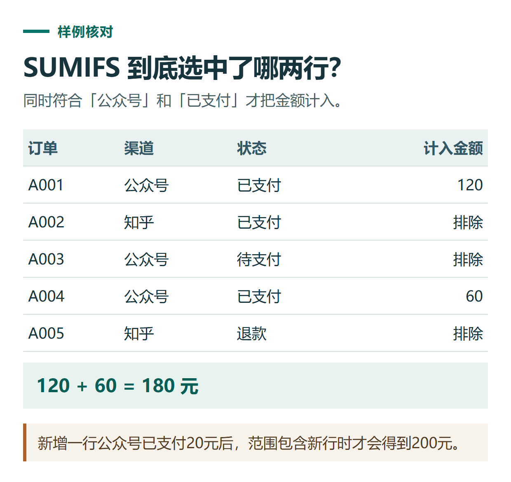

# 用 ChatGPT 写 Excel 公式：说明列位置、计算条件与检查答案

[知识库首页](../README.md) · [文件、表格与图表](../catalog/topics/data-files.md) · [按问题找答案](../catalog/TASKS.md)

资料核对：2026-11-03。适用环境：Excel公式辅助；原创样例不含真实订单，实际兼容性在所用软件验证。

> **先看结论：** 向ChatGPT要公式时，不只描述“帮我求和”，还要给出工作表列位置、有效数据范围和筛选条件。公式返回一个数字，不代表计算口径正确。

**练习材料：** [打开输入、提示词与检查答案](../resources/practice/chatgpt-excel-formulas/README.md)。

<details>
<summary>本篇导航</summary>

- [一、先提供完整小表](#section-01)
- [二、得到公式后逐段解释](#section-02)
- [三、结果不对时提供哪些信息](#section-03)
- [四、检查新增数据是否被包含](#section-04)
- [五、把公式交给同事前保留说明](#section-05)

</details>

<a id="section-01"></a>

## 一、先提供完整小表

在Excel从A1开始放入下表，首行为列名，数据位于第2—6行：

| A订单号 | B渠道 | C金额 | D状态 |
|---|---|---:|---|
| A001 | 公众号 | 120 | 已支付 |
| A002 | 知乎 | 80 | 已支付 |
| A003 | 公众号 | 100 | 待支付 |
| A004 | 公众号 | 60 | 已支付 |
| A005 | 知乎 | 40 | 退款 |

提问时明确：“金额均为数值，状态为文本；只计算公众号渠道的已支付金额，不包括待支付和退款。”

<a id="section-02"></a>

## 二、得到公式后逐段解释

```text
请给出适用于这份表的Excel公式。
求B列为“公众号”且D列为“已支付”的C列金额合计。
数据范围为第2到第6行，请解释各参数，并给出人工核对结果。
不要引用其他工作表或整列中未提供的数据。
```

本练习可用：

```excel
=SUMIFS(C2:C6,B2:B6,"公众号",D2:D6,"已支付")
```

SUMIFS的第一个范围是被求和的数值，后面按“条件范围、条件”成对出现。函数定义可查[Microsoft官方说明](https://support.microsoft.com/en-us/excel/functions/sumifs-function)。

参考结果为120＋60＝180。不是280，也不是包含知乎订单后的260；这两个数反映不同口径。



*本篇练习图。新增一行公众号已支付20元后，范围包含新行时才会得到200元。*

<a id="section-03"></a>

## 三、结果不对时提供哪些信息

给出当前公式、实际结果、预期结果和几行输入。如果公式显示错误，保留错误原文；如果只是显示0，检查渠道尾部空格、金额是否为文本、条件文字是否一致。

```text
这条公式现在得到0，我预期为180。
请先检查可能的数据类型和匹配条件，不直接换一条更复杂公式。
列出我能在原表中逐项验证的步骤。
```

不同地区或软件设置可能使用不同参数分隔符。遇到公式无法识别，按你实际软件的提示调整，并说明版本与语言，不把所有错误都归因于模型算错。

<a id="section-04"></a>

## 四、检查新增数据是否被包含

现在在第7行新增一条“公众号、20、已支付”。原公式只到第6行，因此仍为180；若目标是把新行也算入，需要更新引用范围或使用适合的表格结构。包含新行后应为200。

这个练习能检查公式是否真的随数据需求变化，而不只是第一张截图正确。大表中更要检查末行、隐藏行与新增记录的处理口径。

<a id="section-05"></a>

## 五、把公式交给同事前保留说明

留下用途、适用列、排除条件和一个人工可算的例子。需要ChatGPT直接处理表格，可参考[数据分析](chatgpt-data-analysis.md)；原数据混乱时先做[数据清洗](chatgpt-excel-data-cleaning.md)，不要用越来越复杂的公式掩盖输入问题。

## 接下来按你的情况继续

- [清洗表格数据](chatgpt-excel-data-cleaning.md)：处理重复、日期、空值、金额和退款并保留清洗记录。
- [图表与指标口径](chatgpt-charts-dashboard.md)：先核对指标口径，再制作和检查图表。

[返回文件、表格与图表专题](../catalog/topics/data-files.md) · [完整文章索引](../catalog/ALL_ARTICLES.md)
