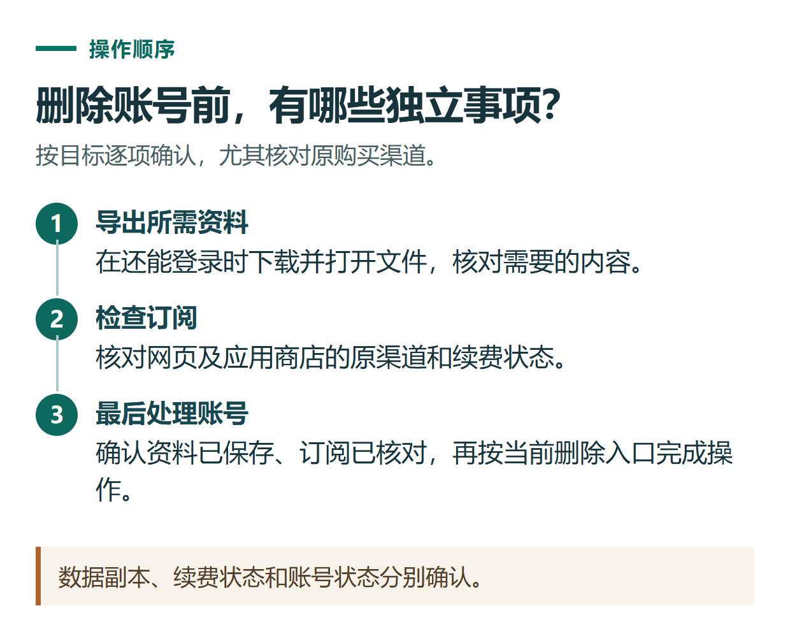

# ChatGPT 数据怎么导出？删除账号前先检查聊天、文件和订阅

[知识库首页](../README.md) · [登录、隐私与账号](../catalog/topics/accounts.md) · [按问题找答案](../catalog/TASKS.md)

资料核对：2026-11-03。适用范围：个人账号的数据导出与删除；本文介绍操作，不替读者执行删除。

> **先看结论：** 想保存聊天资料，先申请导出并实际打开检查；想停止付费，去取消订阅；只有明确不再使用该账号时，才考虑删除账号。导出文件不是恢复已删除聊天的工具，账号删除也不等于单纯清空侧栏。

本篇导航

- [一、先判断需要哪一种操作](#section-01)
- [二、个人账号怎样申请导出](#section-02)
- [三、下载完成，检查这四项](#section-03)
- [四、删除账号前，把订阅单独处理](#section-04)
- [五、确实需要删除时，怎样操作](#section-05)

## 一、先判断需要哪一种操作

| 目标 | 更直接的做法 |
|---|---|
| 保存一篇已完成文章 | 下载或复制最终成稿，附上版本日期 |
| 保存账号中可导出的资料 | 申请账号数据导出 |
| 不再看到某段聊天 | 选择归档或删除该聊天 |
| 停止下期收费 | 按原购买渠道取消续费 |
| 彻底停止使用这个账号 | 先完成资料与订阅检查，再删除账号 |

组织工作区的自助导出与删除权限不同。Business、Enterprise等用户应先联系组织管理员，不把个人账号路径直接当作组织数据管理规则。[官方数据导出说明](https://help.openai.com/en/articles/7260999-exporting-your-chatgpt-history-and-data)

## 二、个人账号怎样申请导出

网页版登录原账号，从个人菜单进入“设置 → Data controls → Export data”，确认导出请求。手机端可从数据控制里的导出入口操作；若应用要求转到网页，在同一账号完成即可。

提交前确认邮箱或账号关联的接收方式仍可使用。等待通知后，用申请导出的同一账号打开下载入口，保存ZIP文件。

当前官方说明导出处理可能需要至多7天，下载链接在收到后24小时失效。未完成前先等待已有请求，不反复发起；链接过期则按官方流程重新申请。

## 三、下载完成，检查这四项

**压缩包能否打开。** 不要只看到文件出现在下载目录就认为备份成功。

**能否找到需要的对话。** 选择一段已知标题和日期的聊天，核对正文是否存在。导出内容与结构以实际文件为准，不预设每次都具有完全相同的目录。

**重要原文件有没有单独保存。** 需要长期留存的附件、生成文档、图片，建议从原文件入口下载并逐个打开，不只依赖聊天导出中出现过它们的名字。

**存放位置是否合适。** 导出可能包含敏感资料，不应把整个ZIP直接上传到公开GitHub仓库。为了反馈问题，只提供与问题相关且脱敏的最小片段。

## 四、删除账号前，把订阅单独处理

先查网页、Apple、Google Play及其他相关订单，确认哪些仍有续费。官方说明，删除账号不会取消Apple订阅；应先在原渠道处理不再需要的移动订阅。[官方账号删除说明](https://help.openai.com/en/articles/6378407-deleting-your-chatgpt-account)

此外，删除会影响该账号访问OpenAI服务，包括ChatGPT和API。如果你还使用API、关联组织或其他服务，应先检查实际影响，不能只考虑当前一个聊天窗口。

只为停止付费的读者，直接看[取消续费教程](chatgpt-cancel-refund.md)，不需要为此删除账号。

*数据副本、续费状态和账号状态分别确认。*

## 五、确实需要删除时，怎样操作

个人账号网页版当前路径为“设置 → Account → Delete account”。按页面核验身份、阅读最终确认，再决定是否执行永久删除。无法登录时，可以通过[OpenAI隐私门户](https://privacy.openai.com/)提交相应请求。

删除不可逆。账号以后是否可以重新注册，与旧账号能否恢复是不同问题；重新注册不能当作恢复原资料的方法。保留确认信息，操作结果以正式确认状态为准，不把完成一次登录验证误认为已经删除成功。

文件、分享链接和记忆的管理也有各自入口，整理资料时可分别参考[文件管理](chatgpt-library-space-files.md)、[聊天与分享](chatgpt-chat-history-sharing.md)及[隐私设置](chatgpt-privacy-temporary-chat.md)。

## 接下来按你的情况继续

- [取消续费与退款](chatgpt-cancel-refund.md)：知道停止未来扣费和申请退款的不同路径。
- [Library与Space文件管理](chatgpt-library-space-files.md)：找到已保存资料，区分Library、Space、项目及文件副本。

[返回登录、隐私与账号专题](../catalog/topics/accounts.md) · [完整文章索引](../catalog/ALL_ARTICLES.md)
