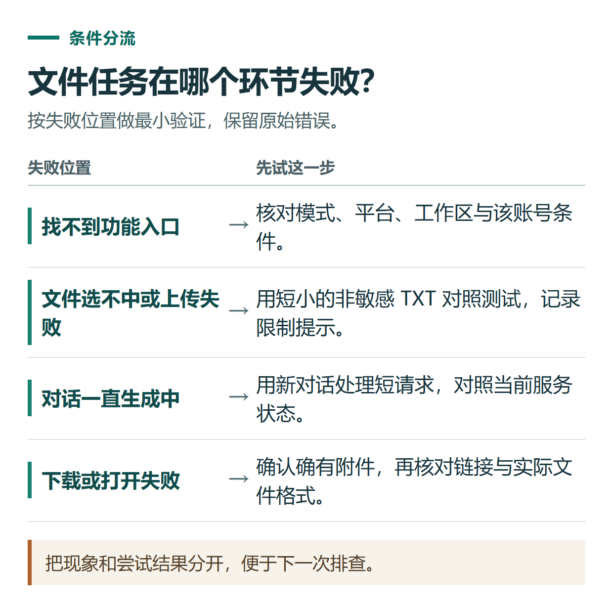

# ChatGPT 找不到功能、上传失败或文件下载不了？先按问题类型排查

[知识库首页](../README.md) · [文件、表格与图表](../catalog/topics/data-files.md) · [按问题找答案](../catalog/TASKS.md)

资料核对：2026-11-03。适用环境：网页版与官方客户端；付款问题另见[订阅排查](chatgpt-payment-troubleshooting.md)。

> **先看结论：** “ChatGPT不能用了”可能是页面卡住、附件被拒、额度到顶、生成文件失效，或者只是进入了不支持该功能的对话。先确定失败发生在哪一步，处理速度通常比反复刷新更快。

<details>
<summary>本篇导航</summary>

- [一、先给问题定位](#section-01)
- [二、找不到功能，不一定是套餐没生效](#section-02)
- [三、上传失败，先把文件问题与额度问题分开](#section-03)
- [四、生成卡住，做一次干净对照](#section-04)
- [五、下载失败，先确认是否有真正的文件](#section-05)

</details>

<a id="section-01"></a>

## 一、先给问题定位

| 现象 | 最先核对的内容 | 可做的最小验证 |
|---|---|---|
| 看不到入口 | 模式、平台、版本、工作区 | 普通新对话中查看同一功能 |
| 文件选不中或传不上 | 格式、文件本身、限制提示 | 上传一个很短的TXT |
| 一直生成中 | 服务状态、对话长度、浏览器 | 新对话发送一个短问题 |
| 下载链接打不开 | 文件是否真的生成、链接状态 | 请求重新提供可下载文件 |
| 文件可下载但不能打开 | 实际格式与生成完整性 | 用对应软件检查并反馈错误 |

先保留原提示和已输入内容。需要清除站点数据或退出账号前，确认自己知道原登录方式。



*把现象和尝试结果分开，便于下一次排查。*

<a id="section-02"></a>

## 二、找不到功能，不一定是套餐没生效

先查看教程适用的是普通Chat、Work、项目还是某个客户端。例如，学习模式的入口条件与项目对话不同；桌面专用插件也不能因为在网页目录中看见就直接使用。

按“账号与工作区 → 使用模式 → 应用版本 → 官方功能条件”检查。若只有一篇旧教程说某按钮必然存在，先核对其发布日期。需要的功能有单独开放条件时，会员状态正常也可能暂时没有入口。

<a id="section-03"></a>

## 三、上传失败，先把文件问题与额度问题分开

新建一个TXT，只写“上传检查：三项材料已经准备好”，尝试上传。若小文件成功，重点查看原文件是否损坏、格式是否支持、内容是否过大或复杂。

若小文件也失败，阅读错误提示是否明确指出上传频率或存储空间。官方[文件上传说明](https://help.openai.com/en/articles/8555545-uploading-files-and-audio-to-chatgpt)区分上传限制与保存文件的存储管理；失败尝试有时也可能计入上传次数，连续重试并不总有帮助。

删除资料库文件，不一定立即解决按时间计算的上传频率限制；重装应用也不能作为重置账号额度的方法。

<a id="section-04"></a>

## 四、生成卡住，做一次干净对照

查看[官方服务状态](https://status.openai.com/)，保存任务要求，再用新对话做短测试。网页端可用无扩展的浏览窗口检查；如果只有原来很长的对话异常，将任务要点整理后转入新对话。

每次只改变一个主要条件，记下结果。例如：原浏览器失败、新窗口成功，就优先检查原窗口的扩展和站点数据。不要一次换账号、清缓存、重装再改网络，最后仍不知道原因。

上述方向参考[官方错误消息排查](https://help.openai.com/en/articles/7996703-troubleshooting-chatgpt-error-messages)，并不表示每次卡住都是同一种原因。

<a id="section-05"></a>

## 五、下载失败，先确认是否有真正的文件

聊天中写着“文件已完成”，但只有正文或文件名，不等于已经提供附件。可以继续发送：

```text
我需要可以下载的实际文件，而不是文件内容的文字描述。
请确认当前是否已经生成该文件，并提供可用附件或下载入口。
如果原文件已不可用，请说明，依据当前确认内容重新生成。
不要只重复原来的失效链接。
```

临时生成链接可能失效。保存在Library或Space中的文件应从相应入口寻找；不同存放位置的规则不能混为一谈。重要结果下载后用本地软件打开检查，详见[文件成果验收](chatgpt-word-ppt-files.md)。

仍失败时，向支持提交发生时间与时区、平台版本、准确报错、已尝试操作和脱敏截图。原始日志可能含个人信息，应仅按支持要求通过对应渠道提供。

## 接下来按你的情况继续

- [Library与Space文件管理](chatgpt-library-space-files.md)：找到已保存资料，区分Library、Space、项目及文件副本。
- [联系官方支持](chatgpt-support-ticket-troubleshooting.md)：整理时间、环境、步骤和证据并选择正确渠道。

[返回文件、表格与图表专题](../catalog/topics/data-files.md) · [完整文章索引](../catalog/ALL_ARTICLES.md)
