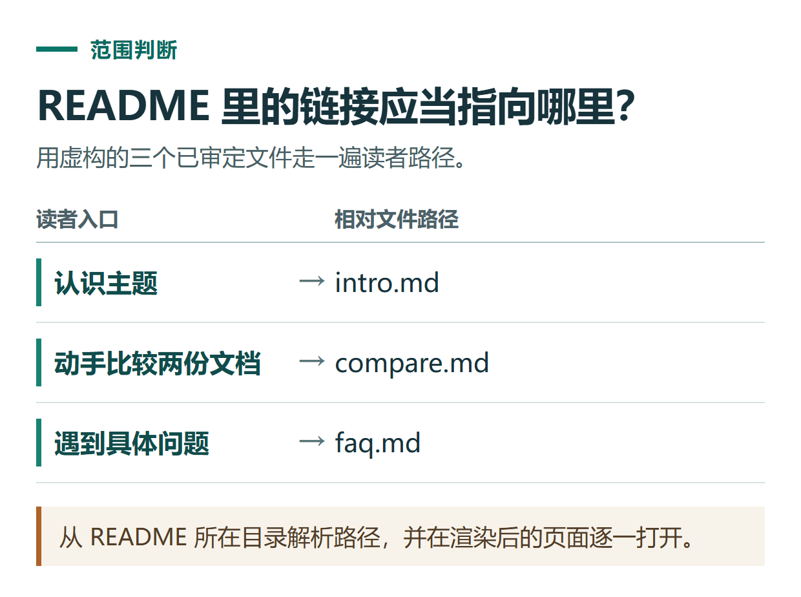

# ChatGPT 编写 GitHub README：说明用途、组织教程与检查链接

[知识库首页](../README.md) · [办公与内容创作](../catalog/topics/work.md) · [按问题找答案](../catalog/TASKS.md)

资料核对：2026-11-03。适用环境：Markdown文档辅助；示例为虚构小知识库，不代表本仓库文章已全部发布。

> **先看结论：** README通常是读者进入仓库首先看到的说明。它应该让人知道这里解决什么问题、如何开始、哪些内容可以直接阅读，而不是把内部排期和审核表全部放在首页。

GitHub官方说明README常用于介绍用途、开始方式、帮助入口和维护者；也支持相对链接与图片路径。[README官方说明](https://docs.github.com/en/repositories/managing-your-repositorys-settings-and-features/customizing-your-repository/about-readmes)

<details>
<summary>本篇导航</summary>

- [一、先列实际存在的内容](#section-01)
- [二、要求一个简洁可读的首页](#section-02)
- [三、相对链接如何理解](#section-03)
- [四、让第一次来的读者试读](#section-04)
- [五、业务入口怎样放才自然](#section-05)

</details>

<a id="section-01"></a>

## 一、先列实际存在的内容

给ChatGPT一份准确的文件清单，说明哪些已经可以公开：

```text
虚构示例：仓库有intro.md、compare.md、faq.md三篇审定教程。
另有内部审阅表和未补图草稿，不进入公开README。
目标读者：希望学会用AI整理资料的中文新手。
维护者：示例维护者，不添加虚构资历和用户量。
```

如果只有目录没有正文，应直接标明尚未上线，不让模型替你生成看起来完整的失效链接。

<a id="section-02"></a>

## 二、要求一个简洁可读的首页

```text
请用中文写README，包含名称、能解决什么、建议阅读顺序、教程导航和反馈方式。
只链接明确存在且可公开的三篇文章。
不放内部交付标准、审稿状态表、推广排期或未确认成绩。
使用自然准确的标题，不承诺覆盖未来所有功能。
```

先审阅文字，再检查链接。标题可以长期稳定，“持续更新”的说明应对应真实维护行动，而不是只按日历修改年份。

<a id="section-03"></a>

## 三、相对链接如何理解

假设README在仓库根目录，文章在docs目录，可以使用指向docs内文件的相对链接；若文章内引用同目录文件，则从文章所在位置计算路径。

让ChatGPT检查时，提供真实目录结构，而不是只给截图中的几个文件名。移动文章后，旧链接可能失效；改标题通常不要求同时改文件名。

图片同样需要真实文件和正确路径。截图尚未补齐时，先在内部稿保留占位；公开稿不能长期展示破图或“编辑待截图”的制作说明。



*从 README 所在目录解析路径，并在渲染后的页面逐一打开。*

<a id="section-04"></a>

## 四、让第一次来的读者试读

从首页点击建议阅读顺序，确认每一步都能打开。检查“下一篇”是否真的帮助继续任务，而不是把读者绕回同一页。长文章使用清楚的标题层级，让GitHub自动生成的导航更容易使用。

<a id="section-05"></a>

## 五、业务入口怎样放才自然

首页可以如实介绍维护者和相关网站，文章中则按读者问题提供对应入口。教程本身应可独立使用，不把关键步骤全部藏到购买页面之后。

没有确认的许可证、赞助关系和官方合作身份，不要让模型自动补上。多平台内容如何从同一份材料改编，可看[内容计划](chatgpt-content-calendar.md)；正文的搜索意图组织可看[SEO文章规划](chatgpt-seo-article-brief.md)。

## 接下来按你的情况继续

- [六平台内容排期](chatgpt-content-calendar.md)：将一个完整主题改编成六个平台的具体交付。
- [Sites资源网站](chatgpt-sites-website-workflow.md)：准备资源资料，预览页面并检查检索交互。

[返回办公与内容创作专题](../catalog/topics/work.md) · [完整文章索引](../catalog/ALL_ARTICLES.md)
