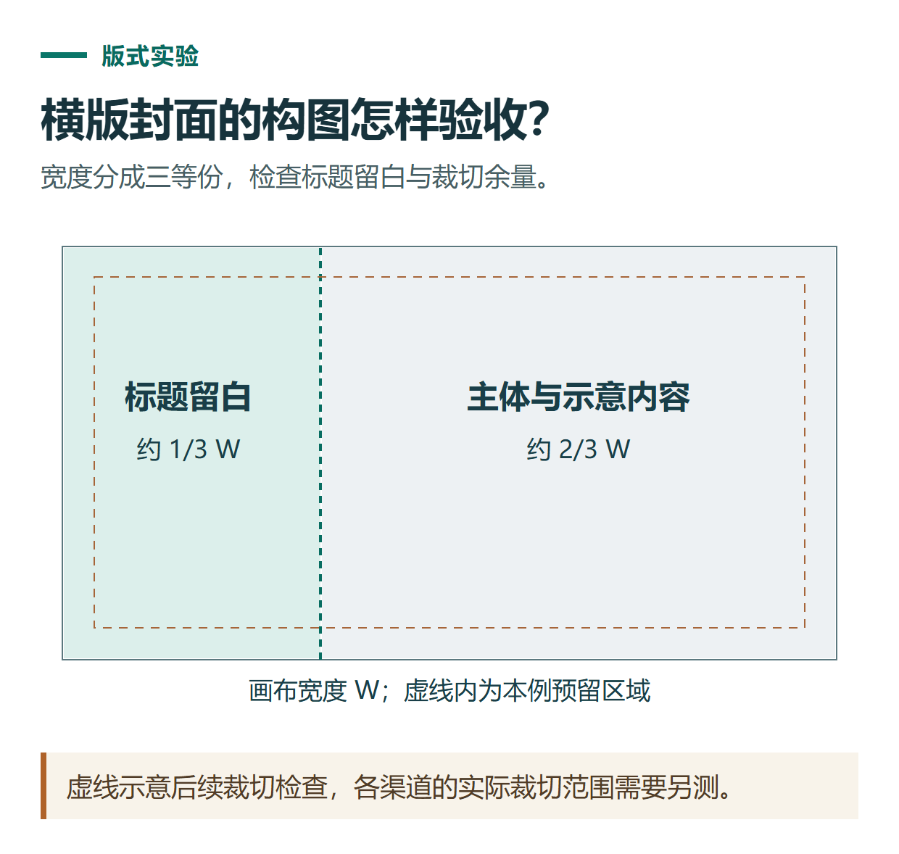

# ChatGPT 生成图片与改图教程：从公众号封面到保留主体的局部修改

[知识库首页](../README.md) · [图片理解与创作](../catalog/topics/images.md) · [按问题找答案](../catalog/TASKS.md)

资料核对：2026-11-03。适用环境：具有图像生成功能的ChatGPT账号；以下为原创提示词，结果须实际生成后检查。

> **先看结论：** 用ChatGPT生成图片，先说清楚图片放在哪里、主体是什么、画面怎样安排。改图时则补充两件事：什么要变，什么必须保留。这样更容易判断结果是否达到了用途。

官方[图片生成说明](https://learn.chatgpt.com/docs/image-generation)支持通过自然语言描述生成图片，也可以附上参考图进行修改。具体可用性和用量取决于账号与工作区条件。

<details>
<summary>本篇导航</summary>

- [一、先做一张没有文字的教程配图](#section-01)
- [二、先验收构图，再修改细节](#section-02)
- [三、修改自己的照片时怎样描述](#section-03)
- [四、下载以后，还要做一次发布检查](#section-04)
- [常见问题](#section-05)

</details>

<a id="section-01"></a>

## 一、先做一张没有文字的教程配图

假设要为“用AI整理工作记录”的公众号文章制作配图，可以先把需求写成简短的图像任务书：

| 项目 | 本次练习要求 |
|---|---|
| 用途 | 文章头图，需适应后续裁切 |
| 主体 | 书桌、笔记本电脑、纸质便签 |
| 风格 | 干净自然的编辑插画 |
| 重点 | 从杂乱记录到清楚列表的视觉对比 |
| 保留空间 | 左侧留空，后续人工排标题 |
| 不需要 | 品牌标志、模拟软件截图、未经核实的产品界面 |

随后发送：

```text
生成一张横向文章配图，主题是“把零散工作记录整理成清楚的周报”。
画面右侧是一张自然光下的书桌，有笔记本电脑和少量便签，
用简洁图形表现整理后的有序列表；左侧留出约三分之一干净留白。
风格为克制的编辑插画，以浅蓝、米白和少量深灰为主。
不要写文字，不出现品牌标志，不模仿真实ChatGPT操作界面。
主体不要紧贴四边，方便之后裁切。
```

这里先不让模型写标题，是为了把视觉创作和文字排版分开检查。不是所有配图都必须这样做，但需要准确标题时，这种方式更便于控制。



*本篇练习图。虚线示意后续裁切检查，各渠道的实际裁切范围需要另测。*

<a id="section-02"></a>

## 二、先验收构图，再修改细节

检查四件事：主体是否清楚、留白是否真的可用、边缘能否裁切、有无多余文字或标志。不要只说“更好看一点”，把不符合用途的地方具体指出来。

例如，主体太拥挤时，可以继续发送：

```text
以刚才生成的图片为基础修改。
保留笔记本电脑的位置、整体配色和插画风格。
减少桌面上约一半的便签，把左侧留白扩大一些。
不要新增人物，不要添加文字，其余构图尽量保持。
```

改完后并排检查修改前后。如果要求只减少便签，电脑形状却被明显改变，继续点出这个变化。局部修改也可能影响其他区域，需要人工验收。

<a id="section-03"></a>

## 三、修改自己的照片时怎样描述

上传一张自己有权使用的图片，先指出用途，再说明保留和修改范围：

```text
请编辑我上传的产品照片，用于文章中的示意配图。
保留产品轮廓、颜色与可见标识，不改变实际结构。
只把杂乱背景改成干净的浅灰背景，保留自然阴影。
不要添加未实际存在的配件、认证标识或效果文字。
如果某个细节无法可靠保留，请指出需要我人工复核的位置。
```

如果图片用于展示实物细节，不能只看整体相似，要放大检查边缘、标识与配件。生成式编辑可能改变细节，真实商品信息最终应以实物和原图核对。

<a id="section-04"></a>

## 四、下载以后，还要做一次发布检查

打开下载后的实际图片，检查尺寸、清晰度、裁切效果和文字。聊天窗口里看着正常，不代表上传到公众号或网站后的显示也正常。

如果平台的封面规格有变化，按当时后台要求裁切，不把某个长期不变的比例写成全部平台通用规则。需要透明背景时，在生成或编辑要求中明确说明，并检查文件是否真正保留透明区域。

<a id="section-05"></a>

## 常见问题

**让它生成图片，却只得到文字描述：** 明确说“请直接生成图片”，检查当前账号是否提供图像生成能力和额度；提示词本身不能创造不存在的功能权限。

**中文标题有错字：** 将标题单独核对，必要时保留无字底图，用排版工具添加准确文字。

**能不能生成教程里的操作截图：** 操作教程应使用真实界面截图。AI插画可以解释概念，但不能充当功能已经存在或操作已经成功的证据。

配图准备好后，可结合[公众号与短视频内容制作](chatgpt-content-workflow.md)安排图片位置和镜头内容。

## 接下来按你的情况继续

- [参考图与系列图片](chatgpt-image-reference-series.md)：用固定视觉规范与参考图生成并检查系列画面。
- [中文海报与排版](chatgpt-image-poster-text-layout.md)：先确认准确文案，再检查文字与裁切效果。

[返回图片理解与创作专题](../catalog/topics/images.md) · [完整文章索引](../catalog/ALL_ARTICLES.md)
