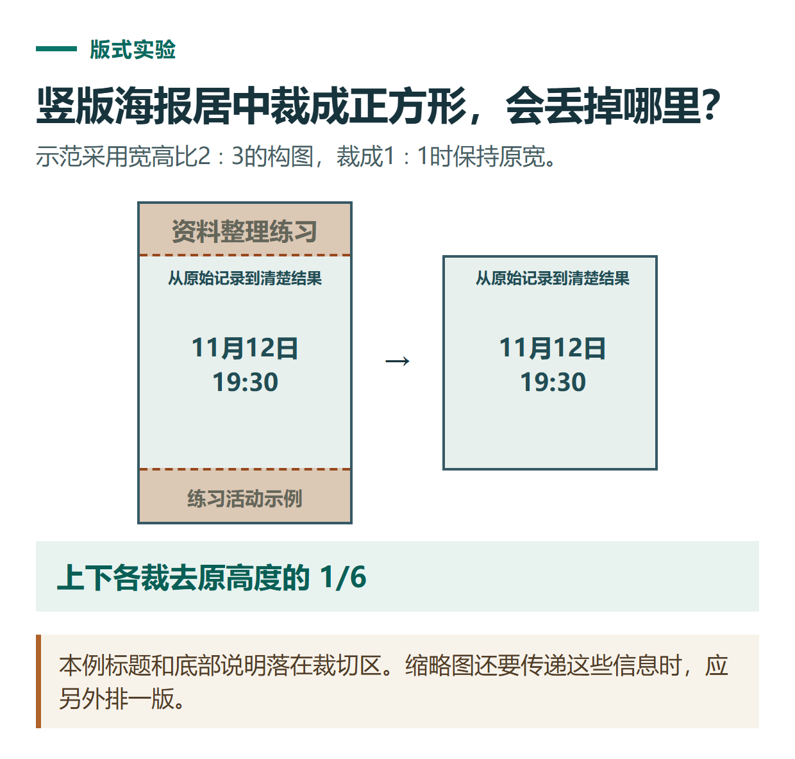

# ChatGPT 制作中文海报：控制文字、留白、裁切与最终校对

[知识库首页](../README.md) · [图片理解与创作](../catalog/topics/images.md) · [按问题找答案](../catalog/TASKS.md)

资料核对：2026-11-03。适用环境：可用的图片生成工具；海报文案为原创虚构活动，不是实际公告。

> **先看结论：** 中文海报最常见的问题是文字出错、重要信息太小或裁切后丢失。先确认文案，再决定让模型直接生成文字，还是生成背景后用设计工具排字。

<details>
<summary>本篇导航</summary>

- [一、准备一份唯一有效文案](#section-01)
- [二、选择合适的文字方案](#section-02)
- [三、按阅读顺序检查](#section-03)
- [四、每次只修改明确的问题](#section-04)
- [五、下载后再做最终验收](#section-05)

</details>

<a id="section-01"></a>

## 一、准备一份唯一有效文案

```text
主标题：资料整理练习
副标题：从原始记录到清楚结果
日期：11月12日
时间：19:30
说明：练习活动示例
不添加：价格、二维码、报名链接、主办方名称
```

生成前自己核对日期与时间。模型不能替你判断这是不是实际获批活动，本例必须保留“练习活动示例”。

<a id="section-02"></a>

## 二、选择合适的文字方案

字数少、需要快速看整体效果时，可以要求直接生成指定文字；文字较多、需要精确字体或反复修改时，可以先要无字背景，再人工排字。官方图像指南也建议对密集文案和重要排版逐字检查，必要时用设计工具完成。[图像与文字排版指南](https://learn.chatgpt.com/docs/image-generation)

```text
制作竖版中文练习海报，浅色背景、蓝灰配色。
只使用我给出的五行文字，逐字准确，不增加任何词。
标题最大，日期和时间次之，说明放底部且可读。
四周留足空间，避免重要文字贴边；不生成二维码或标志。
```

<a id="section-03"></a>

## 三、按阅读顺序检查

先看标题是否一眼能辨认，再看日期时间，最后检查副标题与说明。逐字对照原文，不只看整体像不像中文；相似字、漏字和额外标点都可能影响意思。

放大检查字符，缩小到手机实际显示大小检查可读性。大图里清楚的小字，缩到消息列表后可能无法阅读。



*本篇练习图。本例标题和底部说明落在裁切区。缩略图还要传递这些信息时，应另外排一版。*

<a id="section-04"></a>

## 四、每次只修改明确的问题

```text
只修改日期和时间区域。
日期必须为“11月12日”，时间必须为“19:30”。
保持主标题、插画和配色不变，增加这两行的可读性。
不要新增报名信息。
```

重新生成后仍要检查整张图，因为局部请求不保证其他位置绝对不变。若关键文字反复出错，改用无字背景，在设计工具里输入审定文字。

<a id="section-05"></a>

## 五、下载后再做最终验收

检查实际尺寸、文字清晰度、边缘留白和颜色。若平台会裁切，先预览标题与时间是否仍在可见范围；不要默认所有平台都使用同一比例。

保留无字背景、审定文字和最终导出文件，便于下次改日期时避免重做全部。需要一套风格统一的配图，可以继续看[多参考图与系列图片](chatgpt-image-reference-series.md)。

## 接下来按你的情况继续

- [参考图与系列图片](chatgpt-image-reference-series.md)：用固定视觉规范与参考图生成并检查系列画面。
- [公众号与视频改编](chatgpt-content-workflow.md)：得到可核对的文章片段、镜头表和发布检查方法。

[返回图片理解与创作专题](../catalog/topics/images.md) · [完整文章索引](../catalog/ALL_ARTICLES.md)
