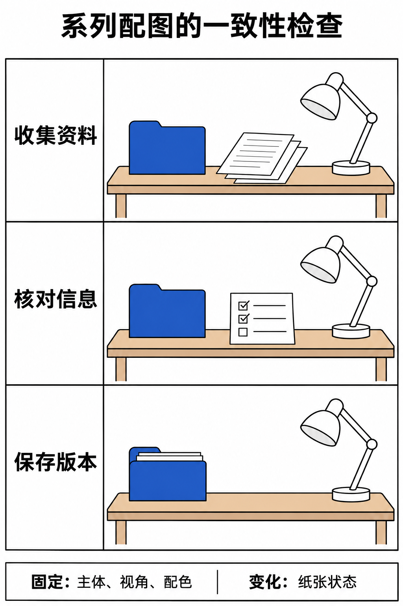

# ChatGPT 多参考图与系列配图：固定主体、统一风格并检查每张差异

[知识库首页](../README.md) · [图片理解与创作](../catalog/topics/images.md) · [按问题找答案](../catalog/TASKS.md)

资料核对：2026-11-03。适用环境：当前账号具备图像生成与编辑能力；本篇附一张三栏教学图，供核对固定主体与变化项。

> **先看结论：** 要做一套系列图片，先确定哪些元素固定、哪些允许变化。只在每次请求中重复“风格一致”，很难检查结果是否真的符合要求。

<details>
<summary>本篇导航</summary>

- [一、先准备一份视觉规格](#section-01)
- [二、说明每张参考图的用途](#section-02)
- [三、逐张生成并指出变化](#section-03)
- [四、做一张一致性核对表](#section-04)
- [五、保存审定版与使用说明](#section-05)

</details>

<a id="section-01"></a>

## 一、先准备一份视觉规格

原创示例是一套“资料整理三步走”配图：

```text
用途：中文教程中的三张插画，不含文字。
固定主体：一张木桌、一个蓝色文件夹、一盏白色台灯。
固定风格：简洁平面插画，浅米色背景，蓝灰配色。
三张场景：收集资料、核对信息、保存版本。
避免：额外品牌标志、随机文字、不同数量的文件夹。
```

这些要求只定义目标，不能保证生成结果完全一致。先做一张作为审定参考，再扩展系列，比同时要求十张更容易发现漂移。

<a id="section-02"></a>

## 二、说明每张参考图的用途

如果有自己拍摄或有权使用的图片，明确区分：图1用于主体与布局，图2用于配色和线条。不能只上传几张图，然后让它猜哪些元素必须保留。

官方图像指南建议在多参考图任务中说明图片顺序和各自作用，并明确修改与保留范围。[图像生成指南](https://learn.chatgpt.com/docs/image-generation)

<a id="section-03"></a>

## 三、逐张生成并指出变化

第一张确认后，可以这样继续：

```text
以刚确认的图片为参考，制作第二张“核对信息”场景。
保留木桌、蓝色文件夹、白色台灯、配色和画面比例。
只增加一张放在桌面上的检查表，用图形线条表示内容，不写文字。
不要改变文件夹形状或让台灯消失。
```

第三张再改为保存版本场景。每次只改变必要元素，发现固定主体变形时先修正，不要带着错误继续扩展整套。

<a id="section-04"></a>

## 四、做一张一致性核对表

| 检查项 | 三张都要看什么 |
|---|---|
| 主体 | 文件夹颜色、形状和数量是否一致 |
| 画面 | 比例、留白、视觉中心是否接近 |
| 风格 | 线条、阴影和色调是否连续 |
| 内容 | 三个场景是否能够区分 |
| 杂项 | 是否出现错字、标志或无关物件 |

如果图片里主体一致但场景几乎没有变化，系列仍没有完成表达任务。相反，场景清楚但风格大幅变化，也需要调整。



*AI 教学图解。对照三栏中的桌面、文件夹与台灯，再检查散页、核对表和收纳状态。这是一张教学对照图。*

<a id="section-05"></a>

## 五、保存审定版与使用说明

按主题和序号命名，保留哪张图作为参考、哪些变化已经确认。下载后检查尺寸和显示效果，发布时需要文字说明的，再单独排版。

如果目标是准确呈现产品界面，应使用实际截图，不能用生成图替代。基础改图操作见[图片生成与编辑](chatgpt-image-generation.md)；含中文字的海报另看[海报排版练习](chatgpt-image-poster-text-layout.md)。

## 接下来按你的情况继续

- [图片生成与修改](chatgpt-image-generation.md)：完成一张配图和一次可对照的修改。
- [中文海报与排版](chatgpt-image-poster-text-layout.md)：先确认准确文案，再检查文字与裁切效果。

[返回图片理解与创作专题](../catalog/topics/images.md) · [完整文章索引](../catalog/ALL_ARTICLES.md)
