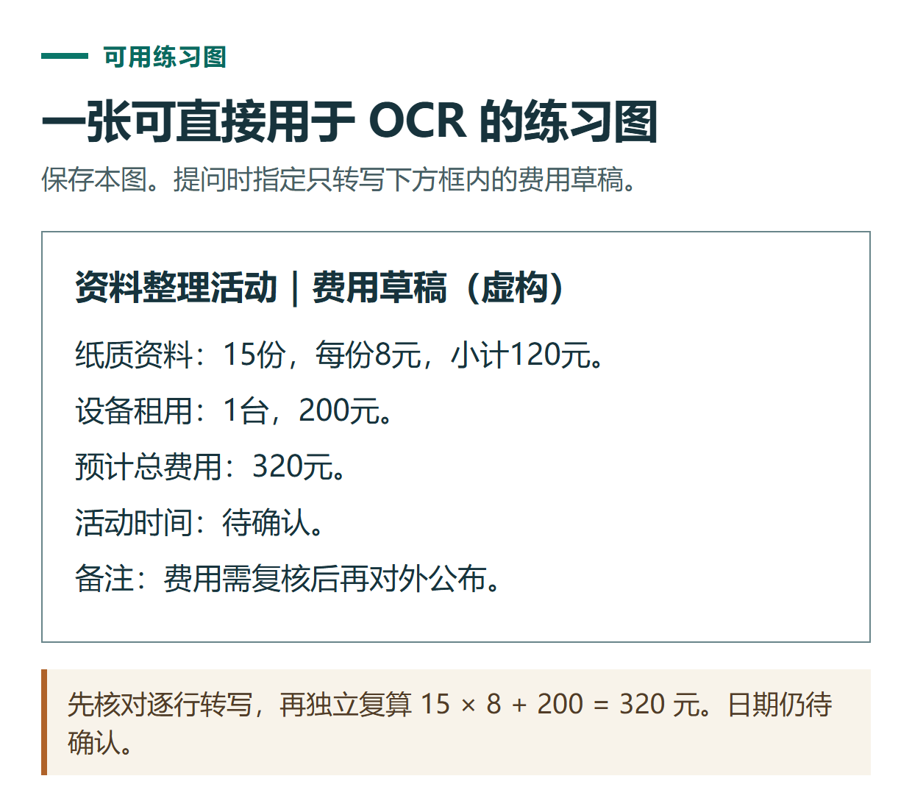

# ChatGPT 怎么看截图和识别图片文字？OCR、图表与白板整理练习

[知识库首页](../README.md) · [图片理解与创作](../catalog/topics/images.md) · [按问题找答案](../catalog/TASKS.md)

资料核对：2026-11-03。适用环境：可上传图片的ChatGPT账号；本文练习材料为原创虚构。

> **先看结论：** 给ChatGPT上传图片后，先说明你希望它读文字、解释图表，还是识别某个界面问题。只发送一张图并问“看看”，容易得到泛泛描述，也不方便核查它有没有看错数字。

<details>
<summary>本篇导航</summary>

- [一、先处理图片，再处理问题](#section-01)
- [二、制作一张能检查对错的练习图](#section-02)
- [三、识别核对后再整理成表格](#section-03)
- [四、截图排错与图表解读怎么提问](#section-04)
- [五、识别不准确时怎么补救](#section-05)

</details>

<a id="section-01"></a>

## 一、先处理图片，再处理问题

上传前检查文字是否清晰、页面是否转正、边缘是否被裁掉。需要它重点看某个区域，可以先做箭头或圈注，但保留影响理解的上下文。

官方[图片输入说明](https://help.openai.com/en/articles/8400551-chatgpt-image-inputs-faq)支持从输入区添加图片，也提示模糊文字、旋转、精确计数及部分图表可能出现理解误差。图片识别结果应当可对照，不能只看它回答得是否自信。

<a id="section-02"></a>

## 二、制作一张能检查对错的练习图

把下列虚构文字粘贴到文档里，放大到容易阅读，再用系统截图工具截取。它是文字识别练习，不是伪造产品界面。

```text
资料整理活动｜费用草稿（虚构）
纸质资料：15份，每份8元，小计120元。
设备租用：1台，200元。
预计总费用：320元。
活动时间：待确认。
备注：费用需复核后再对外公布。
```

上传截图后，第一轮只做OCR，也就是从图片中识别文字：

```text
请按图片中的行顺序转写文字，暂时不要总结或计算。
保留数字、单位、标点和“待确认”等状态。
不清楚的字写“[无法确认]”，不要靠上下文猜成确定答案。
```

对照图片检查15、8、120、200、320及“费用需复核”。如果漏掉最后一句，不能直接把输出当作已确认预算。



*本篇练习图。先核对逐行转写，再独立复算 15 × 8 + 200 = 320 元。日期仍待确认。*

<a id="section-03"></a>

## 三、识别核对后再整理成表格

```text
以刚才已核对的文字为准，整理为费用表。
列为项目、数量、单价、金额、待确认事项。
重新计算小计和合计，说明是否与原图一致。
没有单独给出的单价不能随意补；活动日期仍写待确认。
```

本练习中15×8=120，120+200=320，合计应一致。设备数量为1台、总额200元，可以说明由这两个数得到对应单价，不要把推算值伪装成原图明确写出的字段。

真正涉及付款或业务报表时，最好取得原始表格，再按[数据分析教程](chatgpt-data-analysis.md)处理；图片适合起步，不应成为精确数值唯一依据。

<a id="section-04"></a>

## 四、截图排错与图表解读怎么提问

**看软件截图：** 写出自己正在做什么、期待什么、页面哪里不符合预期。例如：“我在上传文件，右下角显示这个提示。请先转写提示，再解释可能原因；看不见的步骤不要猜。”

**看图表：** 先要求列出标题、横纵轴、单位、图例和时间范围，再解释趋势。不能因为某根柱子看起来更高，就编出图上没有标明的精确百分比。

**整理白板：** 先区分可读文字、箭头关系和不确定内容，再生成结构。手写姓名或缩写含糊时，交给本人确认，不自动扩成完整人名。

<a id="section-05"></a>

## 五、识别不准确时怎么补救

原图过小就重新截图，而不是只在聊天中要求“认真一点”。一次传入太多页时，按顺序分批，并写清页码。涉及某一段模糊内容，可以补一张局部高清图，同时告诉它这张图对应原图什么位置。

最后把“图中看得到的内容”和“根据内容提出的建议”分成两栏。读图的实用价值，在于帮助你整理和检查，而不是给每一张不清楚的图补出一个看起来完整的故事。

## 接下来按你的情况继续

- [PDF阅读](chatgpt-pdf-reading.md)：用两页练习文件核对页码、摘要与三行表格。
- [对比两份文档](chatgpt-compare-documents.md)：用完整版本材料查出变更、未变项及原文位置。

[返回图片理解与创作专题](../catalog/topics/images.md) · [完整文章索引](../catalog/ALL_ARTICLES.md)
