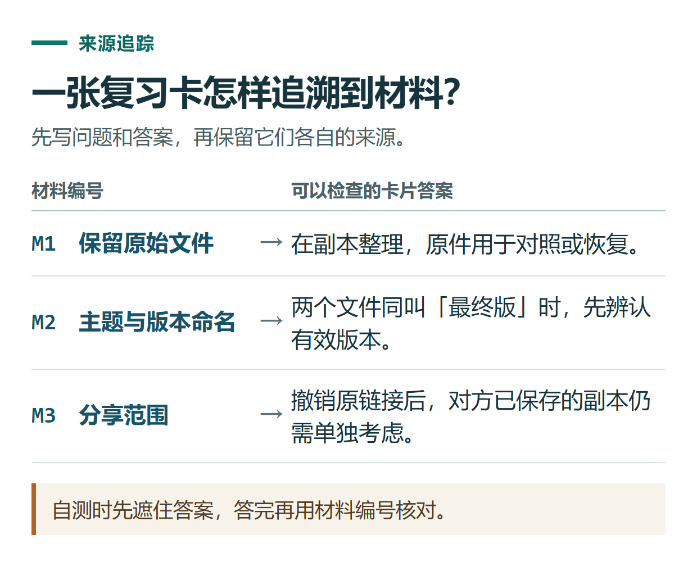

# ChatGPT 制作学习卡片：从原始笔记到可自测的问题与答案

[知识库首页](../README.md) · [学习、求职与表达](../catalog/topics/learning.md) · [按问题找答案](../catalog/TASKS.md)

资料核对：2026-11-03。适用环境：文字对话或可用的Study模式；下文笔记与卡片示例为原创。

> **先看结论：** 学习卡片的价值在于让你尝试回忆和解释。把整段教材缩短并放进表格，还不一定能用于自测。每张卡最好有明确问题、可核对答案和对应材料。

<details>
<summary>本篇导航</summary>

- [一、先提供短而可靠的学习材料](#section-01)
- [二、要求一张卡只考一个重点](#section-02)
- [三、把卡片用于真正的自测](#section-03)
- [四、发现题目不好，先改卡片](#section-04)
- [五、怎样保存和更新](#section-05)

</details>

<a id="section-01"></a>

## 一、先提供短而可靠的学习材料

用下面三条资料管理笔记练习：

```text
M1：原始文件保留不动，整理和修改在副本上进行。
M2：文件命名包含主题与版本，避免多个文件都叫最终版。
M3：分享前检查接收对象与内容范围，删除链接不等于收回别人已保存的副本。
```

不要让它仅凭一个课程名就生成几百张卡，再假定全部符合你的教材。先用小范围材料确定格式和难度。

<a id="section-02"></a>

## 二、要求一张卡只考一个重点

```text
仅依据M1—M3生成6张中文复习卡。
其中3张考概念，3张给情境判断。
字段：编号、问题、参考答案、材料编号。
问题不能直接泄露答案；未知内容不要扩写。
```

原创参考卡片：

| 问题 | 参考答案 | 来源 |
|---|---|---|
| 为什么修改资料前要保留原文件？ | 便于对照和恢复，修改在副本进行。 | M1 |
| 两个文件都叫“最终版”，应先改进什么？ | 用主题与版本区分，先确认哪份有效。 | M2 |
| 撤销分享链接后，别人保存的副本会自动消失吗？ | 不会由撤销原链接自动收回。 | M3 |

这些是编辑编写的参考答案，实际生成结果需要按同一材料检查。



*自测时先遮住答案，答完再用材料编号核对。*

<a id="section-03"></a>

## 三、把卡片用于真正的自测

可以要求它一次只问一题，等你回答后再给反馈。Study模式也支持问题引导和学习检查，入口以当前账号为准。[学习模式说明](https://help.openai.com/en/articles/11780217-using-study-mode-in-chatgpt)

```text
按刚才六张卡逐题考我，不先显示答案。
我的回答完整就简短确认；漏了条件就指出具体遗漏。
记录本次答对、答错和需要解释的题号，结束后汇总。
```

答案意思正确但措辞不同，不应机械判错。涉及定义、数字或必备条件时，则应要求说清关键部分。

<a id="section-04"></a>

## 四、发现题目不好，先改卡片

问题如果太大，比如“谈谈文件管理”，就拆成“如何命名版本”“修改时保留什么”等小问题。情境题如果同时包含三个未知条件，先减少干扰，保证能够依据材料回答。

重复卡片可以合并，但不要为了凑数量把一句话换成十种问法。覆盖材料中的关键点，比卡片总数更有意义。

<a id="section-05"></a>

## 五、怎样保存和更新

保留材料版本、问题、答案和最后核对日期。要导入其他学习软件时，先确认它要求的字段和格式，再导出，不假定任意CSV都能直接导入。

课程内容更新后，修改受影响卡片；旧知识不再适用时注明版本。进一步整理错误原因，可以看[错题复盘](chatgpt-exam-mistake-review.md)。

## 接下来按你的情况继续

- [错题复盘](chatgpt-exam-mistake-review.md)：定位错误步骤并用变式题检查是否理解。
- [计划任务](chatgpt-scheduled-tasks.md)：创建并核对提醒时间，区分运行失败与通知未显示。

[返回学习、求职与表达专题](../catalog/topics/learning.md) · [完整文章索引](../catalog/ALL_ARTICLES.md)
