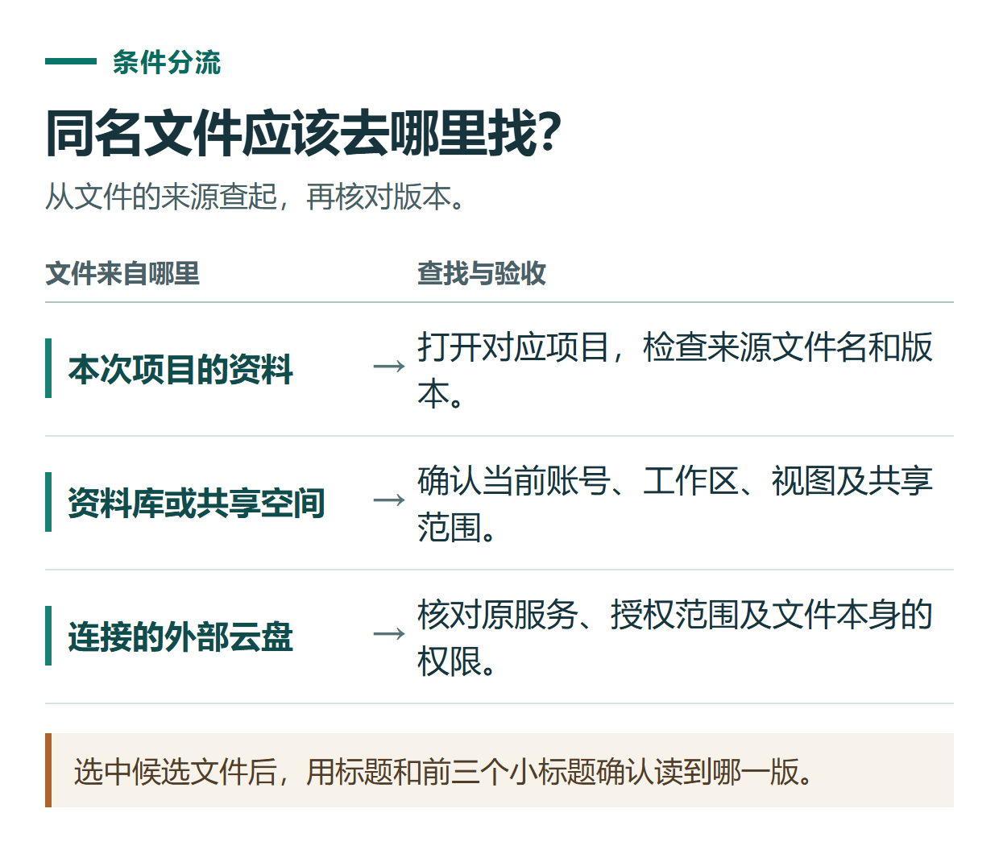

# ChatGPT Library 与 Space 怎么找文件？复用、下载、存储与删除指南

[知识库首页](../README.md) · [文件、表格与图表](../catalog/topics/data-files.md) · [按问题找答案](../catalog/TASKS.md)

资料核对：2026-11-03。适用环境：网页为主，按账号实际显示的Library或Space入口操作。

> **先看结论：** 上传过的资料或生成文件，不必每次从旧聊天里翻。先看自己的侧栏是Library还是Space，再从对应入口搜索和复用。聊天记录、保存的文件和外部云盘原文件，是需要分别管理的对象。

<details>
<summary>本篇导航</summary>

- [一、为什么你的界面与别人不同](#section-01)
- [二、找到之前使用过的文件](#section-02)
- [三、在新对话中复用，而不是反复上传](#section-03)
- [四、存储空间与上传次数不是一回事](#section-04)
- [五、删除聊天后，为什么文件还在](#section-05)

</details>

<a id="section-01"></a>

## 一、为什么你的界面与别人不同

官方[Library说明](https://help.openai.com/en/articles/20001052-using-library-to-manage-files-in-chatgpt)指出，获得Space的账号会由Space替代Library，Projects仍然独立存在。因此，“资料库不见了”有时是入口变化，不一定是文件丢失。

| 内容 | 主要用途 | 查找起点 |
|---|---|---|
| Library | 查找和复用保存的文件 | 资料库搜索与类型筛选 |
| Space | 页面、文件与共享内容的组织 | Your items、Shared with you等视图 |
| Projects | 同一主题的聊天、文件和指令 | 对应项目 |
| 外部云盘文件 | 原服务中的资料 | 已授权连接及原服务 |

不要把它们理解为四份必然相同的备份。

<a id="section-02"></a>

## 二、找到之前使用过的文件

若界面是Library，进入后用文件名或关键词搜索，结合上传/生成及文件类型筛选。若是Space，从个人内容或共享内容视图查找，也可以使用搜索。

先核对文件名、内容和版本，再打开。一个很实用的命名方式是“主题－用途－版本”，例如 `注册说明-审定稿-v2.docx`，避免所有附件都叫“最终版”。

Space的具体内容视图和访问范围见[官方Space入门](https://help.openai.com/en/articles/20001549-getting-started-with-space-in-chatgpt)。找不到内容时，先确认账号、工作区、共享权限，以及原内容是否存放在其他位置。



*选中候选文件后，用标题和前三个小标题确认读到哪一版。*

<a id="section-03"></a>

## 三、在新对话中复用，而不是反复上传

Library界面可从输入区附件菜单选择Add from library，再选择已保存文件。使用Space或连接来源时，按当前可用入口把目标文件加入对话。

可以用下面的要求确认引用的是正确版本：

```text
请使用我这次选中的“注册说明-审定稿-v2”文件。
先列出文件标题和前三个小标题，确认读取范围。
再整理一份5项以内的检查清单。
不要自行改用同名旧版本，也不要把文件中未提供的信息当事实补齐。
```

把文件选进对话，不等于已经准确理解全部内容。关键任务仍要让结果附上原文位置，方法见[PDF阅读](chatgpt-pdf-reading.md)与[文档对比](chatgpt-compare-documents.md)。

<a id="section-04"></a>

## 四、存储空间与上传次数不是一回事

在Library的Storage或当前账号的存储设置中查看使用情况。长期保存的文件占用空间，而一段时间内的上传频率是另一类限制。

如果明确显示存储已满，可以先下载需要保留的文件，再清理不再使用的副本。如果显示的是需要等到某个时间重试，删除文件未必能解决该频率限制。

清理前按“还在使用、已归档备份、可以删除”三类判断，避免为了腾空间误删正在引用的材料。

<a id="section-05"></a>

## 五、删除聊天后，为什么文件还在

保存到Library的独立文件需要单独删除，删除原聊天不会自动清理这份保存副本。若Library提供Recently deleted，可在其允许范围内恢复或永久删除；不要将其理解为任何文件都保证能恢复。

连接的Google Drive原文件仍由原服务管理；从ChatGPT断开连接，也不能当作原文件已经被删除。相反，页面里已经复制的内容也需要单独考虑，移除来源链接不一定移除复制文本。

完成整理后，应能说清：文件在哪、哪个版本在用、有没有本地备份、哪些对象真正被删除。需要整个账号的资料副本时，另看[数据导出](chatgpt-export-delete-account.md)。

## 接下来按你的情况继续

- [功能、上传与下载排查](chatgpt-feature-file-troubleshooting.md)：区分功能缺失、上传限制、文件读取及下载问题。
- [处理本地文件](chatgpt-desktop-local-files-work.md)：在指定练习目录生成一个可复查的输出文件。

[返回文件、表格与图表专题](../catalog/topics/data-files.md) · [完整文章索引](../catalog/ALL_ARTICLES.md)
