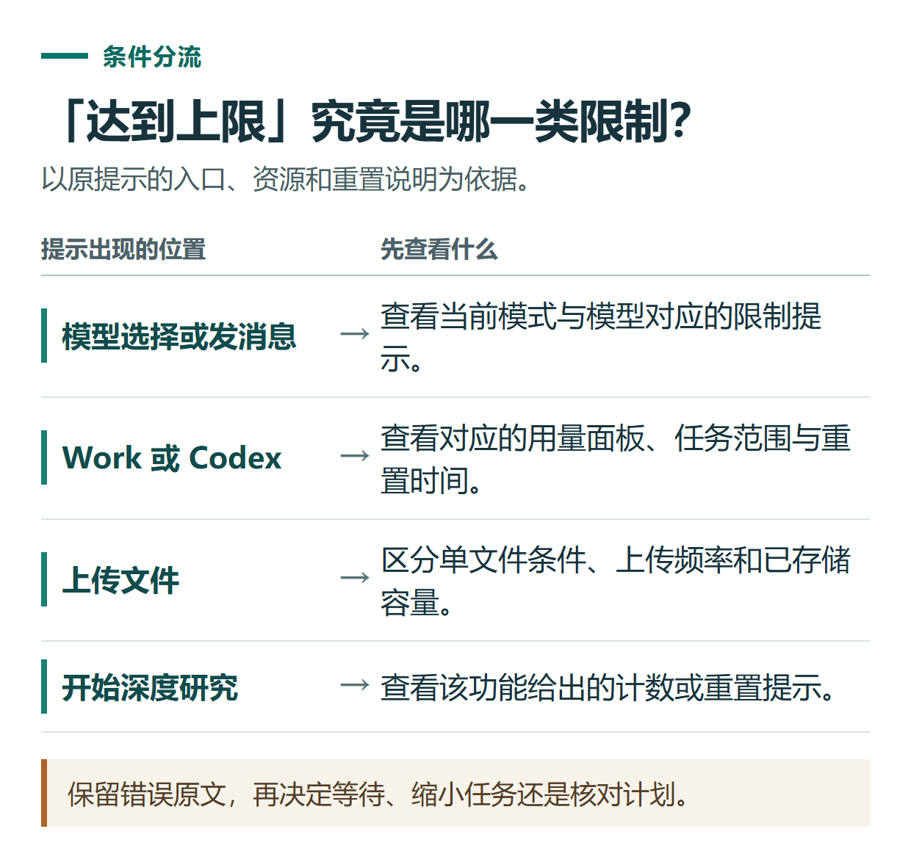
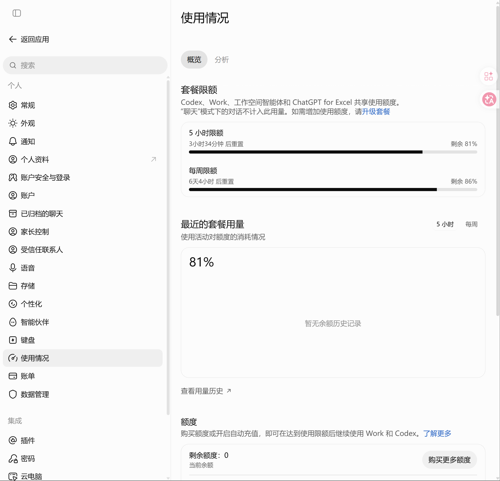

# ChatGPT 提示达到上限怎么办？分清消息、文件、研究与Work用量

[知识库首页](../README.md) · [套餐、充值与账单](../catalog/topics/subscription.md) · [按问题找答案](../catalog/TASKS.md)

资料核对：2026-11-03。适用环境：以实际账号显示的限制、重置时间和工作区设置为准。

> **先看结论：** “达到上限”不一定是同一个问题。继续重发、换设备或者重新购买，未必会改变限制。先把提示原文、出现位置和时间记下来，再判断限制对应什么资源。

<details>
<summary>本篇导航</summary>

- [一、先看是哪一类限制](#section-01)
- [二、Work和Codex不要分别估算成两份独立额度](#section-02)
- [三、用三项真实任务安排一天的工作](#section-03)
- [四、减少无效返工，比反复重发更有用](#section-04)
- [五、达到上限后如何选择](#section-05)

</details>

<a id="section-01"></a>

## 一、先看是哪一类限制

| 出现场景 | 优先核对 |
|---|---|
| 选择模型或发送消息时 | 该入口、模型及计划显示的使用限制 |
| Work或Codex任务中 | 当前用量面板、剩余额度、重置时间及可用计费方式 |
| 上传文件时 | 单个文件条件、上传频率和已存储文件容量 |
| 开始深度研究时 | 该功能显示的剩余次数与重置说明 |
| 某功能入口没有出现 | 先确认开放条件，不把“没有入口”直接解释为次数耗尽 |

文件上传的速率限制与存储限制需要分别排查；深度研究也有对应的使用计数。[文件与音频上传说明](https://help.openai.com/en/articles/8555545-uploading-files-and-audio-to-chatgpt) · [深度研究说明](https://help.openai.com/en/articles/10500283-deep-research-in-chatgpt)



*保留错误原文，再决定等待、缩小任务还是核对计划。*

<a id="section-02"></a>

## 二、Work和Codex不要分别估算成两份独立额度

当前官方资料说明，ChatGPT Work与Codex共享用量。任务复杂度、模型、上下文和工具使用等都会影响消耗；相似请求也可能消耗不同，不能用“一个问题固定扣一次”来计算。查看当前用量面板比记住一张旧的次数表更可靠。[Work与Codex计费和用量说明](https://learn.chatgpt.com/docs/pricing)

这条规则有明确的产品范围，不能推导成所有普通Chat消息、文件存储、深度研究计数都共用一个完全相同的计量器。API计费也需要单独查看。

<a id="section-03"></a>

## 三、用三项真实任务安排一天的工作

下面是工作安排示例，不代表实测耗时或实际额度。

| 任务 | 先准备什么 | 完成标准 |
|---|---|---|
| 把一段通知改得更清楚 | 原文与必须保留的日期、人数 | 事实不变，输出一版可审核文字 |
| 汇总一个CSV | 字段含义、统计口径、异常值处理规则 | 得到汇总与核对依据 |
| 比较三种资料管理方式 | 预算、人数、必需功能和来源范围 | 关键结论有出处，未知项保留 |

先处理交付时间明确的工作。简单改写可以从普通对话开始；确实需要生成文件或开展多步工作时，再使用对应入口。复杂研究先核对研究计划，避免围绕错误范围反复生成整份报告。

<a id="section-04"></a>

## 四、减少无效返工，比反复重发更有用

每次提供必要材料，并明确最终格式；已有项目资料尽量持续维护，不混入重复旧版本。先审核一小段结果或一份结构，再扩展成完整交付物。输出不符合要求时，指出具体差异，不只发送“再来一次”。

```text
本次只修正表格中金额口径，不重写其余内容。
以“已支付”为统计条件，待确认的金额保持空缺。
返回修改后的汇总、计算步骤，以及与上一版不同的地方。
```



*这是实际账号的用量界面示例，百分比与重置时间随账号和时间变化。*

<a id="section-05"></a>

## 五、达到上限后如何选择

有重置时间就结合任务期限安排等待；页面提供其他可用方式时，先核对费用与适用范围。只有持续记录表明现有计划不够用，再比较升级或额外额度。不要把续费当作立即重置当前限制的保证。

套餐判断见[会员选择指南](chatgpt-plans-comparison.md)，上传失败见[文件与功能排查](chatgpt-feature-file-troubleshooting.md)，任务入口选择见[Chat、Work与Codex](chatgpt-chat-work-codex-choice.md)。

## 接下来按你的情况继续

- [模型与思考强度](chatgpt-models-thinking.md)：分清Chat与Work可选模型，用同一任务比较质量和返工。
- [功能、上传与下载排查](chatgpt-feature-file-troubleshooting.md)：区分功能缺失、上传限制、文件读取及下载问题。

[返回套餐、充值与账单专题](../catalog/topics/subscription.md) · [完整文章索引](../catalog/ALL_ARTICLES.md)
