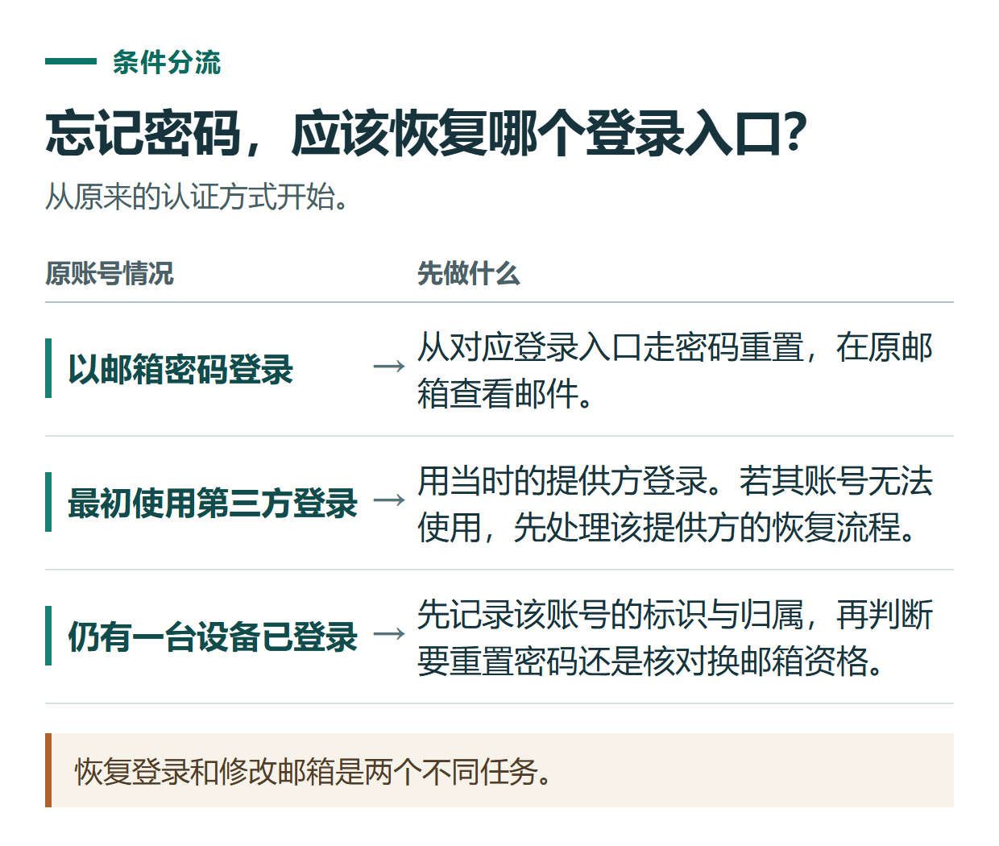

# ChatGPT 忘记密码、收不到重置邮件或想换邮箱，应该怎样处理

[知识库首页](../README.md) · [登录、隐私与账号](../catalog/topics/accounts.md) · [按问题找答案](../catalog/TASKS.md)

资料核对：2026-11-03。适用环境：官方个人账号；组织管理账号和SSO另按管理员安排。

> **先看结论：** 登录不进去时，先确认原来用的是邮箱密码，还是Google、Microsoft、Apple等登录方式。密码重置、身份提供方恢复和更换邮箱，各有不同前提。

本篇导航

- [一、先找到原登录方式](#section-01)
- [二、收不到重置邮件，先查这些地方](#section-02)
- [三、换邮箱先看是否符合条件](#section-03)
- [四、符合条件时使用网页版设置](#section-04)
- [五、恢复后检查什么](#section-05)

## 一、先找到原登录方式

如果还有一台设备保持登录，先查看账号信息。邮箱密码账号可在官方登录页进入密码输入步骤，再选Forgot password；尚未添加OpenAI密码的第三方登录账号，应先用原登录按钮进入。[密码重置说明](https://help.openai.com/en/articles/4936828-resetting-or-changing-your-chatgpt-password)

不要因为邮箱拼写一样，就认为每一种登录按钮都能互换。若需要恢复Google或Apple自身的账号，应到相应身份提供方处理。

*恢复登录和修改邮箱是两个不同任务。*

## 二、收不到重置邮件，先查这些地方

核对输入邮箱拼写、是否查了正确收件箱，以及垃圾邮件。第三方登录但没有设置OpenAI密码时，反复点重置通常不解决原认证问题。

收到邮件后先确认来源和目标域名，再按官方流程操作。不把验证码或重置链接交给代为“找回账号”的陌生人；支持请求也不需要公开密码。

## 三、换邮箱先看是否符合条件

当前官方说明，自助更换需要能够登录，并访问现有与新邮箱；新邮箱不能已经属于另一个OpenAI账号。属于Business、Enterprise、Edu或组织SSO的账号不能按普通个人路径自助更换，即使同时有个人工作区也需按组织安排处理。[更换邮箱条件](https://help.openai.com/en/articles/4936827-changing-your-openai-account-email-address)

原邮箱无法访问时，不应承诺通过联系客服就能绕过这些条件。官方明确说明不能对现有邮箱访问要求作例外处理。

## 四、符合条件时使用网页版设置

当前路径为 **Settings → Account → Email**，按提示输入新邮箱并验证。第三方登录且尚无OpenAI密码的情况，需要先按当前设置提供的方式添加密码；添加密码本身不改变换邮箱资格。

更换完成后会在设备上退出，使用新邮箱重新登录。修改原账号邮箱与新建另一个账号不同：前者保留原账号资料，后者不能自动迁移订阅或合并历史。[官方更换流程](https://help.openai.com/en/articles/4936827-changing-your-openai-account-email-address)

## 五、恢复后检查什么

确认能进入原聊天和正确工作区，核对会员状态，再检查安全设置及其他设备会话。更改OpenAI账号信息可能同时影响API登录，实际使用相关服务时一并核对。

需要求助时，列清尝试过的登录方式、错误原文和哪些设备仍可登录，不猜测账号状态。安全检查见[账号安全](chatgpt-account-security.md)，提交材料见[支持请求](chatgpt-support-ticket-troubleshooting.md)。

## 接下来按你的情况继续

- [注册与登录](chatgpt-sign-up-login.md)：确认原登录方式，并能在新设备重新进入同一账号。
- [账号安全](chatgpt-account-security.md)：设置可用的多重验证，检查登录会话并准备换设备。

[返回登录、隐私与账号专题](../catalog/topics/accounts.md) · [完整文章索引](../catalog/ALL_ARTICLES.md)
