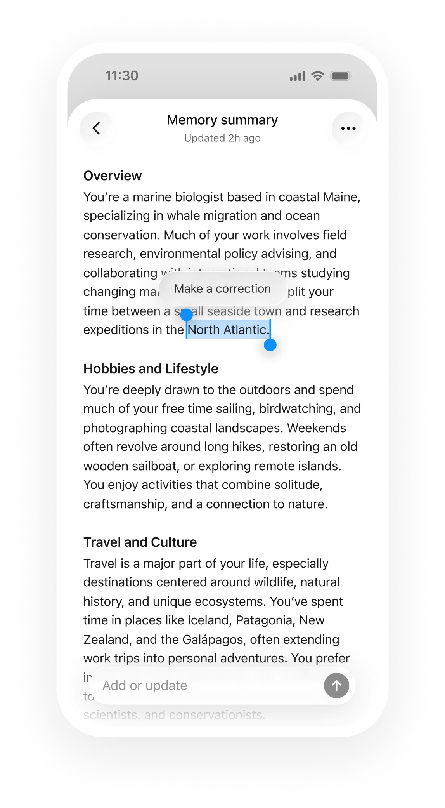
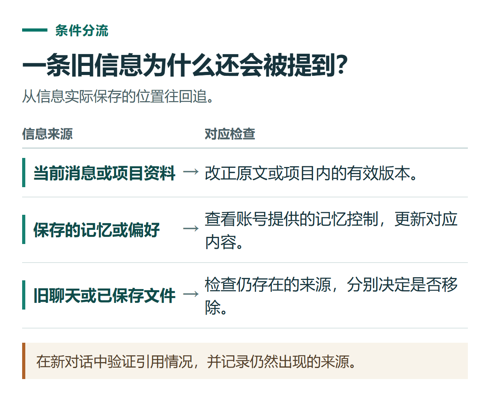

# ChatGPT 记忆怎么查看、修改和删除？把长期偏好与单次任务分开

[知识库首页](../README.md) · [项目、记忆与技能](../catalog/topics/projects.md) · [按问题找答案](../catalog/TASKS.md)

资料核对：2026-11-03。适用环境：个人账号可用的Memory与Personalization设置；界面因账号而异。

> **先看结论：** 如果ChatGPT总沿用旧职业、旧项目或不喜欢的表达，先查它正在参考什么。修改记忆、关闭记忆、删除聊天和调整自定义指令，是不同操作，不要只删除一段聊天就认为全部关联信息都消失。

<details>
<summary>本篇导航</summary>

- [一、先确定这条信息应该放在哪里](#section-01)
- [二、查看当前账号的记忆控制](#section-02)
- [三、用一个可逆的偏好练习](#section-03)
- [四、旧信息错了，先纠正来源](#section-04)
- [五、哪些内容不必记住](#section-05)

</details>

<a id="section-01"></a>

## 一、先确定这条信息应该放在哪里

| 信息 | 建议位置 |
|---|---|
| 长期希望用简体中文、先给步骤 | 自定义指令或明确的长期偏好 |
| 某个项目专用术语与材料 | 项目指令和项目资料 |
| 这一次要写300字 | 当前任务消息 |
| 已结束活动的日期和价格 | 对应历史材料，避免当长期默认事实 |

这是一种整理方法，不表示系统会自动把所有信息放到正确位置。官方也说明记忆不会保留每次聊天的全部细节。[记忆说明](https://help.openai.com/en/articles/8590148-memory-in-chatgpt)

<a id="section-02"></a>

## 二、查看当前账号的记忆控制

打开 **Settings → Personalization → Memory**。可能看到记忆摘要、管理列表、已保存记忆或历史引用等不同选项。先确认你实际使用的体验，再按界面操作。

也可以问“你目前记得哪些关于我写作偏好的信息”，但回答不是完整的数据清单。记忆摘要和回答中的Sources也不一定展示所有影响因素。[记忆查看范围](https://help.openai.com/en/articles/8590148-memory-in-chatgpt)



*官方记忆摘要示例，显示选中内容后进行更正。不同账号界面可能不同。 [图片来源](https://help.openai.com/en/articles/8590148-memory-in-chatgpt)*

<a id="section-03"></a>

## 三、用一个可逆的偏好练习

可选择一条确实适合自己的表达习惯，例如：

```text
今后解释软件操作时，默认使用简体中文。
先给可执行步骤，再解释原因。
遇到不确定的按钮名称，注明需要按实际界面确认。
```

在新聊天提问“怎样整理一份活动报名表”，查看是否符合偏好。若未遵循，先检查设置与指令是否冲突，不要据一次回答就认定记忆永久失效。

临时要求可以明确覆盖表达方式：“这一次只要一句话，不需要步骤。”长期偏好是默认习惯，不应让每个任务都变成同一种格式。

<a id="section-04"></a>

## 四、旧信息错了，先纠正来源

例如旧材料写“我是大学生”，现在已经工作，可以直接说明变化，并在当前可用的记忆摘要或条目中修正。若旧项目文档仍保留过期身份，也检查它是否还被作为有效资料引用。

“不要再提这件事”主要改变引用行为，不等于删除原文件或聊天。若确实需要移除相关信息，应按来源分别处理记忆条目、聊天、保存文件和连接应用。关闭Memory同样不会删除全部历史。[纠正与删除记忆](https://help.openai.com/en/articles/8590148-memory-in-chatgpt)



*在新对话中验证引用情况，并记录仍然出现的来源。*

<a id="section-05"></a>

## 五、哪些内容不必记住

订单号、一次性验证码、临时客户清单和已失效活动条件，通常没有必要变成长期偏好。需要通用回答时，可使用当前提供的不个性化临时聊天；保存临时聊天后行为会变化，详见[临时聊天与隐私](chatgpt-privacy-temporary-chat.md)。

项目内风格与全局偏好发生冲突时，检查[项目设置](chatgpt-projects-memory-instructions.md)，不必先把所有记忆清空。

## 接下来按你的情况继续

- [隐私与临时聊天](chatgpt-privacy-temporary-chat.md)：分别设置训练用途、临时聊天与个性化，并判断保存后的变化。
- [项目、记忆与指令](chatgpt-projects-memory-instructions.md)：建立演示项目与表达偏好，并知道如何管理记忆。

[返回项目、记忆与技能专题](../catalog/topics/projects.md) · [完整文章索引](../catalog/ALL_ARTICLES.md)
