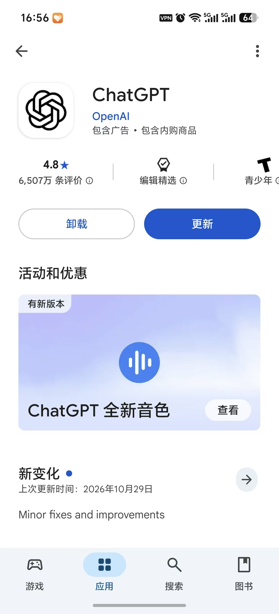
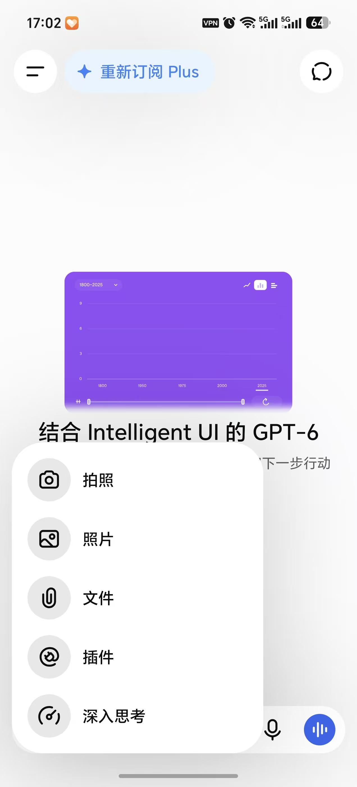

# ChatGPT 手机端下载安装与使用：iPhone、Android 入门教程

[知识库首页](../README.md) · [网页、手机与桌面](../catalog/topics/devices.md) · [已上线教程](../README.md)

资料核对：2026-11-03。适用环境：官方iOS与Android应用；需要先满足官方地区及商店条件。

> **先看结论：** 手机上使用ChatGPT，可以先从官方下载页找到对应商店，再核对发布者。应用名称和图标相似，不足以判断是不是官方版本。完成安装后，用原来的ChatGPT账号登录，再进行第一次练习。

<details>
<summary>本篇导航</summary>

- [一、iPhone和Android分别从哪里下载](#section-01)
- [二、安装之后，先核对同一个账号](#section-02)
- [三、用手机完成一个短任务](#section-03)
- [四、输入文字、拍图和语音有什么区别](#section-04)
- [五、常见问题如何快速定位](#section-05)

</details>

<a id="section-01"></a>

## 一、iPhone和Android分别从哪里下载

| 设备 | 建议入口 | 核对重点 |
|---|---|---|
| iPhone / iPad | [官方下载页](https://chatgpt.com/download/)指向的App Store | 发布者及当前系统兼容性 |
| Android | 官方下载页指向的Google Play | 发布者及设备兼容性 |

核对日的[官方手机应用FAQ](https://help.openai.com/en/articles/8142208-chatgpt-ios-and-android-app-faq)标明，App Store发布者为OpenAI OpCo, LLC，Google Play发布者为OpenAI。系统版本要求应查看当时商店页面，不沿用旧教程里未经复核的最低版本。

如果商店不可用或显示地区不支持，先核对地区与设备条件，参见[国内使用前准备](chatgpt-china-preparation.md)。本文不把更改商店入口描述为改变官方服务资格的方法。



*Android 商店页面示例，发布者为 OpenAI。iPhone 用户请在 App Store 核对发布者。*

<a id="section-02"></a>

## 二、安装之后，先核对同一个账号

打开应用，选择原来使用的邮箱、Google、Microsoft或Apple登录方式。进入账号设置检查账号标识，再找原来的历史对话。

官方FAQ说明，同一账号和工作区的历史对话可以跨设备同步。如果手机里没有原对话，先核对是否登录了另一个账号或工作区；已删除的对话不能靠重装应用恢复。

新手容易把手机商店账号和ChatGPT账号当作同一件事。商店负责应用获取或部分订阅支付，ChatGPT账号负责识别你在产品中的身份，排查时应分别核对。

<a id="section-03"></a>

## 三、用手机完成一个短任务

先创建新对话，把下面的虚构材料粘贴到输入区：

```text
我要出门参加半天的线上培训，在外面用笔记本听课。
已知：培训14:00开始、17:00结束，需要做练习，现场不保证插座。
请整理一份出门前检查清单，最多8项。
只根据这些条件提出准备建议。
不要编造培训地点、交通线路或课程内容。
```

收到清单后，检查是否考虑电脑电量、充电设备、耳机、网络和练习资料等实际准备事项。它可以提出建议，但不能把未知地点说成已确定事实。

继续发送：“把清单分成出门前检查和到场后检查，保留重要项。”比较修改前后是否遗漏原有必要准备，熟悉手机上的追问方式。

<a id="section-04"></a>

## 四、输入文字、拍图和语音有什么区别

**打字或粘贴：** 适合需要准确保留日期、数字和原文的任务。

**上传照片：** 适合围绕可见内容提问，例如解释一页说明或整理拍下的白板。先裁去无关区域，检查文字是否清晰，再发送具体问题。

**语音对话：** 适合连续练习或口头讨论；想把一句话转成可编辑文字时，则选择听写输入。两者的操作与检查方法见语音使用指南。

手机相册里有敏感内容时，只选择当前任务要用的图片。不要为了一个练习上传整组不相关照片。



*Android 输入菜单示例，具体入口和可用功能以实际页面为准。*

<a id="section-05"></a>

## 五、常见问题如何快速定位

**界面和教程不同：** 在应用设置中查看版本，再从原商店检查更新。官方FAQ给出了版本查看位置；不同平台菜单可能不同。

**照片文字识别不完整：** 重新拍摄，保证正对页面、光线均匀、不切掉边缘，再让它先列出识别到的文字供你确认。

**会员与电脑端不一致：** 对照原账号、工作区和购买渠道，按[付款与权益排查](chatgpt-payment-troubleshooting.md)处理。

**想停止扣费：** 删除手机应用不能完成取消续费，应该按[取消订阅指南](chatgpt-cancel-refund.md)到原购买渠道操作。

## 接下来按你的情况继续

- 多设备同步排查：辨认账号、聊天类型、本地文件和云端接续差异。
- 语音练习：完成5问以内练习并记录3句表达。

[返回网页、手机与桌面专题](../catalog/topics/devices.md) · [完整目录](../catalog/ALL_ARTICLES.md)
