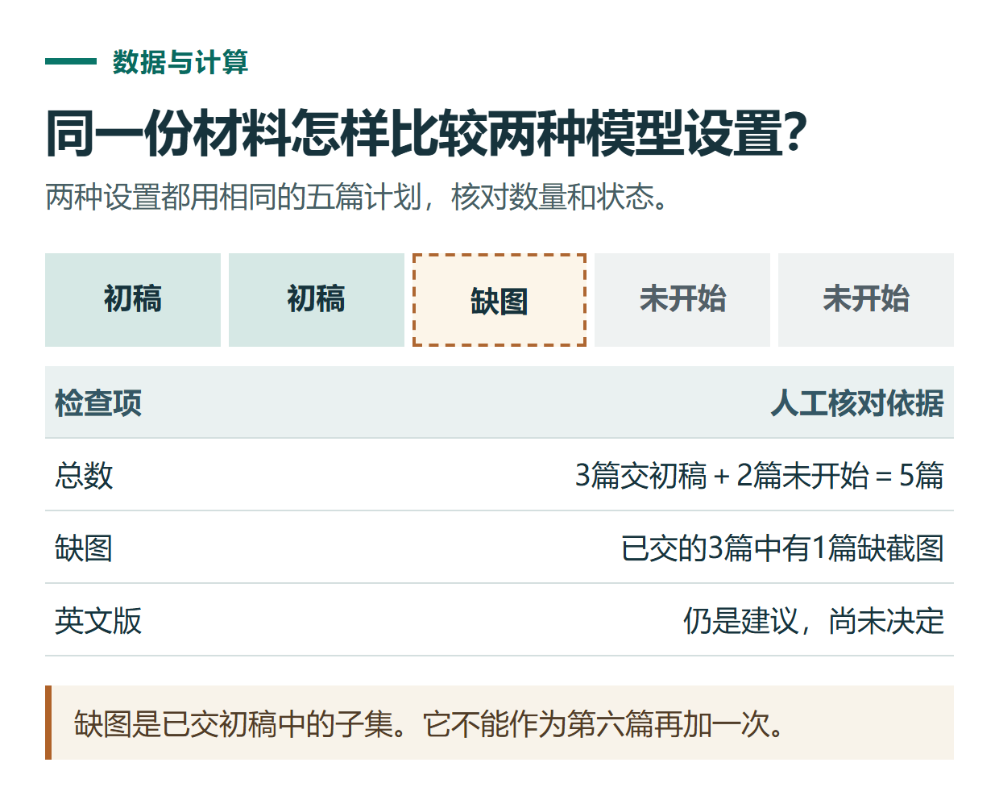

# ChatGPT 模型和思考强度怎么选？先分清 Chat、Work 与任务需求

[知识库首页](../README.md) · [提问、模型与回答质量](../catalog/topics/prompting.md) · [按问题找答案](../catalog/TASKS.md)

资料核对：2026-11-03。适用环境：官方ChatGPT的Chat与Work；不把API型号清单当作聊天账号可选项。

> **先看结论：** 选择模型时，先看自己正在使用什么模式，再看任务是否需要复杂推理。一个模型在API或Work里提供，并不意味着普通Chat也有同名入口；把思考强度调高，也不等于自动获得更高套餐。

<details>
<summary>本篇导航</summary>

- [一、先认清三类信息](#section-01)
- [二、当前界面怎样查看](#section-02)
- [三、按任务决定是否增加思考](#section-03)
- [四、用同一份材料做比较](#section-04)
- [五、什么时候才考虑升级套餐](#section-05)

</details>

<a id="section-01"></a>

## 一、先认清三类信息

| 界面信息 | 它主要表示什么 | 容易混淆的地方 |
|---|---|---|
| Chat / Work | 当前使用方式与任务入口 | 不能直接当作会员档位 |
| 模型名称 | 当前可选的模型 | 不同产品可用名单可能不同 |
| Thinking / 推理强度 | 为任务投入的思考程度 | 更高不保证每次更准确 |

官方当前[Chat模型说明](https://help.openai.com/en/articles/20001354-gpt-6-and-other-models-in-chatgpt)区分了Chat中的GPT-6及思考选项，与Work/Codex中的GPT-6.1系列。GPT-6.1 Sol、Terra的Work/Codex选项不能直接写成Chat统一入口。

<a id="section-02"></a>

## 二、当前界面怎样查看

在Chat中，展开模型菜单和实际提供的Thinking选项。官方资料列有Instant、Medium、High、Extra High及Pro等，但账号不一定显示全部。

在Work或桌面相关任务界面中，查看输入区附近的模型与推理控制；如果出现Power和Advanced，可从高级选项核对具体模型。官方[Work与Codex模型说明](https://learn.chatgpt.com/docs/models)解释了这些控制与开放条件。

没有某个型号时，先核对平台、版本、工作区权限与账号开放情况。不要向聊天里的模型追问“你到底是什么型号”，再把它的文字自述当作账号权益凭证。

<a id="section-03"></a>

## 三、按任务决定是否增加思考

**短文本修改、分类、格式转换：** 从默认或较轻的设置开始，先看事实是否保留、格式是否正确。

**多个来源相互冲突、需要规划多步成果：** 可以增加思考强度，再检查推理和证据，而不是只看回复是否变长。

**需要完成文档、页面或浏览器任务：** 除了模型，还要核对工具权限和输入材料。缺少文件或外部访问权限时，调高思考无法代替这些条件。

官方[模型选择指南](https://learn.chatgpt.com/docs/model-selection)建议用相同输入与验收标准比较结果。下面给出一个不依赖专业知识的小测试。

<a id="section-04"></a>

## 四、用同一份材料做比较

```text
根据下面记录，列出已完成、待办和需要确认的信息。
每项必须指出对应原文，不能补负责人或截止时间。

记录：
计划写5篇文章，已交初稿3篇；其中1篇还缺截图。
另外2篇尚未开始。
小林建议下周增加英文版，但尚未决定。
本周先处理已有3篇的审核。
```

分别在两种可用设置下运行，其他材料和要求保持一致。按下表检查，不预设哪个模型一定胜出：

| 检查项 | 合格标准 |
|---|---|
| 数量 | 初稿3篇，未开始2篇，总计划5篇 |
| 状态 | 不能把交初稿写成全部正式发布 |
| 缺口 | 保留1篇缺截图 |
| 决策 | 英文版仍是未决定建议 |
| 可用性 | 能直接用于审核沟通，少量或无需修正 |

记录生成时间，也记录你为了修正错误花的时间。只比较回答出现得快不快，可能忽略后续人工成本。



*本篇练习图。缺图是已交初稿中的子集。它不能作为第六篇再加一次。*

<a id="section-05"></a>

## 五、什么时候才考虑升级套餐

先确定是当前任务质量不足、明确额度不够，还是所需模式没有开放。对不清楚的问题直接购买最高档，不能保证解决。

可以把任务、当前设置、出现的限制和想达到的结果整理出来，再读[套餐选择](chatgpt-plans-comparison.md)。本文不维护一张覆盖所有账号的永久模型表；变化较快的访问范围以当前账号和对应官方文档为准。

## 接下来按你的情况继续

- [Chat、Work与Codex选择](chatgpt-chat-work-codex-choice.md)：按提问、文件交付和技术任务选择入口。
- [用量与上限](chatgpt-limits-usage-planning.md)：识别限制类型，按实际任务安排用量和升级判断。

[返回提问、模型与回答质量专题](../catalog/topics/prompting.md) · [完整文章索引](../catalog/ALL_ARTICLES.md)
