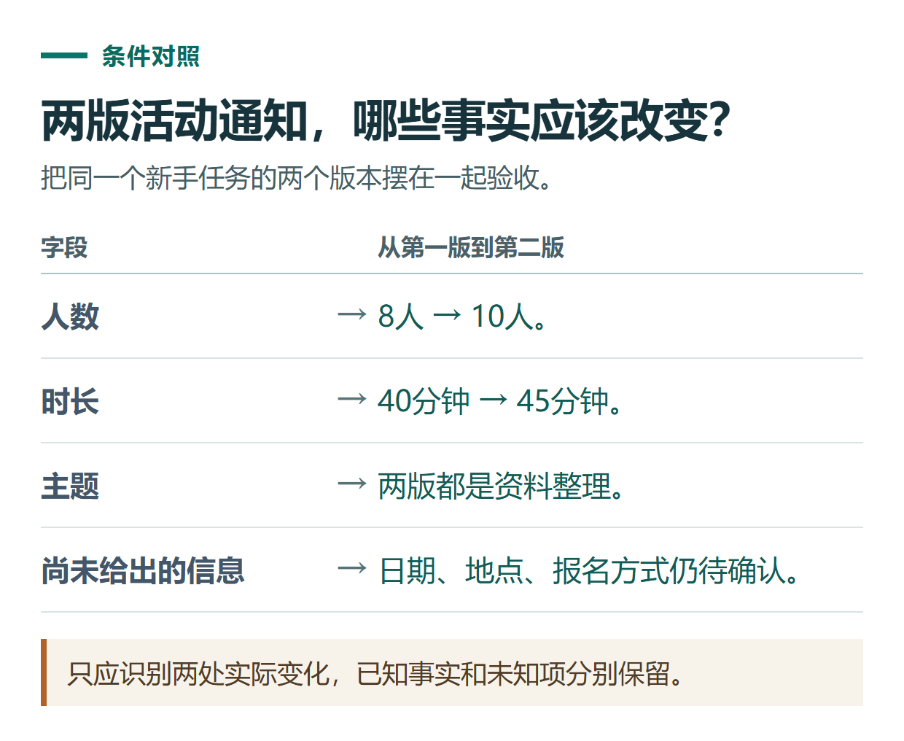

# ChatGPT 新手学习路线：用7个任务完成从提问到实际交付

[知识库首页](../README.md) · [认识与开始](../catalog/topics/start.md) · [按问题找答案](../catalog/TASKS.md)

资料核对：2026-11-03。适用环境：按自己的可用功能练习；7个任务可分多天完成，不要求每天购买或解锁新工具。

> **先看结论：** 第一次学习ChatGPT，可以围绕一件小事逐步练习。下面用“准备一场小型资料整理分享”串起提问、文件、核查和交付。活动是虚构练习，所有人数、预算与安排只服务于示例。

<details>
<summary>本篇导航</summary>

- [任务1：确认入口与使用条件](#section-01)
- [任务2：用三条确定事实写通知](#section-02)
- [任务3：让它比较两个版本](#section-03)
- [任务4：检查一个外部事实](#section-04)
- [任务5：选一个与你工作相关的进阶任务](#section-05)
- [任务6：把持续资料放进项目](#section-06)
- [任务7：根据实际需求决定后续投入](#section-07)

</details>

<a id="section-01"></a>

## 任务1：确认入口与使用条件

先读[ChatGPT是什么](what-is-chatgpt.md)，再确认[使用条件和准备事项](chatgpt-china-preparation.md)。已经有账号就用原登录方式进入，核对自己所在的账号和工作区；遇到问题按[注册与登录指南](chatgpt-sign-up-login.md)处理。

**完成标准：** 能找到官方入口，知道自己当前计划；不把第三方网站的账号当作官方账号。

<a id="section-02"></a>

## 任务2：用三条确定事实写通知

```text
请帮我写一则资料整理分享的活动通知，面向没有技术背景的同事。
已确定：参加人数8人，时长40分钟，主题是整理资料。
日期、地点和报名方式尚未确定。
请写一个标题和一段正文，把缺少的信息列为待确认，不要补写。
```

**完成标准：** 人数和时长正确；没有虚构日期、费用、地点。继续要求“语气自然一些，保留全部事实”，体会[多轮修改](chatgpt-prompting-practice.md)如何进行。

<a id="section-03"></a>

## 任务3：让它比较两个版本

将任务2的已知信息保存为第一份文本；再做第二份，将人数改为10人、时长改为45分钟，其余保持相同。按[多文档对比](chatgpt-compare-documents.md)提问，要求列出差异与来源。

**完成标准：** 找到人数与时长两处变化，未变的主题不算变化。若当前入口无法上传，可粘贴两个明确分隔的短文本完成同类练习，并注明使用方式。



*只应识别两处实际变化，已知事实和未知项分别保留。*

<a id="section-04"></a>

## 任务4：检查一个外部事实

选一个实际关心的问题，例如“当前深度研究报告支持哪些下载格式”。让它提供官方来源，再自己打开页面核对具体段落和适用范围。[来源核查方法](chatgpt-research-source-checking.md)说明了如何区分原文、推断和未知。

**完成标准：** 至少核对一项结论；来源打不开或没有对应内容时，保留未核实状态，不把带链接的回答直接当作可靠答案。

<a id="section-05"></a>

## 任务5：选一个与你工作相关的进阶任务

有数据工作就做[表格清洗](chatgpt-excel-data-cleaning.md)；写内容就做[内容排期](chatgpt-content-calendar.md)；处理客户咨询就做[回复整理](chatgpt-email-customer-replies.md)。先选一项完成，不必一次体验所有功能。

**完成标准：** 产出一份能够独立核对的结果，至少检查一个数字、一个事实或一个未确认项，而不是只看文字是否流畅。

<a id="section-06"></a>

## 任务6：把持续资料放进项目

如果活动需要反复修改，可按[多文件项目案例](chatgpt-projects-multi-file-case.md)整理需求、资源清单和旧版本，明确哪份是当前依据。仅涉及一次性短任务时，也可以保留清楚的文件夹和文字记录。

**完成标准：** 下一次继续工作时能找到有效版本；项目资料与记忆功能各自的作用清楚，不靠猜测模型“应该记得”。

<a id="section-07"></a>

## 任务7：根据实际需求决定后续投入

记录哪些任务重复出现、哪些功能确实不够用、哪里需要人工修改，再看[套餐选择](chatgpt-plans-comparison.md)和[用量安排](chatgpt-limits-usage-planning.md)。需要购买时，先做[账号与订单检查](chatgpt-account-sharing-purchase-checklist.md)。

**完成标准：** 能解释自己需要付费功能的具体原因，或者明确当前方案已经够用。后续学习围绕实际任务展开，不用把“从入门到精通”理解为记住所有按钮。

这条练习路线由本指南设计；如何提供目标、材料与输出要求，可对照[OpenAI提示词指南](https://learn.chatgpt.com/docs/prompting)。

## 接下来按你的情况继续

- [ChatGPT是什么](what-is-chatgpt.md)：认识产品，完成一条有依据的提问。
- [套餐怎么选](chatgpt-plans-comparison.md)：选出待比较的档位，明确升级希望解决的限制。

[返回认识与开始专题](../catalog/topics/start.md) · [完整文章索引](../catalog/ALL_ARTICLES.md)
