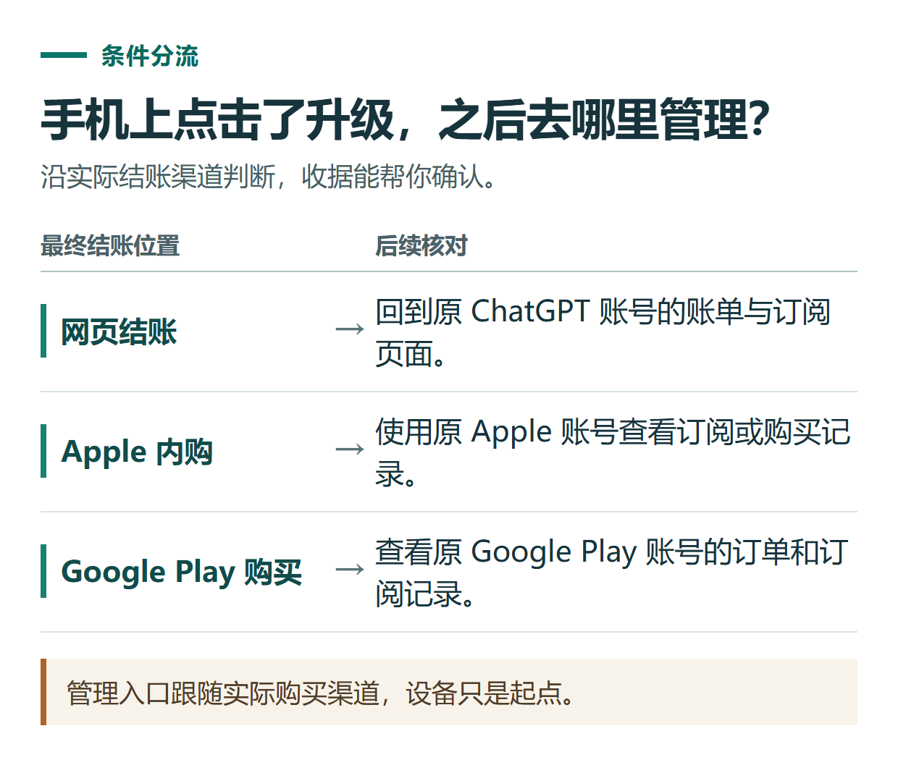

# ChatGPT 官网怎么开通会员？首次订阅、续费与更换套餐的操作顺序

[知识库首页](../README.md) · [套餐、充值与账单](../catalog/topics/subscription.md) · [按问题找答案](../catalog/TASKS.md)

资料核对：2026-11-03。适用范围：符合官方使用及支付条件的个人账号；以网页首次订阅为主。

> **先看结论：** 已经决定购买ChatGPT会员，下一步应先确认目标账号，再进入升级页面，核对金额与周期后付款。需要续费或更换套餐时，则先查原订阅，避免在另一个账号或支付渠道重复购买。

本文讲官方订阅操作。还没选好套餐，先看[个人套餐对比](chatgpt-plans-comparison.md)；需要第三方办理，另看[小小AI下单与验收](chatgpt-topup-order-guide.md)。

<details>
<summary>本篇导航</summary>

- [一、付款前先做三项检查](#section-01)
- [二、网页首次开通的步骤](#section-02)
- [三、在iPhone里点击升级，谁来管理账单](#section-03)
- [四、续费与换套餐，先检查旧订阅](#section-04)
- [五、用这张卡保存办理结果](#section-05)

</details>

<a id="section-01"></a>

## 一、付款前先做三项检查

**确认账号。** 在设置中查看当前账号标识，尤其注意Apple隐藏邮箱。收据发送到哪个邮箱，不一定能单独证明订阅属于哪个ChatGPT账号。

**确认已有订阅。** 查看网页账单、Apple或Google Play的原购买记录。曾经买过但不确定是否仍在续费时，先查清楚，不从新的升级按钮直接重买。

**确认需要的功能。** 把购买理由写具体，例如上传资料或需要更多研究任务用量。升级不能保证一个尚未向账号开放的入口立即出现，也不能改变[地区支持条件](chatgpt-china-preparation.md)。

<a id="section-02"></a>

## 二、网页首次开通的步骤

1. 打开[ChatGPT官网](https://chatgpt.com/)，登录需要升级的账号。
2. 从个人菜单选择“Upgrade plan（升级套餐）”等当前入口。
3. 选择目标套餐；以Plus为例，官方说明使用“Get Plus”进入办理。
4. 阅读结账页，核对套餐、币种、支付总额、计费周期和后续续费说明。
5. 填写页面要求的支付资料，完成必要的银行验证，再等待实际支付结果。
6. 返回账号设置查看会员状态，并保留收据。

入口依据[官方Plus说明](https://help.openai.com/en/articles/6950777-what-is-chatgpt-plus)。按钮文案可能调整，判断重点是目标套餐和结账结果，而不是截图里某个按钮必须同名。

<a id="section-03"></a>

## 三、在iPhone里点击升级，谁来管理账单

从iOS应用的升级入口开始，最后可能在Apple内购页付款，也可能进入网页结账。应该按最终收款渠道判断，不能只因为第一步点的是手机应用，就认定由Apple管理。

官方当前[iOS升级说明](https://help.openai.com/en/articles/7905739-chatgpt-ios-app-upgrading-to-a-paid-subscription)特别区分了这两种情况。若跳转浏览器，再核对一次浏览器登录的ChatGPT账号；如果应用里没有目标套餐，查看官网当前可选项。

Android用户同样应记录最终购买渠道和商店账号，之后按收据找到订阅管理入口。各设备不需要因为换了入口就新建账号购买。



*管理入口跟随实际购买渠道，设备只是起点。*

<a id="section-04"></a>

## 四、续费与换套餐，先检查旧订阅

把原订阅的渠道、当前套餐、下一次扣费或到期日期记录下来，再进入该渠道的管理页面。

如果页面提供更换套餐，重点看：新套餐何时生效、本次需要支付多少、旧周期如何处理、下一次计费是什么时间。没有看到明确说明时，向原渠道支持核对；不要自行套用“立即生效”“只补差价”或“剩余天数全退”等结论。

跨网页与应用商店切换购买方式前，尤其要确认原订阅的后续扣费安排。[官方账单说明](https://help.openai.com/en/articles/9039756-managing-billing-for-chatgpt-and-the-api-platform)提醒，不同平台的订阅可能分别计费。

<a id="section-05"></a>

## 五、用这张卡保存办理结果

```text
目标账号：仅记在自己的安全笔记中
购买渠道：网页 / Apple / Google Play
套餐全名：
本次金额及币种：
付款日期：
当前账期与下一次扣费：
收据保存位置：
需要更换或停止订阅时的管理入口：
```

若扣款后仍显示免费，先按[会员未生效排查](chatgpt-payment-troubleshooting.md)核对原账号，暂不重复购买。需要停止续费，按[取消与退款教程](chatgpt-cancel-refund.md)操作。

无法自行办理且需要了解服务条件，可查看[小小AI会员办理](https://xiaoxiao.pro/shop?utm_source=github&utm_medium=referral&utm_campaign=chatgpt_guide&utm_content=a21_shop)。小小AI是独立第三方服务方，其订单费用与服务规则应另行确认。

## 接下来按你的情况继续

- [小小AI下单与验收](chatgpt-topup-order-guide.md)：按同一笔订单完成付款核对和官方权益验收。
- [账单与重复扣款](chatgpt-billing-receipts-duplicates.md)：按渠道找凭证并判断两笔交易的状态。

[返回套餐、充值与账单专题](../catalog/topics/subscription.md) · [完整文章索引](../catalog/ALL_ARTICLES.md)
