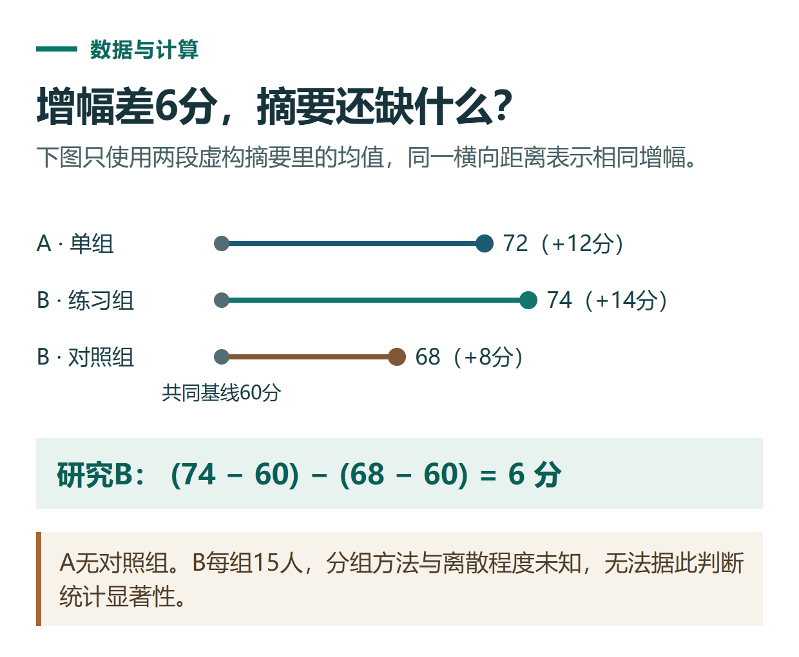

# ChatGPT 阅读论文与整理文献：研究问题、方法、结果和局限怎么拆

[知识库首页](../README.md) · [搜索、PDF与研究](../catalog/topics/research.md) · [按问题找答案](../catalog/TASKS.md)

资料核对：2026-11-03。适用环境：论文文件或明确提供的摘要；下文研究材料为虚构教学示例，不是真实文献。

> **先看结论：** 读论文时，先区分作者做了什么、观察到什么，以及结果能够支持多大范围的结论。ChatGPT可以帮助拆解和比较，但不能凭一个标题补出实验细节、引用编号或不存在的论文。

<details>
<summary>本篇导航</summary>

- [一、上传后先确认读取范围](#section-01)
- [二、使用两个虚构摘要练习](#section-02)
- [三、比较结果，但不越过材料](#section-03)
- [四、建立自己的文献表](#section-04)
- [五、从读懂一篇到整理多篇](#section-05)

</details>

<a id="section-01"></a>

## 一、上传后先确认读取范围

提供你有权使用的PDF、摘要或相关章节，说明要读全文还是某几页。先要求它列出能识别的标题、章节和表格，再开始总结。官方文件说明支持论文概括、文档比较等任务。[文件处理说明](https://help.openai.com/en/articles/8555545-uploading-files-and-audio-to-chatgpt)

只给摘要时，在结果里注明“基于摘要”；没读到方法全文，就不应声称已经完整评估实验设计。

<a id="section-02"></a>

## 二、使用两个虚构摘要练习

```text
练习研究A：24名学习者完成一次10分钟练习。
一周后平均测试分数从60变为72。
未设置对照组；未报告分数离散程度。

练习研究B：30名学习者分为两组，每组15人。
两组基线平均分均为60。
一周后，练习组平均74，对照组平均68。
分组方法和离散程度未在摘要中说明。
```

```text
请按研究问题、对象、方法、结果、缺失信息五项拆解材料。
所有数字必须来自原文。
不要补作者、刊物、年份或DOI；这两份只是虚构练习。
```

<a id="section-03"></a>

## 三、比较结果，但不越过材料

A的平均分增加12分。B练习组增加14分，对照组增加8分，两组平均增幅差为6分。这些是材料内的算术关系。

没有离散程度和更多设计细节，不能据此声称差异“统计显著”；A没有对照组，也不能仅凭前后变化断言提升完全由练习造成。

```text
请将“直接报告的结果”“根据数字计算的结果”“无法判断的内容”分开。
指出需要补读全文哪些章节，才能进一步评价。
不要把两个小样本练习推广到所有学习者。
```



*本篇练习图。A无对照组。B每组15人，分组方法与离散程度未知，无法据此判断统计显著性。*

<a id="section-04"></a>

## 四、建立自己的文献表

真实文献可以记录：题名、作者、年份、直接链接、研究对象、方法、关键结果、局限、相关页码。题名和DOI应由原文或可信出版记录确认，而不是让模型凭印象生成。

页码要说明是PDF页面序号还是论文印刷页码。引文引用的是原作者结论，还是你的解释，也应分开表达。

<a id="section-05"></a>

## 五、从读懂一篇到整理多篇

先让每篇文献使用相同字段，再比较对象、方法和测量指标是否一致。不同研究的数字口径不一致时，不直接排成效果排行榜。

写综述前回到原文检查关键结论，不把ChatGPT的概括当作新的证据来源。找更多资料可用[深度研究](chatgpt-deep-research-workflow.md)，逐条引用核对见[来源检查](chatgpt-research-source-checking.md)。

## 接下来按你的情况继续

- [PDF阅读](chatgpt-pdf-reading.md)：用两页练习文件核对页码、摘要与三行表格。
- [完整深度研究流程](chatgpt-deep-research-workflow.md)：完成选题、研究计划、来源限定、报告与核对。

[返回搜索、PDF与研究专题](../catalog/topics/research.md) · [完整文章索引](../catalog/ALL_ARTICLES.md)
