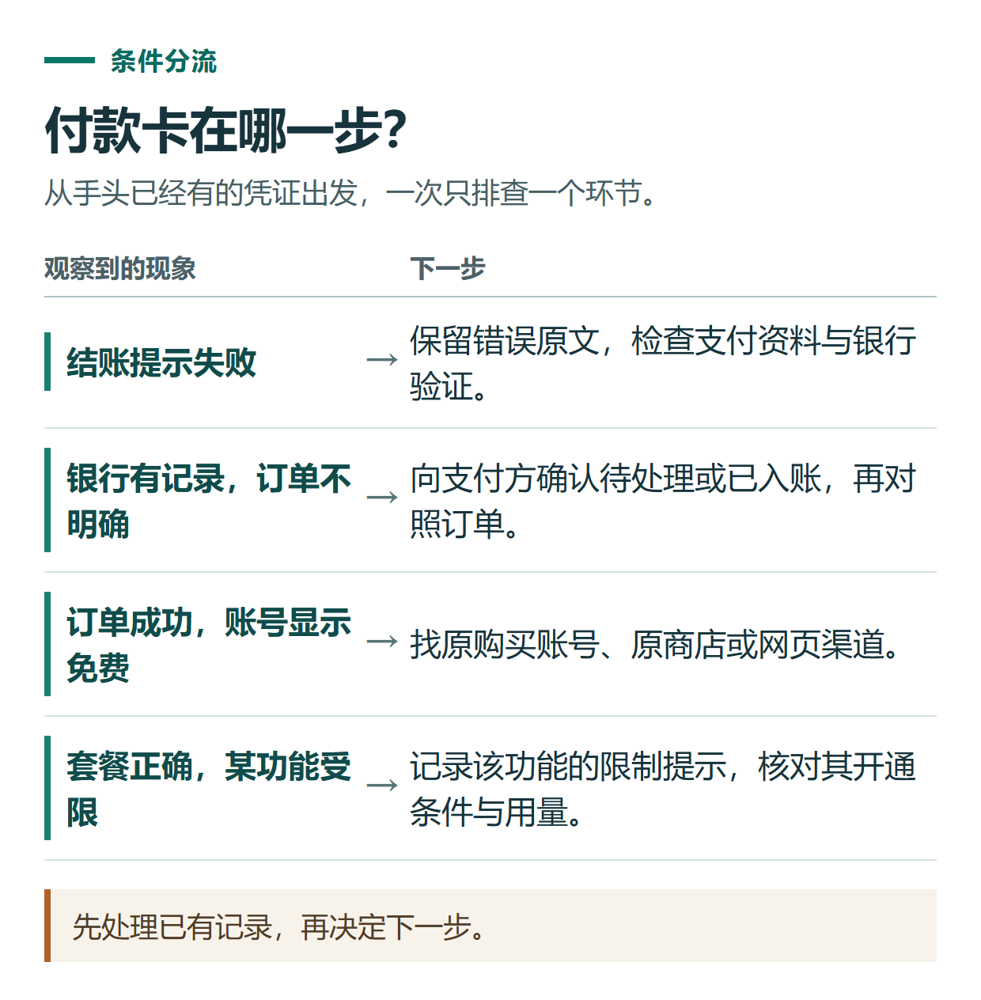

# ChatGPT 付款失败或会员未生效怎么办？按四种情况排查

[知识库首页](../README.md) · [套餐、充值与账单](../ROADMAP.md#module-03) · [订阅专题目录](../ROADMAP.md#module-03)

资料核对：2026-11-03。适用范围：个人 ChatGPT 订阅的付款及权益显示问题。

> **先看结论：** 处理 ChatGPT 充值问题，第一步是区分“没有付成功”“已经扣款但未显示会员”“登录错账号”和“会员正常但功能受限”。它们的处理方向不同，反复点击付款不一定有帮助。

<details>
<summary>本篇导航</summary>

- [一、先看自己属于哪一种](#section-01)
- [二、付款失败：核对资料与验证流程](#section-02)
- [三、已经付款，却看不到会员](#section-03)
- [四、会员正常，但文件、图片或研究功能受限](#section-04)
- [五、给支持人员的信息怎样写](#section-05)

</details>

<a id="section-01"></a>

## 一、先看自己属于哪一种

| 当前情况 | 先核对什么 | 下一步 |
|---|---|---|
| 结账明确提示付款失败 | 错误原文、卡片信息、银行验证 | 排查支付条件 |
| 银行显示记录，但没有成功订单 | 记录是待处理还是已入账 | 结合银行与订单状态核实 |
| 有成功订单，账号仍显示免费 | 登录账号与付款渠道 | 找到订单对应的原账号 |
| 套餐正确，某功能不能继续使用 | 功能名称、额度和错误提示 | 按使用限制排查 |

不要只凭一条银行卡通知判断订阅已经完成，也不要只凭某个按钮没出现判断付款失败。



*先处理已有记录，再决定下一步。*

<a id="section-02"></a>

## 二、付款失败：核对资料与验证流程

先检查卡号、有效期、账单地址和可用金额，再向发卡行确认在线交易或跨境交易限制。如果出现银行验证页面，应在原支付流程中完成验证；浏览器拦截弹窗或跳转也可能影响这一步。

还要核对产品支持地区与发卡地区要求。官方[信用卡被拒帮助](https://help.openai.com/en/articles/7232916-why-was-my-credit-card-declined)列出了这些排查方向。该文中针对 API 预付额度的规则，不能自动扩展成所有 ChatGPT 付款方式的统一结论。

遇到“卡片或设备关联数量”一类明确提示时，应按该提示联系支持。它与普通余额不足不同，不能通过购买额外额度来解释或解决。[官方卡片与设备限制说明](https://help.openai.com/en/articles/20001559-understanding-card-and-device-limits-in-chatgpt)

<a id="section-03"></a>

## 三、已经付款，却看不到会员

按顺序核对：

1. **找凭证。** 看付款来自网页、Apple、Google Play还是第三方订单。
2. **找账号。** 查看 ChatGPT 当前账号标识，和购买时使用的账号对应起来；特别注意 Apple 隐藏邮箱。
3. **找原平台。** 手机商店购买需要同时核对商店账号，不能只看手机当前登录的 ChatGPT。
4. **重新查看状态。** 刷新或在确认登录方式后重新登录，再打开对应订阅页面。
5. **仍有差异就提交核验。** 附上订单、时间及状态截图，避免在核验期间重复购买。

官方说明强调，订阅与原账号及购买渠道有关，重新安装应用不会把订阅转到另一个账号。[订阅访问与账号变更帮助](https://help.openai.com/en/articles/20001056-troubleshooting-chatgpt-subscription-access-and-account-changes)

<a id="section-04"></a>

## 四、会员正常，但文件、图片或研究功能受限

把功能提示中的限制对象记下来：是某个模型、上传次数、图片生成、语音，还是 Work 中的任务用量？套餐生效和某项用量是否耗尽，是两个问题。

可以记录“什么时候出现、哪个功能、是否写了重置时间”，再查看对应帮助文档。不要拿一张“Plus已开通”的截图，推导所有功能在任何设备上都不受限制。

<a id="section-05"></a>

## 五、给支持人员的信息怎样写

```text
我遇到的具体问题：
发生时间及所在时区：
设备、浏览器或应用版本：
购买渠道及套餐：
订单或收据编号：仅通过对应支持渠道提交
当前账号标识：通过对应支持渠道核对
错误提示原文：
已经尝试的操作及结果：
```

官方购买通过[OpenAI帮助中心](https://help.openai.com/)寻求支持；小小AI订单可以先[查询订单进度](https://xiaoxiao.pro/orders)，再从站内客服入口反馈。提交材料不需要在公开评论中暴露完整付款信息。

如果实际需求是停止下次扣费，继续看[取消续费与退款指南](chatgpt-cancel-refund.md)，这与修复会员显示问题属于不同操作。

## 接下来按你的情况继续

- 账单与重复扣款：按渠道找凭证并判断两笔交易的状态。
- 联系官方支持：整理时间、环境、步骤和证据并选择正确渠道。

[返回套餐、充值与账单专题](../ROADMAP.md#module-03) · [完整目录](../ROADMAP.md)
