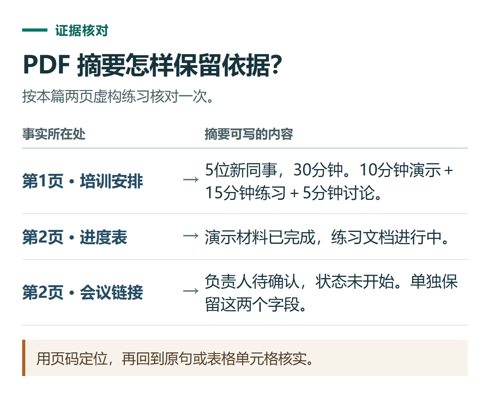

# ChatGPT 怎么阅读 PDF？摘要、定位原文与提取表格的完整练习

[知识库首页](../README.md) · [搜索、PDF与研究](../catalog/topics/research.md) · [按问题找答案](../catalog/TASKS.md)

资料核对：2026-11-03。适用环境：具有文件上传能力的ChatGPT账号；练习资料为原创虚构。

> **先看结论：** 用ChatGPT读PDF，先让它确认读到了什么，再要求摘要和提取。直接问“总结一下”，容易得到一段看似顺畅、却遗漏条件或无法回到原文核查的文字。

<details>
<summary>本篇导航</summary>

- [一、上传前先检查文件类型](#section-01)
- [二、先用一份两页练习材料](#section-02)
- [三、第一轮只确认识别情况](#section-03)
- [四、第二轮做有出处的摘要](#section-04)
- [五、第三轮提取表格并检查空值](#section-05)
- [六、换成真实PDF时怎样检查](#section-06)

</details>

<a id="section-01"></a>

## 一、上传前先检查文件类型

文字型PDF通常可以选中文字；扫描型PDF主要是页面图片。先在本地打开文件，试着选择、搜索一句话，判断自己交给它的是什么。

ChatGPT支持上传PDF等文件，但复杂排版、扫描件和图表不应假定都能完整解析。对于需要精确分析的数据，官方建议优先使用可读取的结构化材料，而不是仅依赖截图或扫描图。[文件上传说明](https://help.openai.com/en/articles/8555545-uploading-files-and-audio-to-chatgpt)、[数据分析说明](https://help.openai.com/en/articles/8437071-data-analysis-with-chatgpt)

<a id="section-02"></a>

## 二、先用一份两页练习材料

把下面两段复制进文档工具，在“第2页”之前插入分页符，再导出为 `training-plan.pdf`。这样就有一份能逐项核对的练习PDF。

```text
第1页：新员工工具入门分享方案（虚构练习）
目的：帮助新同事学会整理工作记录并检查生成结果。
对象：5位新同事。
时长：30分钟。
安排：演示10分钟，个人练习15分钟，讨论5分钟。
每位参与者需准备一段不含个人隐私的工作记录。
活动日期：待确认。

第2页：准备清单与进度（虚构练习）
项目 | 负责人 | 状态
演示材料 | 小林 | 已完成
练习文档 | 小周 | 进行中
会议链接 | 待确认 | 未开始
补充说明：所有材料仅用于内部练习，不能包含客户姓名和联系方式。
```

<a id="section-03"></a>

## 三、第一轮只确认识别情况

上传文件，确认附件名正确，再发送：

```text
请先检查这个PDF是否可以读取。
列出识别到的页数、每页标题和主要内容类型。
如果不能可靠识别页码、表格或某段内容，明确指出，不要猜。
暂时不要写摘要。
```

如果它没有准确读到第二页，先解决识别问题再继续。可以重新导出为文字型PDF，或者把原始文档内容提供给它，不要让缺少一页的材料直接进入结论。

<a id="section-04"></a>

## 四、第二轮做有出处的摘要

```text
根据这份PDF，输出200字以内的摘要。
包含目的、参加对象、时间安排、准备事项和待确认内容。
每项后面注明所在页码；如果无法可靠确认页码，改用页标题和短原文定位。
只写文件中存在的事实，不自行给活动安排具体日期。
```

检查摘要是否保留“5位”“30分钟”“10+15+5分钟”和“活动日期待确认”。若写成“活动已经确定在周五举行”，就属于没有依据的补充。

较长文件可先做章节索引，再按章摘要，最后汇总。这样发现遗漏时，可以回到具体章节处理，而不是反复重写整篇。



*用页码定位，再回到原句或表格单元格核实。*

<a id="section-05"></a>

## 五、第三轮提取表格并检查空值

```text
提取第2页准备清单，输出为表格。
列为项目、负责人、状态、原文位置。
保留“待确认”和“未开始”的原意，不把它们当空白删除。
在表格后列出仍需人工确认的事项。
```

合格结果应有3行项目。会议链接的负责人仍是待确认，练习文档仍是进行中。如果模型把列错位了，要求按原表逐行重新核对，不要直接拿错误表格生成下一份计划。

<a id="section-06"></a>

## 六、换成真实PDF时怎样检查

先抽查三类信息：数字和单位、附加条件、否定句。比如“可以”与“不可以”、“所有”与“部分”只差几个字，却可能改变结论。

需要读取多个版本时，给文件起清楚的名字，并明确哪份较新。要求分别列出每份材料的依据，再比较差异，避免把旧版本条件当成新版本要求。

如果主要目标是计算表格数据，优先取得原Excel或CSV，继续使用[ChatGPT数据分析教程](chatgpt-data-analysis.md)。

## 接下来按你的情况继续

- [图片识别与OCR](chatgpt-image-understanding-ocr.md)：把图片转成可核对文字和表格，标出识别不清的信息。
- [论文阅读与比较](chatgpt-paper-reading-literature.md)：提取研究设计、结果及不能据此得出的结论。

[返回搜索、PDF与研究专题](../catalog/topics/research.md) · [完整文章索引](../catalog/ALL_ARTICLES.md)
