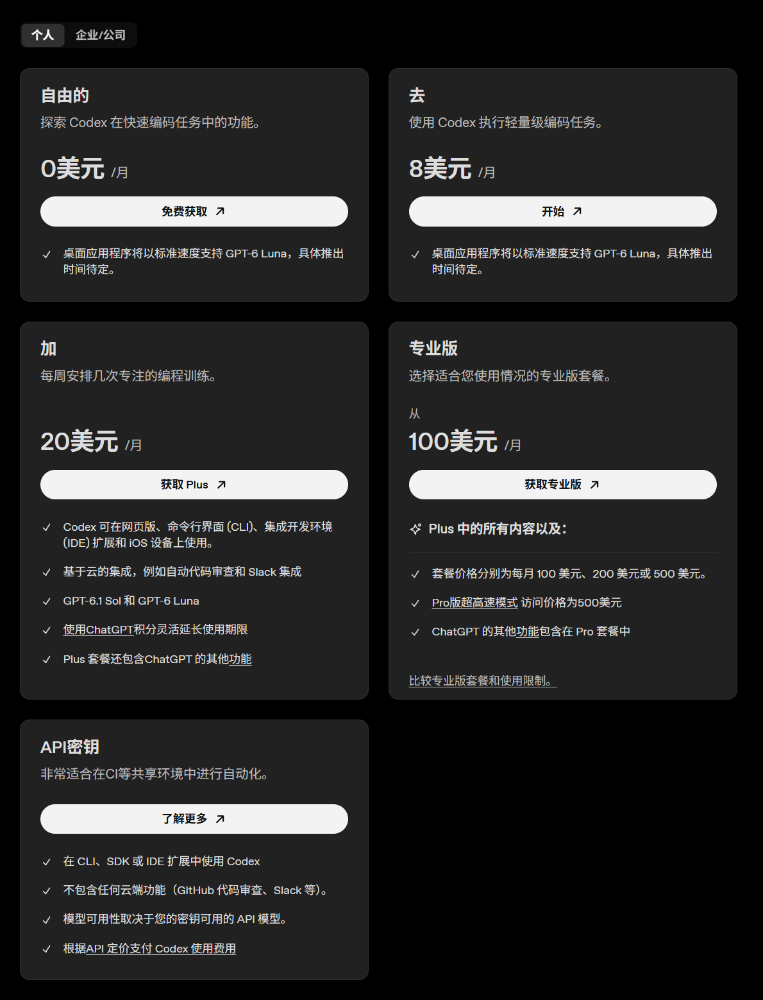
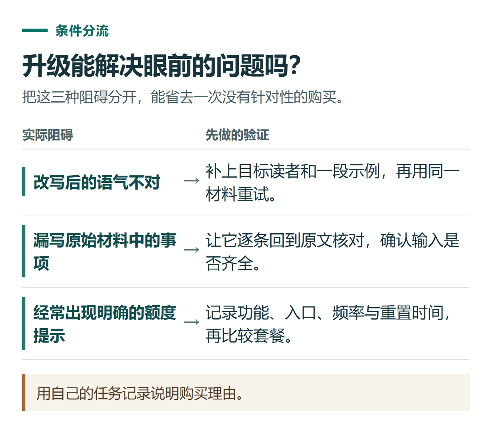
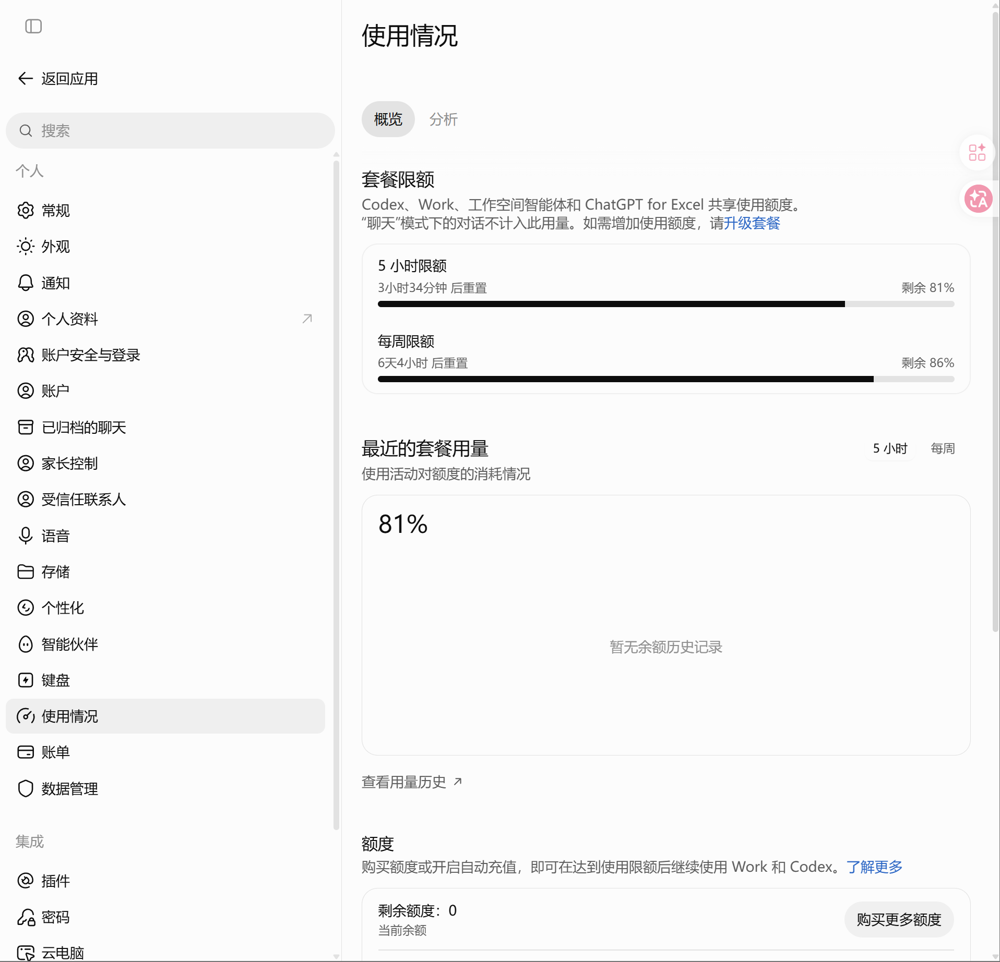

# ChatGPT Free、Go、Plus、Pro 怎么选？按任务与使用强度判断

[知识库首页](../README.md) · [套餐、充值与账单](../catalog/topics/subscription.md) · [已上线教程](../README.md)

资料核对：2026-11-03。适用范围：个人套餐选择；价格与权益在付款前需再次查看账号结账页。

> **先看结论：** 选 ChatGPT 套餐，先找出免费使用时具体遇到了什么限制。如果只是偶尔改一段文字，没有遇到影响工作的限制，可以继续使用 Free；经常处理资料或连续完成任务，再比较 Go、Plus 与 Pro。

本篇导航

- [一、先把价格档位看清楚](#section-01)
- [二、用三天真实任务决定，而不是猜](#section-02)
- [三、付款前逐项比较这五件事](#section-03)
- [四、四种典型情况怎么选](#section-04)
- [五、确定套餐后再选择办理方式](#section-05)

## 一、先把价格档位看清楚

以下为核对日官方公开页面列出的美元月费档位，不是小小AI服务报价，也不是人民币换算价。地区、税费、商店渠道与实际结账金额需要另看付款页。

| 个人套餐 | 官方公开美元月费 | 本文建议的比较起点 |
|---|---:|---|
| Free | $0 | 先体验并记录需求 |
| Go | $8 | 预算有限，核对它是否覆盖主要任务 |
| Plus | $20 | 经常使用，比较所需功能及用量 |
| Pro | $100 / $200 / $500 | 已有持续高用量需求，再逐档比较 |

价格依据：[OpenAI 套餐与价格说明](https://learn.chatgpt.com/docs/pricing)。该页包含 Work / Codex 的定价和用量说明，不能把其中某个模式的额度直接当作普通聊天的统一条数。

*这张截图来自以 Codex 为重点的套餐页面，功能说明主要围绕编程使用。截图中的套餐名称经过中文翻译，Free、Go、Plus 分别显示为“自由的”“去”“加”。比较 ChatGPT 的文字对话、图片和研究等功能时，请同时查看 [ChatGPT 官方套餐对比](https://chatgpt.com/pricing/)。实际价格和可购档位以账号结账页为准。*

## 二、用三天真实任务决定，而不是猜

准备一张简单记录表，每做完一个任务就记一行。

| 任务 | 使用频率 | 实际遇到的问题 | 需要购买才能解决吗 |
|---|---|---|---|
| 修改一篇公众号草稿 | 每周2次 | 语气不合适 | 先改提示词与材料 |
| 阅读多份资料 | 每周3次 | 上传或使用额度不足 | 比较对应功能用量 |
| 整理短工作记录 | 每天1次 | 偶尔漏一项 | 先增加核对步骤 |
| 连续研究或开发 | 工作日高频 | 多次出现额度提示 | 再比较更高档位 |

这是选择方法示例，不是各套餐实际限额。把你自己的问题写进去，才知道升级要解决什么。

回答不理想也可能来自材料不完整、目标不清楚或结果未核查。提高套餐不能保证每次答案正确；把写作问题直接归因于“会员不够高级”，可能多花钱仍解决不了。

*用自己的任务记录说明购买理由。*

## 三、付款前逐项比较这五件事

**需要的功能。** 直接找上传文件、图片、语音、搜索或研究等自己会使用的项目，不只看套餐名。

**使用上限。** 对照具体功能的额度提示与重置时间，不采用“付费就无限”的笼统理解。

**实际使用模式。** 你主要在普通 Chat 中问答，还是在 Work / Codex 中执行长任务？不同模式的用量说明要分别看。

**计费周期。** 确认月付、其他周期或促销条件，关注下一次扣费时间。

**当前订阅状态。** 之前若在 Apple 或 Google Play 购买，先弄清原渠道的续费状态，再决定是否更换方式。[官方账单说明](https://help.openai.com/en/articles/9039756-managing-billing-for-chatgpt-and-the-api-platform)提醒，多平台订阅可能产生分别收费。

## 四、四种典型情况怎么选

**刚入门：** 先用 Free 完成[网页版小练习](chatgpt-web-basics.md)，找到自己的真实需求。

**日常学习与轻量写作：** 将 Go 和 Plus 放在一起看，逐项确认所需能力是否包含。不要仅凭一句“性价比高”做决定。

**经常处理文档、表格和研究任务：** 优先比较 Plus 能否覆盖当前工作量；记录实际限制，再判断是否需要 Pro。

**已经高频使用且多次触及限制：** 把一周的任务和额度提示整理出来，按 Pro 各档的当前规则核对。只因为“最高档一定更专业”而购买，缺少判断依据。

*截图展示的是 Work、Codex 等功能共享的用量和重置时间。图中的百分比与倒计时只反映该账号截图时的状态，普通聊天的限制请按页面实际提示核对。*

可以用这张卡记录自己的购买理由：

| 购买前确认 | 你的记录 |
|---|---|
| 任务 | 实际要完成什么、每周大约用多少次 |
| 阻碍 | 缺功能、缺用量，还是材料与提问需要改进 |
| 原订阅 | 目标账号、购买渠道和后续续费安排；私下保存 |
| 商品 | 完整套餐名、周期和本次总价 |
| 验收 | 对应账号内的套餐状态与账期 |

## 五、确定套餐后再选择办理方式

能自行完成官方订阅的读者，可以从账号的升级入口办理。需要了解第三方服务的读者，可查看[小小AI套餐与会员办理](https://xiaoxiao.pro/shop?utm_source=github&utm_medium=referral&utm_campaign=chatgpt_guide&utm_content=a04_shop)，先确认目标套餐、账号条件、总价和售后范围。

小小AI为独立第三方服务方，服务报价与官方美元标价是不同概念。付款前建议继续阅读[会员订阅、API充值与代充有什么区别](chatgpt-subscription-api-topup.md)，避免产品买错。

## 接下来按你的情况继续

- 官方订阅步骤：核对账号、购买渠道和账期，完成官方订阅及续费前检查。
- 会员购买前检查：购买前明确产品、账号控制、续费和验收。

[返回套餐、充值与账单专题](../catalog/topics/subscription.md) · [完整目录](../catalog/ALL_ARTICLES.md)
