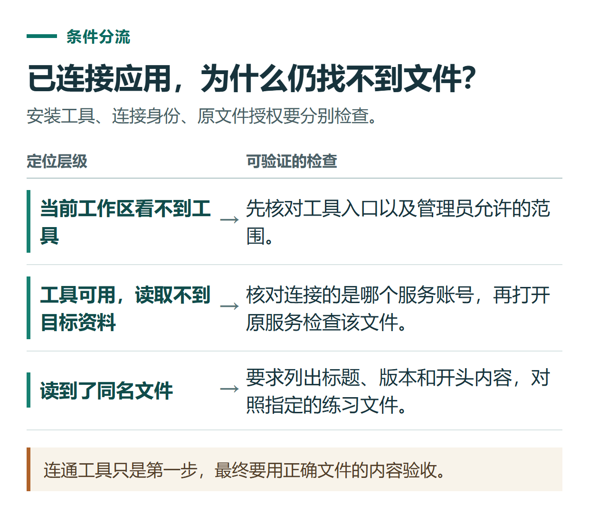

# ChatGPT 插件与连接应用怎么用？从查找一份文件开始

[知识库首页](../README.md) · [工具连接与协作](../catalog/topics/tools.md) · [按问题找答案](../catalog/TASKS.md)

资料核对：2026-11-03。适用环境：账号可用的 Chat 或 Work 插件；不同设备、套餐和组织权限可能不同。

> **先看结论：** 如果资料在 Google Drive 等外部服务里，插件可以让 ChatGPT 在授权范围内查找和使用它们。但“安装插件”“连接正确账号”“找到正确文件”“允许修改文件”是四件不同的事。第一次使用，建议从一份练习文件的读取和整理开始。

本篇从连接一份资料开始；复用操作规则看[技能](chatgpt-skills-reusable-workflows.md)，按时间触发看[计划任务](chatgpt-scheduled-tasks.md)。

<details>
<summary>本篇导航</summary>

- [一、插件、技能和连接应用分别是什么](#section-01)
- [二、安装前明确你要完成什么](#section-02)
- [三、安装、连接，再开一个练习对话](#section-03)
- [四、用一份原创练习文件验证](#section-04)
- [五、找不到文件时按这个顺序检查](#section-05)

</details>

<a id="section-01"></a>

## 一、插件、技能和连接应用分别是什么

可以把插件理解为一套可复用的工作能力。其中的技能提供任务说明，连接工具让它访问外部资料或执行操作；并非每个插件都有外部账号连接，也并非每个插件都支持写入。官方提供统一插件目录，在支持的 Chat、Work 等界面使用；标为 Desktop only 的插件需要桌面端。[官方插件说明](https://learn.chatgpt.com/docs/plugins)

这些说明针对当前产品。网上早期“打开某个旧模型，再开启插件商店”的截图，不能直接当作当前操作依据。

<a id="section-02"></a>

## 二、安装前明确你要完成什么

先写一句任务目标，例如：

> 找到我指定的活动安排文档，提取时间、地点、负责人和未确定事项，整理成表格。

这个任务不需要发送邮件或修改文档。你可以先确认插件是否提供查找和读取能力，再决定是否连接账号，避免为一个摘要任务安装一整套无关工具。

还要看清自己准备连接的是个人账号还是工作账号。公司文件通常受组织权限管理，即使你知道文件标题，也不代表当前连接身份能读到它。

<a id="section-03"></a>

## 三、安装、连接，再开一个练习对话

1. 打开 **Plugins**，搜索需要的服务，例如 Google Drive。
2. 阅读插件介绍及适用设备，选择安装。
3. 如果出现连接要求，核对外部服务名称、账号和授权范围后完成连接。
4. 新建对话，按界面提供的方式选择插件；支持时可输入 `@` 选择。
5. 指定文件标题或链接，以及只需要读取和整理的目标。

安装与连接流程见[插件说明](https://learn.chatgpt.com/docs/plugins)，指定来源的方法见[官方提示指南](https://learn.chatgpt.com/docs/prompting)。操作按钮以实际账号为准。

<a id="section-04"></a>

## 四、用一份原创练习文件验证

如果有 Google Drive 账号，可以先自己创建名为“练习用：资料整理分享会”的文档，放入下面的虚构内容：

```text
活动：资料整理分享会
日期：2026年11月18日
开始时间：19:30，北京时间
时长：40分钟
地点：待确认
负责人：陈老师（练习用虚构人物）
参加人数：8人
要求：通知里不要公布任何成员手机号
```

在 ChatGPT 中选择相应插件后发送：

```text
请读取我指定的“练习用：资料整理分享会”文档。
只整理这份文档，不修改源文件、不发送通知。
输出：已确定事项、待确认事项、原文件链接。
如果找到同名文件，先列出候选文件让我选择，不混合内容。
```

检查结果应当保留“地点待确认”，时间注明北京时间，人数为8人。不要只看它是否说“已找到”；打开返回的原文件链接，确认标题、内容和版本都正确。

<a id="section-05"></a>

## 五、找不到文件时按这个顺序检查

先检查文件能否由你在原服务中打开，再核对连接账号是否相同；随后尝试提供准确链接，避免只用模糊标题。如果组织禁止相关连接，继续重复安装并不能解决权限问题。

即使能读取文件，也要单独确认插件是否支持修改。需要改文档时，先说明目标位置和允许改动的范围；需要发送消息时，先检查收件人和最终内容。操作后回到原服务核对结果，不把聊天中的一句“完成了”当作唯一凭据。

暂时不需要连接账号时，也可以上传一份已经脱敏的文件，使用[文档对比方法](chatgpt-compare-documents.md)。只想查公开资料，则先用[联网搜索与资料核对](chatgpt-search-research.md)。



*连通工具只是第一步，最终要用正确文件的内容验收。*

## 接下来按你的情况继续

- [Work浏览器](chatgpt-work-browser.md)：指定公开页面读取与对比，检查来源后再考虑进一步操作。
- [创建可复用技能](chatgpt-skills-reusable-workflows.md)：把重复的进度整理要求做成可试用的技能流程。

[返回工具连接与协作专题](../catalog/topics/tools.md) · [完整文章索引](../catalog/ALL_ARTICLES.md)
