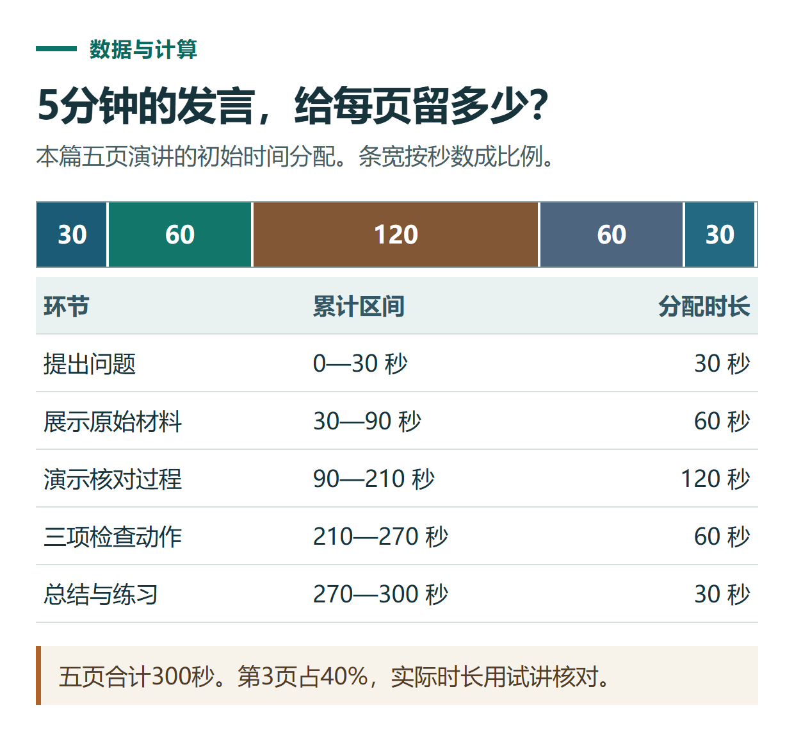

# ChatGPT 写演讲稿与 PPT 备注：把一份材料讲清楚，并控制实际时长

[知识库首页](../README.md) · [办公与内容创作](../catalog/topics/work.md) · [按问题找答案](../catalog/TASKS.md)

资料核对：2026-11-03。适用环境：文字讲稿与演示文稿修改；以下为原创5分钟分享练习。

> **先看结论：** 演讲稿应服务于听众理解。先明确听众最终记住什么，再安排每页重点和口头解释，不必把全文放到幻灯片上。

<details>
<summary>本篇导航</summary>

- [一、准备事实与唯一核心结论](#section-01)
- [二、先设计五页结构](#section-02)
- [三、给每页一个初始时间安排](#section-03)
- [四、用“保留事实”方式压缩讲稿](#section-04)
- [五、正式交付前做两轮检查](#section-05)

</details>

<a id="section-01"></a>

## 一、准备事实与唯一核心结论

练习材料如下：

```text
主题：第一次用AI整理会议记录。
听众：没有使用经验的同事。
核心结论：先提供完整材料，再检查数字、负责人和待确认事项。
案例：计划做3张图，已经完成2张，还有1张待做；尚未发布。
演示目标：不能把“完成2张”写成“3张全部发布”。
总讲解目标：约5分钟，具体以本人试讲为准。
```

不要补不存在的用户案例、提效百分比或真实客户评价。资料越短，越应该把事实条件写准确。

<a id="section-02"></a>

## 二、先设计五页结构

```text
请设计5页分享结构，每页一个重点。
第1页提出常见问题；第2页展示原始材料；第3页演示核对；
第4页给三项检查动作；第5页总结并给一个练习。
每页分别写屏幕文字和演讲备注，避免两者完全重复。
```

官方提示指南建议说明成果的受众、形式和约束；这里的讲稿结构是本例的编辑设计。[官方提示指南](https://learn.chatgpt.com/docs/prompting)

<a id="section-03"></a>

## 三、给每页一个初始时间安排

可以先按30、60、120、60、30秒分配，合计300秒。第3页演示留得较长，是因为需要展示原始材料和核对过程。

这只是排练计划，不是模型保证的实际语速。本人读稿、停顿、切页和操作都会影响时长。若现场还要互动，应另留时间，而不是把问答自动算在“5分钟讲稿”之外。



*本篇练习图。五页合计300秒。第3页占40%，实际时长用试讲核对。*

<a id="section-04"></a>

## 四、用“保留事实”方式压缩讲稿

```text
试讲后发现第3页太长，请压缩这页口头说明。
必须保留计划3张、完成2张、1张待做、尚未发布四个事实。
删掉重复解释，不增加新概念。
其他四页先保持不变。
```

核对压缩版是否把“待做”说成“已完成”，或为了简洁删掉“尚未发布”。演讲语言可以更口语，但不能因此改变结果状态。

<a id="section-05"></a>

## 五、正式交付前做两轮检查

第一轮对内容：事实、顺序、听众是否能理解。第二轮对呈现：字号、图注、投屏可读性、切页和演讲备注是否对应。需要实际PPT时，明确交付可编辑文件，并在演示软件中打开检查。[文件制作与预览](https://learn.chatgpt.com/docs/artifacts-viewer)

如果听众不了解某个词，先换一个短例子，不要靠加更多术语来显得专业。文件生成的具体流程见[Word和PPT教程](chatgpt-word-ppt-files.md)。

## 接下来按你的情况继续

- [生成Word与PPT](chatgpt-word-ppt-files.md)：从同一材料制作可编辑文件，并检查下载后的内容与版式。
- [公众号与视频改编](chatgpt-content-workflow.md)：得到可核对的文章片段、镜头表和发布检查方法。

[返回办公与内容创作专题](../catalog/topics/work.md) · [完整文章索引](../catalog/ALL_ARTICLES.md)
