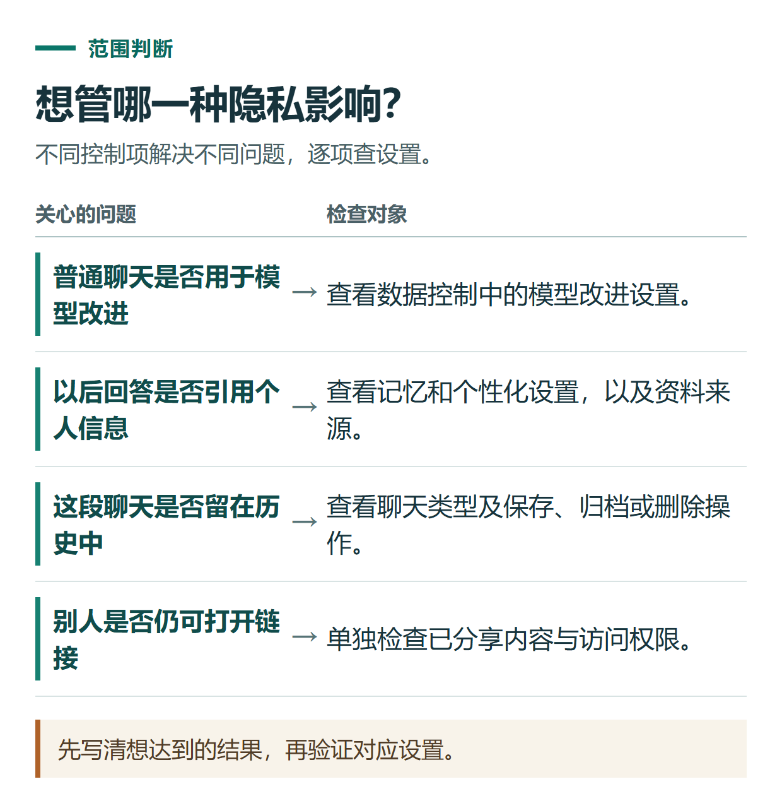
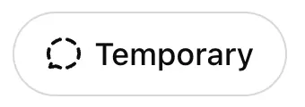

# ChatGPT 临时聊天与隐私设置：训练、记忆、历史记录分别怎么管

[知识库首页](../README.md) · [登录、隐私与账号](../catalog/topics/accounts.md) · [按问题找答案](../catalog/TASKS.md)

资料核对：2026-11-03。适用对象：个人ChatGPT账号的日常聊天；组织管理及特殊产品另有规则。

> **先看结论：** 不想让内容用于模型改进、不想影响以后回答、不想在历史里留下聊天，是三个不同需求。关闭其中一个设置，不代表其他设置也自动关闭。先说明你希望控制什么，再找到对应入口。

<details>
<summary>本篇导航</summary>

- [一、把四件事分开理解](#section-01)
- [二、怎样关闭普通聊天的模型改进分享](#section-02)
- [三、临时聊天现在需要注意个性化选项](#section-03)
- [四、临时聊天保存以后会怎样](#section-04)
- [五、上传材料前做一个实际判断](#section-05)

</details>

<a id="section-01"></a>

## 一、把四件事分开理解

| 你关心什么 | 应查看的设置或操作 | 它不自动代表什么 |
|---|---|---|
| 普通聊天是否用于模型改进 | Improve the model for everyone | 不代表删除已有聊天 |
| 是否用于以后个性化回答 | Memory等个性化设置 | 不代表关闭模型训练 |
| 是否保留在普通历史中 | 临时聊天、保存或删除 | 不等于数据立即从全部系统消失 |
| 别人能否打开分享内容 | 分享链接与访问权限 | 不随训练开关自动撤销 |

数据控制与记忆是独立设置，详情见[官方数据控制说明](https://help.openai.com/en/articles/7730893-data-controls-in-chatgpt)。本文不把普通聊天的开关解释为对所有产品、所有处理方式的统一承诺。



*先写清想达到的结果，再验证对应设置。*

<a id="section-02"></a>

## 二、怎样关闭普通聊天的模型改进分享

网页版进入“设置 → Data controls（数据控制）”，查看“Improve the model for everyone”，按自己需要关闭并保存。手机端从个人设置进入相同的数据控制项。

关闭后，原来保存的聊天仍然存在。如果选择对回答提交赞踩等反馈，与反馈关联的整段对话可能用于模型训练；Codex环境等也可能有独立控制，应查对应产品说明。不要把一个开关理解为所有场景都绝对排除使用。

<a id="section-03"></a>

## 三、临时聊天现在需要注意个性化选项

当前[官方临时聊天说明](https://help.openai.com/en/articles/8914046-temporary-chat-in-chatgpt)提供以下操作：新建聊天，选择Temporary，在发送第一条消息前选择Personalized或Unpersonalized。

- **Personalized：** 可以使用既有记忆、自定义指令和插件。
- **Unpersonalized：** 不使用这些个性化内容与插件。

因此，不能再简单把“临时聊天”写成任何情况下都完全不使用既有记忆。两种方式在保持临时状态时都不创建或更新记忆，但开始后不能直接切换本次个性化选择。

如果想做一次不依赖个人偏好的通用表达测试，可以新开Unpersonalized临时聊天，发送：

```text
请只根据以下材料，把通知改得简明。
材料：周五下午进行一次30分钟的资料整理练习，参加者需自备一段虚构工作记录。
不要补充地点、主办方和报名渠道。
```

这只是熟悉入口的练习，不是证明所有安全或系统上下文都被关闭的测试。



*官方示例中的 Temporary 入口，个性化选择请以当前页面实际显示为准。 [图片来源](https://help.openai.com/en/articles/8914046-temporary-chat-in-chatgpt)*

<a id="section-04"></a>

## 四、临时聊天保存以后会怎样

保持临时状态时，不进入普通历史，也不用于模型改进；官方可能为安全目的保留副本至多30天。它不等于“任何地方都完全不留记录”。

如果选择保存，这段对话会成为普通聊天，并按账号的个性化和模型改进设置处理。需要保留结果时，先决定是只把最终文字另存，还是把整段对话保存到账号中。

使用外部工具时，还应核对哪些内容会发送给外部服务，不能把ChatGPT里的临时状态当成外部网站的数据保留承诺。

<a id="section-05"></a>

## 五、上传材料前做一个实际判断

先问自己：任务真的需要客户姓名、订单号或联系方式吗？例如只想学习周报格式，用“客户甲”和虚构日期通常就够了。先减少不必要信息，比上传后再寻找一个“清除所有痕迹”按钮更可控。

需要管理已保存文件，继续看[Library与Space](chatgpt-library-space-files.md)；需要查看长期偏好，参考[项目、记忆与自定义指令](chatgpt-projects-memory-instructions.md)。如果只是想停止公开链接访问，则应到[分享管理](chatgpt-chat-history-sharing.md)单独操作。

## 接下来按你的情况继续

- [查看、纠正与删除记忆](chatgpt-memory-customization-control.md)：审阅、纠正记忆并区分不再提及、关闭和删除。
- [账号安全](chatgpt-account-security.md)：设置可用的多重验证，检查登录会话并准备换设备。

[返回登录、隐私与账号专题](../catalog/topics/accounts.md) · [完整文章索引](../catalog/ALL_ARTICLES.md)
