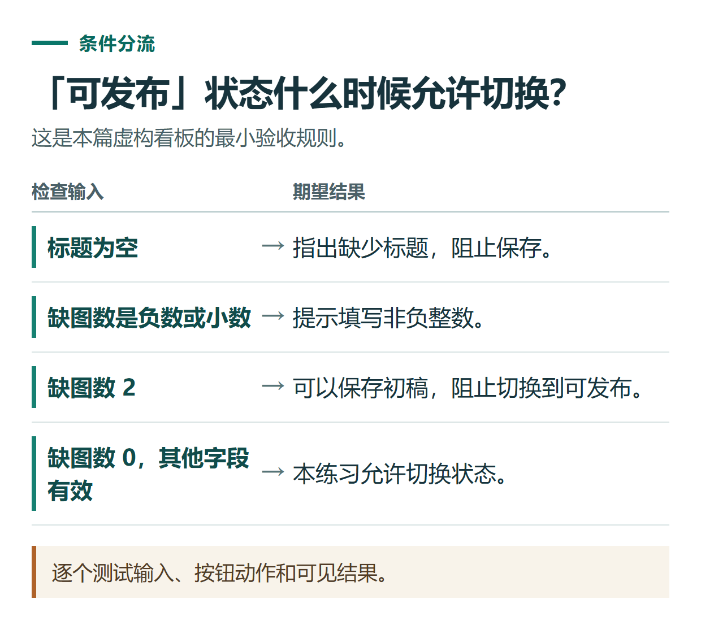

# ChatGPT 写需求文档：从一句想法到范围、规则和验收条件

[知识库首页](../README.md) · [办公与内容创作](../catalog/topics/work.md) · [按问题找答案](../catalog/TASKS.md)

资料核对：2026-11-03。适用环境：需求讨论与文档草稿；案例为原创文章审核看板。

> **先看结论：** “帮我做一个文章管理系统”太宽泛。开始写需求前，先说明谁使用、要完成什么、第一版做到哪里，再把操作结果变成可以检查的条件。

<details>
<summary>本篇导航</summary>

- [一、从一个最小目标开始](#section-01)
- [二、先让ChatGPT列出未确定事项](#section-02)
- [三、把需求写成行为规则](#section-03)
- [四、写出可以执行的验收条件](#section-04)
- [五、控制后续改动](#section-05)

</details>

<a id="section-01"></a>

## 一、从一个最小目标开始

```text
我想做一个供本人使用的文章审核看板。
每条记录有标题、正文路径、缺图数量和状态。
状态包括初稿、审阅中、待配图、可发布。
第一版只整理记录，不自动上传GitHub、不收集读者资料。
需要搜索标题，并按状态筛选。
```

这是原创练习规格，不表示网站已经建成。准备真实需求时，还要说明使用设备、现有数据和是否多人协作。

<a id="section-02"></a>

## 二、先让ChatGPT列出未确定事项

```text
先不要补功能。请列出实现前必须确认的问题。
特别检查：数据保存在哪里、刷新是否保留、谁能改状态、缺图数量如何更新。
将必须决定和可以以后再做的问题分开。
```

这一步可以发现“管理记录”和“长期保存记录”不是同一件事。页面有输入框，不等于刷新后数据还在。任务边界与成果要求可以参考[官方提示指南](https://learn.chatgpt.com/docs/prompting)。

<a id="section-03"></a>

## 三、把需求写成行为规则

为练习先补两条决定：缺图数量由本人手动填写；只有缺图数为0的记录才能标记“可发布”。这只是本工具的练习规则，不代表真实发布仅需检查图片。

```text
请生成简短需求文档，包含目标、使用者、第一版范围、字段、操作流程和异常状态。
明确缺图数量为非负整数。
标题为空不能保存；无搜索结果时展示清楚提示。
不要添加账号系统、付款和自动发布。
```

字段要说明含义。例如“正文路径”是链接还是本地文件位置，会影响点击行为；未决定时保留问题，不自行创建不存在的地址。

<a id="section-04"></a>

## 四、写出可以执行的验收条件

| 操作 | 应有结果 |
|---|---|
| 新建“文档对比”，缺图2，状态初稿 | 记录可保存并出现在列表 |
| 标题为空保存 | 阻止保存并指出标题缺失 |
| 缺图填－1或1.5 | 提示必须为非负整数 |
| 缺图2时标可发布 | 阻止并说明尚有缺图 |
| 缺图0时标可发布 | 状态可以修改 |
| 搜索不存在的标题 | 显示无结果，可清除搜索 |

数据能否在刷新后保留，必须按前面确认的存储方案另列验收，不能默认通过。



*逐个测试输入、按钮动作和可见结果。*

<a id="section-05"></a>

## 五、控制后续改动

新想法出现时记录目的、影响范围和是否进入本版。不要把“以后可能要团队协作”直接变成当前必须交付的复杂权限系统。

文档确认后，按验收条件做小原型，再用真实需求反馈修订。实现离线小工具可参考[HTML练习](chatgpt-html-mini-tool.md)，需要托管和分享则看[Sites流程](chatgpt-sites-website-workflow.md)。

需要协助配置自己的工具、工作流或知识库时，可了解[小小AI安装与定制服务](https://xiaoxiao-ai.com/?utm_source=github&utm_medium=referral&utm_campaign=chatgpt_guide&utm_content=a66_implementation)。这是维护者提供的独立第三方服务；先说明设备、输入、目标与验收要求，再确认范围和费用。

## 接下来按你的情况继续

- [HTML人数小工具](chatgpt-html-mini-tool.md)：生成本地人数计算器并按样例检查交互。
- [Sites资源网站](chatgpt-sites-website-workflow.md)：准备资源资料，预览页面并检查检索交互。

[返回办公与内容创作专题](../catalog/topics/work.md) · [完整文章索引](../catalog/ALL_ARTICLES.md)
