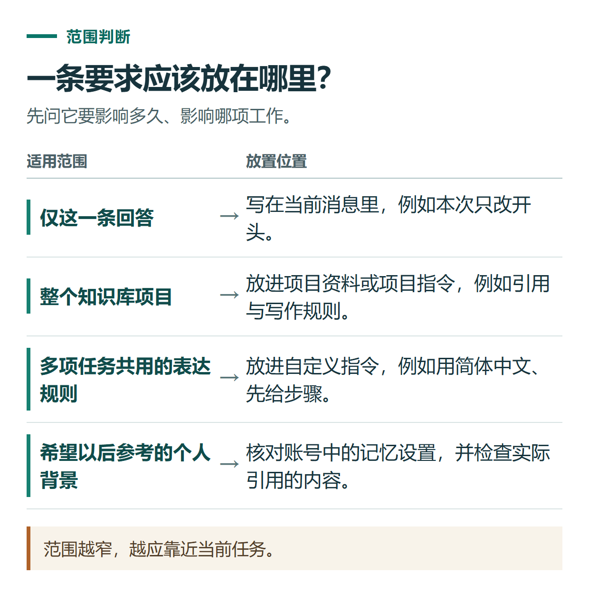

# ChatGPT 项目、记忆和自定义指令有什么区别？建立自己的长期工作空间

[知识库首页](../README.md) · [项目、记忆与技能](../catalog/topics/projects.md) · [按问题找答案](../catalog/TASKS.md)

资料核对：2026-11-03。适用环境：ChatGPT个人账号；具体设置受套餐、平台和开放范围影响。

> **先看结论：** 如果每次提问都重复说明“请用简体中文”“这是给新手的教程”，可以使用自定义指令；如果围绕同一个主题长期整理资料，可以建立项目；记忆则用于产品提供的持续个性化。三者用途不同，不能互相替代。

本篇解决项目、记忆和指令各放什么；完整任务看[多文件案例](chatgpt-projects-multi-file-case.md)，纠正偏好看[记忆控制](chatgpt-memory-customization-control.md)。

<details>
<summary>本篇导航</summary>

- [一、先用一张表决定放在哪里](#section-01)
- [二、先设置一份不过度限制的自定义指令](#section-02)
- [三、建立一个“中文教程写作”项目](#section-03)
- [四、用一个小任务验证设置是否有效](#section-04)
- [五、记忆应该怎样管理](#section-05)
- [常见问题](#section-06)

</details>

<a id="section-01"></a>

## 一、先用一张表决定放在哪里

| 内容 | 更适合放在哪里 | 示例 |
|---|---|---|
| 跨任务都适用的表达偏好 | 自定义指令 | 用简体中文，先给结论 |
| 某一项长期工作的材料与规则 | 项目 | 某个知识库的参考资料、文章对话 |
| 希望产品持续参考的个人背景 | 可用的记忆设置 | 对输出深度或背景的长期偏好 |
| 本次任务专属要求 | 当前消息 | 这篇压到800字，本次只改开头 |

官方资料分别说明了[项目](https://help.openai.com/en/articles/10169521-projects-in-chatgpt)、[自定义指令](https://help.openai.com/en/articles/8096356-chatgpt-custom-instructions)和[记忆](https://help.openai.com/en/articles/8590148-memory-in-chatgpt)的用途。下面的配置是编辑建议，可以按自己的工作调整。



*范围越窄，越应靠近当前任务。*

<a id="section-02"></a>

## 二、先设置一份不过度限制的自定义指令

网页或桌面端可在“设置 → 个性化”查看自定义指令；手机端按设置中的“Customize ChatGPT”等实际入口操作。保存后用新任务验证效果，不要只看开关是否打开。

```text
请默认使用自然的简体中文。
先回答当前问题，再给必要的步骤或解释。
区分我提供的事实、外部来源事实和你的建议。
涉及数字、价格、产品功能时，不确定就明确说明，不编造依据。
我要求修改已有文字时，保留未要求改动的事实。
```

不要把某一篇文章的关键词、客户姓名或临时日期写成所有对话都要遵守的规则。否则下次讨论完全不同的任务时，也可能受到这些信息影响。

<a id="section-03"></a>

## 三、建立一个“中文教程写作”项目

1. 在侧栏选择新建项目，为它起一个自己能识别的名称。
2. 添加与项目有关的文件，例如写作要求、已确认的术语和参考文章。
3. 在项目设置中填写只对这个项目适用的说明。
4. 为每个具体任务新建相应对话，避免把所有文章放进一条无限延长的聊天。

官方项目说明指出，项目指令在对应项目内生效，并可覆盖全局自定义指令。因此，两个地方发生冲突时，应先检查项目内的要求。

可使用这份示例项目说明：

```text
这个项目用于写面向中文新手的工具教程。
每篇先说明读者能完成什么，再写步骤、示例和检查方法。
产品事实使用可核查来源；没有实际操作就不写“亲测”。
截图位置用可见占位标出，记录需要截图的界面和建议文件名。
业务价格、服务期限和售后承诺只采用我已确认的材料。
```

<a id="section-04"></a>

## 四、用一个小任务验证设置是否有效

在项目中新建对话，发送：“请根据项目规则，给‘如何整理工作记录’写一个教程开头，120字以内。”

检查是否用简体中文、先说明读者成果、有没有虚构实测或效果。如果不符合要求，查看项目说明是否保存、资料是否放在正确项目，而不是马上增加更多重复规则。

长期使用时，把已确认的版本记录在自己维护的文档里。项目可以帮助组织材料，但不能代替清晰的版本管理：文件名中区分草稿、审定稿和日期，遇到同名旧稿要明确指定依据。

<a id="section-05"></a>

## 五、记忆应该怎样管理

当前官方记忆设置位于“设置 → 个性化 → Memory”等相关入口，实际界面因账号而异。可以查看并调整可管理的记忆，但不能假定它完整保存了每次聊天的全部细节。

关闭记忆与删除历史信息不是同一个操作；删除聊天也不一定同时删除另行保存的记忆。需要清理某项信息时，按官方说明分别检查相关记忆、聊天或其他来源，不要只做一步就认定全部移除。

<a id="section-06"></a>

## 常见问题

**它总记错临时要求怎么办？** 把一次性要求放回当前消息，清理长期规则里已经过期的内容。

**项目建好就一定会记住全部文件吗？** 重要任务仍要指定文件和版本，并要求给出依据，尤其在材料多或相互矛盾时。

**适合用来维护一系列文章吗？** 可以按主题组织，但每篇仍需要独立核对资料和事实。可从[公众号内容改编案例](chatgpt-content-workflow.md)开始实践。

## 接下来按你的情况继续

- [多文件项目案例](chatgpt-projects-multi-file-case.md)：用需求、资源和旧记录生成有版本依据的活动方案。
- [查看、纠正与删除记忆](chatgpt-memory-customization-control.md)：审阅、纠正记忆并区分不再提及、关闭和删除。

[返回项目、记忆与技能专题](../catalog/topics/projects.md) · [完整文章索引](../catalog/ALL_ARTICLES.md)
