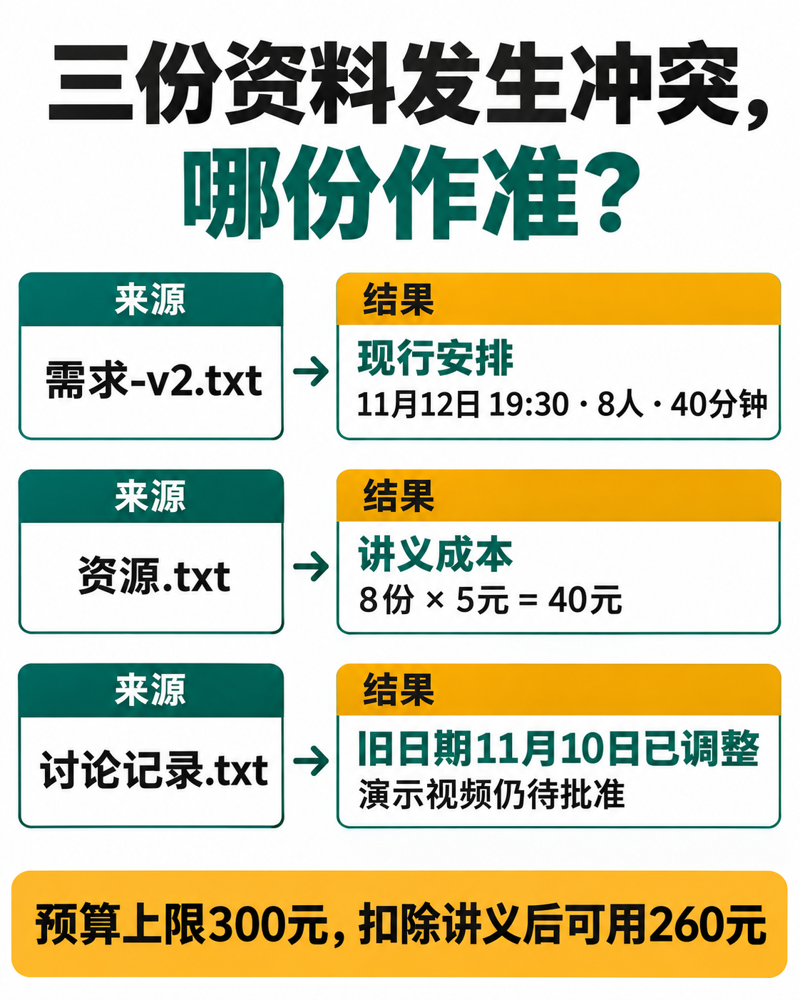

# ChatGPT 多文件项目实践：用需求、资料与进度表完成一份活动方案

[知识库首页](../README.md) · [项目、记忆与技能](../catalog/topics/projects.md) · [按问题找答案](../catalog/TASKS.md)

资料核对：2026-11-03。适用环境：ChatGPT Projects；以下三个文件均为原创虚构材料。

> **先看结论：** 多个文件一起使用时，最容易出错的不是“不会总结”，而是把旧安排、当前要求和建议混成一份事实。项目可以集中保存材料，但你仍需要告诉它每份文件的用途和优先关系。

**练习材料：** [打开输入、提示词与检查答案](../resources/practice/chatgpt-projects-multi-file-case/README.md)。

<details>
<summary>本篇导航</summary>

- [一、准备三份短文件](#section-01)
- [二、建立项目并写入范围说明](#section-02)
- [三、先核对材料，再生成方案](#section-03)
- [四、分别处理不同成果](#section-04)
- [五、需求更新后怎样维护](#section-05)

</details>

<a id="section-01"></a>

## 一、准备三份短文件

将下面内容分别保存为对应TXT文件，也可以按文件名粘贴进项目资料：

```text
需求-v2.txt
目标：给8位新同事做资料整理练习。
日期：11月12日；开始19:30；总时长40分钟。
预算上限300元；地点待确认。
本文件为当前有效需求。
```

```text
资源.txt
现有：投影设备、虚构工作记录、空白检查表。
需要准备：8份练习讲义，每份5元。
讲师：尚未确定。
```

```text
讨论记录.txt
早期建议在11月10日举行，后来已调整。
小林建议做演示视频，但尚未批准。
小周愿意检查投影设备，截止时间待定。
```

合格方案应采用11月12日、19:30；已知讲义费用40元，预算剩余260元只是可用余额，不是已经发生的其他支出。

<a id="section-02"></a>

## 二、建立项目并写入范围说明

从侧栏创建项目，在项目设置中填写说明，再加入三份材料。官方项目支持共享文件与指令；项目指令只作用于该项目，并优先于全局自定义指令。[Projects说明](https://help.openai.com/en/articles/10169521-projects-in-chatgpt)

```text
这个项目只用于虚构培训方案练习。
事实冲突时，以需求-v2.txt的当前安排为准。
讨论中的建议不能写成已批准事项。
输出中文；缺失负责人、地点、日期等信息时保留待确认。
```

<a id="section-03"></a>

## 三、先核对材料，再生成方案

第一轮要求：列出每份文件名称、主要内容和存在的冲突，暂不写完整方案。确认它读到了全部材料后，再发送：

```text
请生成一页活动方案，包含目的、时间安排、准备事项、预算和待确认问题。
为关键事实标出来源文件。
可以建议40分钟内的环节分配，但明确标为建议，不能当作已决定。
```

这样可以把来源错误与写作问题分开。若第一轮没读到资源.txt，先解决文件问题，不要让它凭常识补讲义费用。



*AI 教学图解。核对来源时，时间安排、成本和未批准提议分别回到对应文件。260元是扣去讲义费用后的可用预算。*

<a id="section-04"></a>

## 四、分别处理不同成果

同一项目中，可以新开一个聊天做参与者通知，另一个聊天做物料检查表。两者使用同一组有效材料，但输出目标不同。通知不必展示内部预算；准备清单则应包含讲义和设备。

官方建议用项目保留相关上下文，用独立聊天处理不同成果。[项目与聊天组织](https://learn.chatgpt.com/docs/projects)

<a id="section-05"></a>

## 五、需求更新后怎样维护

新需求出现时，明确有效版本，旧材料保留时标注历史用途。不能假定同名上传必然覆盖原文件；先检查项目资料列表中的实际版本。

更改后让它列出受影响的成果，例如通知日期、讲义清单或时间安排，再逐项更新。项目保存上下文并不替代版本管理。需要比较两版差异时，继续用[文档对比](chatgpt-compare-documents.md)。

## 接下来按你的情况继续

- [项目、记忆与指令](chatgpt-projects-memory-instructions.md)：建立演示项目与表达偏好，并知道如何管理记忆。
- [写SOP流程](chatgpt-sop-process-docs.md)：把文章配图流程整理为步骤、责任与异常处理。

[返回项目、记忆与技能专题](../catalog/topics/projects.md) · [完整文章索引](../catalog/ALL_ARTICLES.md)
