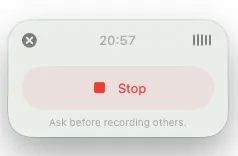

# ChatGPT Record 录音整理教程：录制、暂停、生成笔记与确认行动项

[知识库首页](../README.md) · [语音、听写与录音](../catalog/topics/audio.md) · [按问题找答案](../catalog/TASKS.md)

资料核对：2026-11-03。适用环境：macOS桌面端中实际具备Record入口的账号；Record与Meetings插件分别判断。

> **先看结论：** Record可以把录制内容转成笔记，再整理成后续工作。使用前先确认自己看到的是Record录音入口，还是Meetings插件；两者相关，但开放条件和界面不能互相套用。

<details>
<summary>本篇导航</summary>

- [一、确认入口与录音准备](#section-01)
- [二、用一分钟练习确认流程](#section-02)
- [三、笔记出现后先查任务归属](#section-03)
- [四、保存的是哪些内容](#section-04)
- [五、找不到Record或录不到声音](#section-05)

</details>

<a id="section-01"></a>

## 一、确认入口与录音准备

官方Record说明当前列出macOS及符合条件的付费工作区，并在页面另行介绍Meetings插件的开放安排。看到插件公告，不代表旧Record入口的所有条件同时改变。[官方Record说明](https://help.openai.com/en/articles/11487532-chatgpt-record)

先更新官方客户端，确认账号与实际入口。首次使用可能需要麦克风和系统音频权限。录制别人之前先告知并取得所需同意；练习时可以只录自己的虚构口述，不使用客户或同事的私下谈话。

<a id="section-02"></a>

## 二、用一分钟练习确认流程

下面是可自己朗读的原创材料，不要求恰好读满一分钟：

```text
这次只确认资料整理演示的准备事项。
小陈负责找一段虚构工作记录，小周负责检查投屏。
两人都在十一月十一日下午六点前反馈准备结果。
演示时长二十分钟，是否增加问答环节暂未决定。
```

在实际提供Record的聊天中开始录制，看到计时后再朗读。中间可以暂停，再恢复。结束后检查界面区分的“继续录制”和“发送”；选择Send才进入后续笔记生成流程。[录制与提交步骤](https://help.openai.com/en/articles/11487532-chatgpt-record)



*OpenAI 官方录音界面示例。使用前确认设备和账号实际支持情况。 [图片来源](https://help.openai.com/en/articles/11487532-chatgpt-record)*

<a id="section-03"></a>

## 三、笔记出现后先查任务归属

本练习的检查标准：小陈找虚构记录，小周检查投屏，反馈期限均为11月11日18:00；20分钟只表示演示时长，问答没有决定。若摘要将问答纳入总时长，需指出原文并修正。

```text
请把笔记中的确定事项与建议分开。
输出行动项：事项、负责人、截止时间、原文依据。
没有明确决定的内容放进待确认清单。
不要为了填满表格给任何人新增任务。
```

多人录音中，说话人标签仍需核对。你能听出是谁说的，不代表系统已可靠识别；姓名未确认时先保留匿名标签。

<a id="section-04"></a>

## 四、保存的是哪些内容

官方对录音音频和转写笔记采用不同处理说明，不能把音频处理结束理解为文字笔记也已删除。是否用于后续个性化引用、如何保留，应分别检查个人设置和工作区规则。[录音资料与历史引用](https://help.openai.com/en/articles/11487532-chatgpt-record)

想保留审定纪要，可以另外保存最终文字和版本日期。录音本身含有敏感信息时，先考虑是否需要使用该工具处理，而不是只依赖后续隐藏某个笔记标题。

<a id="section-05"></a>

## 五、找不到Record或录不到声音

先查系统与套餐条件、客户端版本及组织限制，再检查麦克风输入设备和权限。录不到电脑播放的声音，与麦克风录不到自己说话，是不同问题；用一小段自录测试区分。

没有入口时，可以用已有录音走[音频上传转写](chatgpt-audio-transcription.md)。只想用语音输入一条文字问题，则看[听写与屏幕上下文](chatgpt-voice-dictation-screen.md)。

## 接下来按你的情况继续

- [音频上传与转写](chatgpt-audio-transcription.md)：用自行录制的短音频完成转写、纠错和要点整理。
- [听写与屏幕上下文](chatgpt-voice-dictation-screen.md)：选用听写、实时语音或屏幕上下文并核对输入。

[返回语音、听写与录音专题](../catalog/topics/audio.md) · [完整文章索引](../catalog/ALL_ARTICLES.md)
