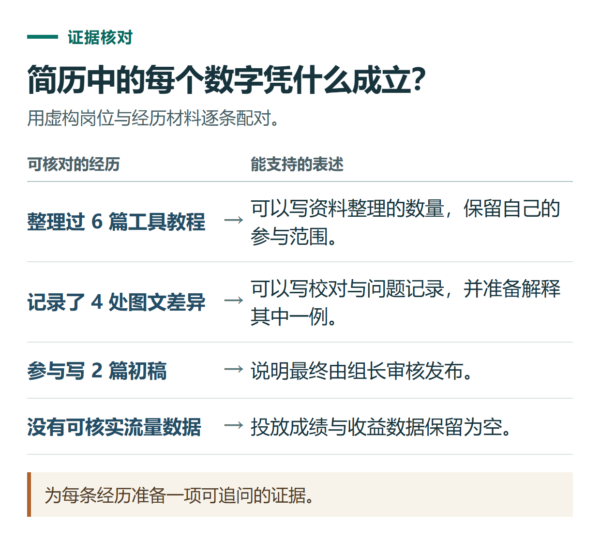

# 用 ChatGPT 优化简历和模拟面试：把真实经历写清楚，不编造业绩

[知识库首页](../README.md) · [学习、求职与表达](../catalog/topics/learning.md) · [按问题找答案](../catalog/TASKS.md)

资料核对：2026-11-03。适用环境：普通文字对话；职位和经历均为虚构练习，不构成真实招聘信息。

> **先看结论：** ChatGPT可以帮助整理经历、匹配岗位要求和练习回答。最有价值的改进，是让已有事实更清楚，而不是把“参与”写成“主导”，或为了好看补出从未统计过的增长率。

<details>
<summary>本篇导航</summary>

- [一、先准备岗位要求和经历证据](#section-01)
- [二、先做匹配表，再写简历](#section-02)
- [三、把不够具体的地方改成追问](#section-03)
- [四、开展一轮有依据的模拟面试](#section-04)
- [五、投递前亲自确认](#section-05)

</details>

<a id="section-01"></a>

## 一、先准备岗位要求和经历证据

把下列两份虚构材料一起发送：

```text
【岗位要求】
中文内容运营助理；需要整理教程、检查截图、维护发布清单，能使用Excel。
希望能与编辑沟通修改意见，并记录问题处理结果。

【我的经历】
曾参与一个课程项目，整理过6篇工具教程。
负责核对截图与文字步骤，发现并记录了4处不一致。
用Excel维护文章状态表，每周向项目同学汇报一次。
参与写过2篇初稿，最终由组长审核发布。
没有正式广告投放经历，没有可核实的流量或收入数据。
```

这是[提示词方法](chatgpt-prompting-practice.md)在求职中的应用：先提供材料和边界，再规定输出。官方[提示指南](https://learn.chatgpt.com/docs/prompting)强调提供与任务有关的背景，本文的岗位与写法是原创示例。

<a id="section-02"></a>

## 二、先做匹配表，再写简历

```text
请对照岗位要求和经历，做一张“要求—现有证据—还缺什么”的表。
没有证据的能力不要替我补。
然后把已有经历改成3条简历表述，突出动作、范围和可核实结果。
保留课程项目性质，不能写成正式任职。
```

一条合格的参考表述是：

> 在课程项目中整理6篇工具教程，核对截图与文字步骤，记录4处不一致并提交组内修订；使用Excel维护文章状态，按周同步进展。

它说明做了什么及可检查的成果，没有把组长的发布工作写成自己的独立职责，也没有凭空添加阅读量。



*为每条经历准备一项可追问的证据。*

<a id="section-03"></a>

## 三、把不够具体的地方改成追问

如果它觉得经历缺少结果，可以要求先提问题，而不是补数字：

```text
列出5个我能回忆或查资料回答的问题，用来补充这段经历。
优先问具体分工、遇到的问题、我做的检查和最终处理。
无法核实的流量、提升比例或收入，不作为必填成果。
```

例如：“4处不一致分别是什么？”“你如何判断已经修正？”都比“请提供一个漂亮的增长率”更接近真实经历。

<a id="section-04"></a>

## 四、开展一轮有依据的模拟面试

```text
请扮演招聘方，围绕这份内容运营助理经历做模拟面试。
每次只问一个问题，等我回答后继续追问，最多5轮。
重点检查我能否解释自己实际负责的部分。
最后评价回答是否具体、是否有证据、是否夸大，不预测录用概率。
```

可以从三个问题开始：你如何检查截图一致性？发现意见冲突时怎样确认？如果10篇文章里有3篇缺图，你如何安排状态表？

最后一题是情景题，可以提出你的做法，但不能把假设做法说成自己已经在真实工作中完成过。

<a id="section-05"></a>

## 五、投递前亲自确认

逐项核对项目性质、任职时间、分工、数字、技能熟练度和作品链接。凡是面试中解释不清、无法提供依据的内容，应修改或删除。

岗位要求里没提的能力，也不需要为堆关键词全部加入。清楚说明自己能做什么、证据是什么，比一页充满抽象能力词更利于沟通。

需要排版成正式文件时，使用[Word文件制作流程](chatgpt-word-ppt-files.md)，再检查导出后的分页和可读性；事实核对不能交给排版代替。

## 接下来按你的情况继续

- [翻译与润色](chatgpt-translation-polishing.md)：分两轮做准确翻译与语气调整，再核对日期、条件和范围。
- [客服与邮件回复](chatgpt-email-customer-replies.md)：在已知事实范围内组织回复和后续动作。

[返回学习、求职与表达专题](../catalog/topics/learning.md) · [完整文章索引](../catalog/ALL_ARTICLES.md)
