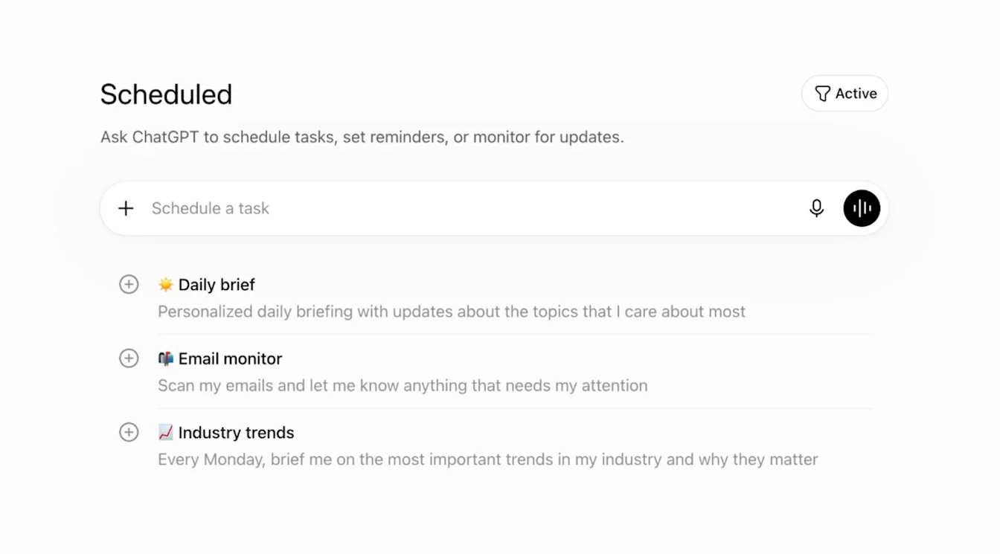
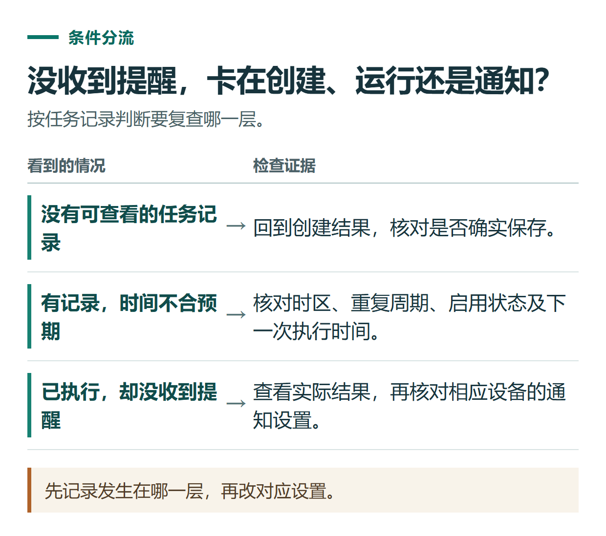
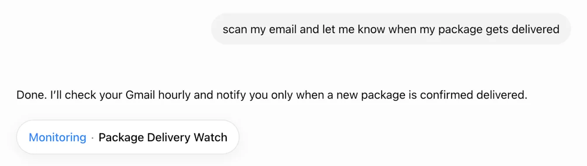

# ChatGPT 计划任务教程：设置提醒、定时练习与检查执行结果

[知识库首页](../README.md) · [工具连接与协作](../catalog/topics/tools.md) · [按问题找答案](../catalog/TASKS.md)

资料核对：2026-11-03。适用环境：账号内可用的 Scheduled tasks；与依赖本机运行的桌面自动化分别判断。

> **先看结论：** ChatGPT 可以把部分任务安排到以后执行，例如定时提醒、每日练习或周期性信息整理。关键是检查任务是否真正创建、时间是否正确、运行后到哪里查看结果。普通对话里一句“我会提醒你”，不足以证明已经存在一个有效任务。

<details>
<summary>本篇导航</summary>

- [一、先从简单提醒开始](#section-01)
- [二、创建后检查四件事](#section-02)
- [三、进阶案例：每天练习两句工作英语](#section-03)
- [四、没有收到提醒，怎么判断问题](#section-04)
- [五、复杂任务先验证资料能否被读取](#section-05)

</details>

<a id="section-01"></a>

## 一、先从简单提醒开始

当前定时频率、精确时间和任务数量受套餐与工作区条件影响；免费账号的灵活时间窗口和付费方案的精确排程不能混为一谈。事件触发任务还涉及连接应用、额外权限和支持范围。[官方计划任务说明](https://help.openai.com/en/articles/10291617-scheduled-tasks-in-chatgpt)

第一次可以用以下提示词，把日期换成你实际希望执行的日期：

```text
请创建一个一次性提醒。
日期：填写实际日期
时间：北京时间20:00（Asia/Shanghai）
内容：提醒我整理今天的学习笔记。
如果当前方案不支持这个精确时间，请先说明可选时间安排。
```

发送前删掉“填写实际日期”，填成明确的年月日。人在国外、设备使用其他时区时，尤其要检查最终创建结果里的时间。

<a id="section-02"></a>

## 二、创建后检查四件事

打开实际出现的任务确认信息，再进入 **Scheduled（计划任务）**；也可从 **Settings → Notifications → Manage tasks** 打开列表。核对：

| 项目 | 检查内容 |
|---|---|
| 任务内容 | 是整理笔记提醒，没有额外发送或发布操作 |
| 时间 | 日期、时区和下一次执行时间正确 |
| 重复方式 | 一次性或按周期执行，与你的需求一致 |
| 状态 | 已启用，没有停在待配置或报错状态 |

如果没有任务记录，继续问清是否创建成功及失败原因。不要为了截图而手工写一张“成功卡片”。



*OpenAI 官方说明中的计划任务页面，示例界面为英文。实际入口与账号界面为准。 [图片来源](https://help.openai.com/en/articles/10291617-scheduled-tasks-in-chatgpt)*

<a id="section-03"></a>

## 三、进阶案例：每天练习两句工作英语

下面是原创任务设计，尚未代表任何账号已成功运行：

```text
请创建每日工作英语练习，按当前账号支持的排程设置。
目标时间：北京时间每天20:00；若不支持精确时间，说明实际窗口。
每次围绕一个工作场景，给2句英文、中文解释和1个改写题。
主题依次从约时间、说明进度、请求补充资料中选择。
用简单自然的表达，不查询或发送我的邮件。
```

第一次运行后，检查是否确实有两句例句、中文解释和改写题。如果只出现一句空泛提醒，说明任务内容还需要补充，不能只改标题。

如果你要求长期记录错题、根据历史表现调整难度，应先验证任务能否稳定取得所需记录，再逐步增加复杂度。初次练习不必同时依赖多个文件和外部账号。

<a id="section-04"></a>

## 四、没有收到提醒，怎么判断问题

先到任务对应的对话或记录查看有没有运行结果。**任务没执行**和**已执行但通知没显示**需要分开处理。

有结果但没通知时，检查 ChatGPT 的 **Settings → Notifications**，以及浏览器或手机系统通知权限；没有结果时，检查启用状态、排程、使用限制和错误提示。官方也说明，归档任务结果所在聊天可能导致后续任务暂停。[任务与通知说明](https://help.openai.com/en/articles/10291617-scheduled-tasks-in-chatgpt)



*先记录发生在哪一层，再改对应设置。*



*这是官方的邮件监测任务示例，展示已创建的任务卡片。本文的提醒练习需要自己创建并核验。 [图片来源](https://help.openai.com/en/articles/10291617-scheduled-tasks-in-chatgpt)*

<a id="section-05"></a>

## 五、复杂任务先验证资料能否被读取

不要默认“我以前上传过”就代表定时任务能读到。官方帮助说明，在项目中创建的任务不能访问上传文件或项目内文件；Work 文档又说明部分网页任务可使用上传的上下文和连接工具。两者不能直接推为所有模式通用，应针对实际环境做一次小任务验证。需要本地文件的桌面任务，还要保持电脑开启、应用运行。[计划任务限制](https://help.openai.com/en/articles/10291617-scheduled-tasks-in-chatgpt)、[Work 自动化说明](https://learn.chatgpt.com/docs/automations)

不再使用时，在任务管理里暂停或删除，并确认状态。提醒任务适合辅助习惯；需要可靠到期提醒的账单、正式活动，也可以同时放入自己常用的日历。

需要即时口语练习，可以继续阅读[语音练习教程](chatgpt-voice-practice.md)；需要逐步讲解题目，可看[学习模式教程](chatgpt-study-mode.md)。

## 接下来按你的情况继续

- [知识卡片与复习](chatgpt-knowledge-flashcards.md)：从给定材料生成可追溯的概念卡与情境卡。
- [语音练习](chatgpt-voice-practice.md)：完成5问以内练习并记录3句表达。

[返回工具连接与协作专题](../catalog/topics/tools.md) · [完整文章索引](../catalog/ALL_ARTICLES.md)
